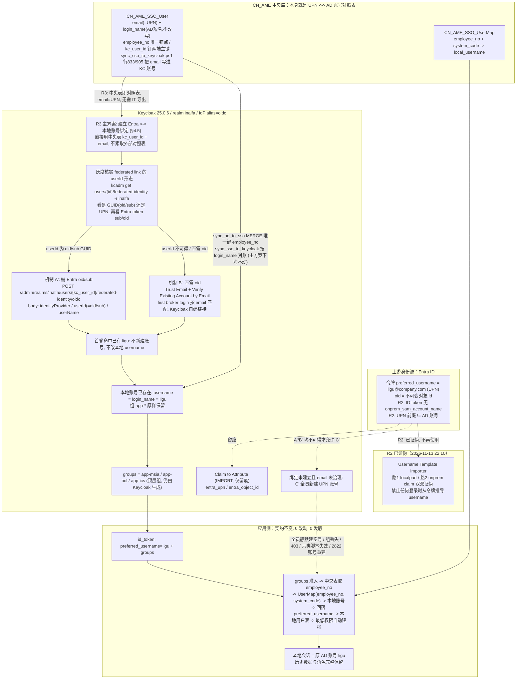
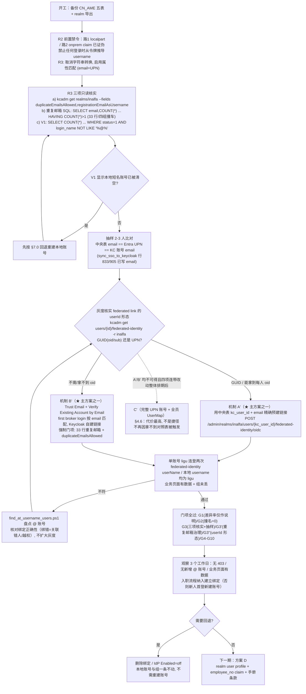

# Entra ID 接入后「Keycloak 用邮箱 / 应用用 AD 账号」映射方案架构评审

> 性质：**架构评审 / 选型报告**，不是部署记录、不是改造工单。本文不修改任何源码、脚本、既有文档；按主理人约束，本次仅新建本 1 份 md 设计文档。
> 评审范围：仅回答「Entra ID 上游 UPN 进入 Keycloak 后，如何与业务系统本地 `samAccountName` 身份对齐」，并给出推荐方案、落地步骤与门项。
> 方案编号 A/B/C/D **按主理人任务书定义**。仓库另有 `统一身份认证实施/docs/方案A落地清单.md`，其中「方案 A」的命名口径与本文 A 是否同义 —— **待核实，勿混用**。
> 现场实例：`IRSCNYTFINEREPORT.ap.inalfa.local` / 库 `CN_AME` / Keycloak 25.0.6 / realm `inalfa` / `https://iame.ap.inalfa.local:8443` / IdP alias `oidc`。

> **R2 修订（2026-11-13 22:10，覆盖 R1 结论）** —— 依据：① **IT 2026-11-13 反馈**：Entra 的 ID 令牌里**没有** `onprem_sam_account_name`（`sAMAccountName`）可选声明，即「从 SSO 认证令牌中无法直接解析到 AD 账号」；② **用户 2026-11-13 22:10 反馈**：**UPN 的 `@` 前缀不等于 AD 账号（`sAMAccountName`）**。
> **结论变更**：路 1（`localpart`）与路 2（onprem claim）**双双证伪**，任何「登录时从令牌推导 username」的方案整体关闭；问题性质由「字符串转换」改为「**事前身份绑定**」—— 在登录之前把 Entra 身份绑定到已有的 `ligu` 账号。推荐主方案迁移为 **A′ 离线目录对照表 + 预建 federated identity link**（§4.5），原「路 2 优先」「路 1 唯一主路径」等表述全部作废、不再作为实施依据。本文保留 A/B/C/D 原始编号与章节结构，仅做定点修订；被证伪内容明确标注并保留作历史对照。

> **R3 修订（2026-11-13 22:13，覆盖 R2 中与本条冲突的部分）** —— 新增决定性事实（**用户 2026-11-13 22:13 确认**）：**AD 名单 / 中央表中的 `email` 与 Keycloak 用户名（Entra 返回的账号，即邮箱 UPN）是一致的**，即 `CN_AME_SSO_User.email` == Entra UPN == Keycloak username。三条事实并列成立：① IT 2026-11-13 确认 ID token 无 `onprem_sam_account_name`；② 用户 2026-11-13 22:10 确认 UPN 的 `@` 前缀 ≠ AD 账号（路 1 / 路 2 双双证伪、禁止任何令牌层推导 username —— **R2 已写对，保留**）；③ 用户 2026-11-13 22:13 确认 `email` = UPN。
> **核心结论（R2 未写，R3 补）**：**中央表 `CN_AME_SSO_User` 本身就是 UPN ↔ AD 账号的对照表** —— `email`(UPN) + `login_name`(AD 短名) + `employee_no`(唯一锚点) + `kc_user_id`(KC 用户 ID)。链路自洽：`sync_ad_to_sso.ps1` 把 AD 名单 `email` 写入中央表 → `sync_sso_to_keycloak.ps1`（**已核实：行 833 建号写 `email`、行 905 改资料写 `email`**）写入 KC 账号。**因此不需要向 IT 索取任何对照表、不需要 Entra 侧配置、不需要改应用**。
> **作废口径**：R2 的「唯一卡点是要 AD/Entra 对照表」「对照表拿不到就 NO-GO」全部删除（§4.4 分支②/③、G3、§9 Q-新5、§8 对照表交付物行）。**新增未查实前提**：federated identity link 的命中键是 `(identityProvider, userId)`，`userId` 通常是 Entra `oid`/`sub` GUID 而非 UPN —— **不得把 `userId=<UPN>` 当成已成立的实施方案**；主方案在 **机制 A′（需 Entra oid/sub）/ 机制 B′（不需 oid，靠 email 属性匹配）** 之间由一项灰度只读核实结果决定（§4.5）。§4.6「零改动 = 全员静默建空号」量化论证保留，但明确 C′ 不再因「拿不到对照表」被触发。R2 的 71 处标记与日期依据体系保留，新增内容补标「2026-11-13 22:13」。

---

## 0. 证据索引与阅读范围

### 0.1 本次已读取并对齐的文档 / 脚本

| 文件（相对 `统一身份认证实施/`） | 取到的关键事实 |
|---|---|
| `docs/sso-user-sync-architecture.md` | 五表职责与边界；`CN_AME_SSO_User` 是唯一事实来源；MERGE 唯一匹配键 `employee_no`；**更新列表故意不含 `login_name` 与 `kc_user_id`**；`sync_sso_to_keycloak.ps1` 定位「先按 `kc_user_id` GET，为空/404 再按 `username=login_name` 查」；§4 末行「用户属性里没有工号…应用侧能拿到的稳定标识是 `preferred_username`（即 `login_name`）」；应用侧身份解析顺序（已实现） |
| `scripts/sql/01_create_sso_tables.sql` | 精确字段：`CN_AME_SSO_User(employee_no NVARCHAR(32) NOT NULL 唯一, login_name NVARCHAR(64) NOT NULL 唯一「Keycloak username，一旦确定不改」, email NVARCHAR(128) NULL, status, source, pwd_set, kc_user_id, ad_object_guid UNIQUEIDENTIFIER NULL 注释「防工号复用误合并（当前名单无此列，留空）」)`；`email` **唯一索引已降级为普通索引、允许空/重复**；`CN_AME_SSO_UserMap(employee_no, system_code, local_username, match_key CHECK(USERNAME/EMAIL/EMPNO), UQ(system_code, local_username))` |
| `docs/entra-id-federation-assessment.md` | 路线 B1 结论「应用一行代码不改、组不用重挂、回滚只需停用 IdP」；§1.2 应用三件事（`aud`/`groups`/`preferred_username`）；**§4.1「`preferred_username` 是 UPN，`login_name` 是 sAMAccountName，现网两者不保证相等（历史上有带后缀、大小写、改名残留）」**；§4.1「对不上的后果不是登录失败，而是能登录但落到错误身份，`auto_create_user=true` 静默建新号」；§6 决策点 4「建议以 sAMAccountName 为准」；B2 改动量（改代码 + PyInstaller 重新打包发版） |
| `docs/entra-broker-setup-runbook.md` | IdP `oidc` 已建；**§4 三条路（路1 `localpart` / 路2 `onprem_sam_account_name` / 路3 完整 UPN）**；25.0.6 模板只支持 `${ALIAS}`/`${UUID}`/`${CLAIM.x}` 与 `uppercase`/`lowercase`/`localpart` 三个转换器，**写错转换器名静默忽略**；`Target=LOCAL` 每次登录执行 `user.setUsername()`（破坏半径大），验证期用 `BROKER_USERNAME`；§3 `first broker login - entra` + `Automatically set existing user=Required`；§4.1 首登「先按 email 查、再按 username 查」；§4.4 跨域名撞名会把第二个人**关联到第一个人的账号**；§4.5 可选声明必须 ID 令牌可加、纯云账号无该属性；§4.9 批量分类判据；§6.4/6.5 回滚状态判断与演练 |
| `docs/entra-email-account-cutover.md` | 「零改动切 Entra 邮箱账号」完整落地版（= 方案 C 的极端形态）：清空本地用户、Keycloak username = 完整 UPN、靠 `CN_AME_SSO_UserMap` 兜底；§0.4/§3.3 代价（MSIA reviewee 工作台为空、BOL VIEWER 全量只读、最低权限自动建档）；§2.1 实测 **2944 行 / distinct 2911 / 33 行重复邮箱**、四组撞车；§5.1 为 9 名历史责任人**改 `login_name` 为邮箱 + 写 9 行 UserMap**（保 232 条 Issue）；§7.3「关闭 IdP ≠ 回滚，必须重建 2822 个账号」；**§8 切换后必然失效的脚本清单** |
| `scripts/powershell/Add-SsoUserMapForLegacyOwners.ps1` | 头部给出**应用侧身份解析的真实 SQL**（见 §1.2）；明确「`preferred_username` 匹配的是 `CN_AME_SSO_User.login_name`，不是 UserMap 的任何列」「只插映射行不够，必须让 `login_name` 等于邮箱」；`-Action Rollback -RollbackLoginName` 可撤销 |
| `scripts/powershell/compare_upn_login.ps1` | 只读比对分类：`OK` / `OK_CASE`（仅大小写）/ `PATH2`（UPN 前缀不同但 `onPremisesSamAccountName == login_name`）/ `PATH3`（两者都不同，只有 UPN）/ `NOT_IN_ENTRA` / `NO_UPN`；Graph 取数列 `userPrincipalName,onPremisesSamAccountName,mail,accountEnabled` |
| `scripts/sql/90_usermap_backfill.sql` | 「匹配约定：`groups` 准入 → `CN_AME_SSO_UserMap(system_code)` → 回落 `preferred_username` → 本地用户表 → 自动建档」；双路径匹配（中央 `login_name` / 中央 `employee_no`）；C 段 UserMap 回填模板（**注释掉，需人工确认**） |
| `scripts/sql/91_usermap_integrity_checks.sql` | 同上解析顺序；§4「重复账号高危名单」；§4.2/4.3 大小写冲突与一对多；§5 用户名脏数据（域名前缀/邮箱形态/空白）；**§7.3「代码只按 `local_username` 匹配，`EMAIL`/`EMPNO` 行不生效」**；判读口径 5 条 |
| `docs/ad-federation-assessment.md` | 路线 A（本地 LDAP 联邦）；§5.2 `Username LDAP attribute = sAMAccountName`，「不能用 `cn`/`displayName`/`mail`」；§6 沟通清单第 4/5 条要求 IT 确认「登录名到底是哪个属性」及「`login_name` 与 `sAMAccountName` 对不上的清单」 |
| `docs/new-system-sso-integration-handbook.md` | **R6.1「身份唯一键必须是员工号或平台下发的稳定 subject；不得用姓名、邮箱、手机号作主键」**；R6.3/R6.6/R6.7（绑定既有账号、不得按邮箱猜测匹配、映射关系必须持久化可查）；R8.4「配置变更不得要求重新打包」；附录 B 三系统接入参数 |
| `docs/cutover-runbook.md` | §2 **开关矩阵**：MSIA `[oidc].enabled` / `[security].local_login_enabled` / `[security].hr_sync_enabled`，BOL `LOCAL_AUTH_ENABLED` / `SELF_REGISTRATION_ENABLED` / `PASSWORD_SELF_SERVICE_ENABLED` / `SSO_STATUS_SYNC_HOURS`；总原则「只做加法、开关化、每一步可回退」 |
| `README.md`（grep 命中行 28/146-148/190） | **默认行为：Keycloak 未部署前 `OIDC_ENABLED=False`，本地登录、HR 同步保持开启，生产行为与改造前一致**；MSIA/BOL 的 OIDC 改造与双轨开关矩阵 |
| `scripts/powershell/sync_ad_to_sso.ps1`（grep） | CSV 列固定 `userName,realName,email,mobile,enable,employeeNo`（**无 UPN 列**）；清洗把 `userName` 全小写、非法邮箱置空；MERGE `UPDATE SET t.email = s.email …` 且「**故意不更新 `login_name` / `kc_user_id`**」；`-SkipKeycloakSync` |
| `scripts/powershell/sync_sso_to_keycloak.ps1`（grep + **R3 定点复核**） | 入口保护：Keycloak 多数用户为邮箱格式（含 `@` 且不少于 20 个）→ **退出码 2，拒绝执行**，理由「按 `login_name` 同步会把在职者重建成本地密码账号（第二套身份）」；**行 833 `if ($uEmail -ne '') { $newUser['email'] = $uEmail }`（建号写 email）、行 905 `if ($uEmail -ne '') { Set-Prop $full 'email' $uEmail }`（改资料写 email）—— 中央表 `email` 确实被同步进 KC 账号，是「中央表即对照表」的代码证据** |
| `docs/避坑点.md`、`docs/entra-broker-setup-runbook.md` §2.4/§4.2/§4.3 | 25.0.6 模板能力边界、`localpart` 静默失效、`getUsername()` 默认小写、签名密钥/凭据无关细节 |
| **R2 新增依据：IT 2026-11-13 反馈** | Entra 的 **ID 令牌没有 `onprem_sam_account_name` 可选声明**，「从 SSO 认证令牌中无法直接解析到 AD 账号」→ `entra-broker-setup-runbook.md` §4.5 的路 2 前提被证伪。此为现场口头/书面确认，非仓库文档 |
| **R2 新增依据：用户 2026-11-13 22:10 反馈** | **UPN 的 `@` 前缀不等于 AD 账号（`sAMAccountName`）** → `entra-broker-setup-runbook.md` §4.4 的路 1 前提被证伪。此为现场确认，非仓库文档 |
| **R2 新增依据：Keycloak 25 Admin REST（能力核实）** | 支持用 `POST /admin/realms/{realm}/users/{kc_user_id}/federated-identity/{alias}` 预建联邦身份链接（body `identityProvider` / `userId` / `userName`）；首登按 `(identityProvider, userId)` 命中已有本地账号，不经 username 模板。这是 A′ 的机制来源。**R3 补充：命中键是 `(identityProvider, userId)`，`userId` 为 IdP 下发的 subject（Entra OIDC 下通常 `oid`/`sub` GUID），其形态必须现场灰度核实（§4.5 前提）** |
| **R3 新增依据：用户 2026-11-13 22:13 反馈** | **`CN_AME_SSO_User.email` == Entra UPN == Keycloak username**。由此：中央表 `email`(UPN) + `login_name`(AD 短名) + `employee_no` + `kc_user_id` 已构成 UPN ↔ AD 账号对照表；**不需要向 IT 索取任何对照表、不需要 Entra 侧配置、不需要改应用**。此为现场确认，非仓库文档 |
| **R3 新增依据：Keycloak broker 首登匹配顺序** | `entra-broker-setup-runbook.md` §4.1「**先按 email 查、再按 username 查**」（25.0.6 `IdpCreateUserIfUniqueAuthenticator.checkExistingUser`）。本地 `ligu` 账号 email = UPN ⇒ Entra 登录可命中已有账号 ⇒ 本地 username 保持 `ligu` ⇒ 应用 `preferred_username=ligu` + `groups=app-*` ⇒ 命中原账号/原角色/原历史数据，应用 0 改动。这是机制 B′ 的依据 |

### 0.2 明确标注「待核实」的项（文档中找不到证据 / 未实测）

| # | 事项 | 状态 |
|---|---|---|
| V1 | 现场**是否已经执行** `docs/entra-email-account-cutover.md` 的「清空本地用户 + 9 人 `login_name` 改邮箱」？ | **待核实**。决定本报告落地步骤是「正向新建」还是「先回退再新建」，是最大分叉 |
| V2 | `realm inalfa` 的 `Email as username`（`registrationEmailAsUsername`）当前值 | **待核实**（`entra-broker-setup-runbook.md` §4.3 明示「本实例该开关未验证」） |
| V3 | Entra **ID 令牌**能否添加 `onprem_sam_account_name` 可选声明 | **已确认：不可用（IT 2026-11-13）**。ID 令牌里没有该可选声明 → 路 2 证伪。仍需区分是「租户下拉里根本没有」还是「未勾选」、以及是否仅纯云账号缺失（§9 Q-新3） |
| V4 | Entra Connect 同步模式（PHS/PTA/ADFS）与覆盖范围；纯云账号数量 | **待核实**（`entra-broker-setup-runbook.md` §7 第 7/8 条仍是向 IT 要的回复项） |
| V5 | UPN 前缀 ↔ `login_name` 全量比对结果（`compare_upn_login.ps1` 六类计数） | **定性已确认（R2，用户 2026-11-13 22:10）：UPN 前缀 ≠ AD 账号，路 1 证伪**；差异率仍需量化（§9 Q-新1），本次评审未运行脚本、未拿到 Entra 导出 CSV |
| V6 | 跨域名 UPN 前缀撞名分组数 | **待核实**；R2 后保留为**强制门项**（撞名分组 = 0 才可进入切换窗口），不因路 1 关闭而取消 |
| V7 | 四组撞车邮箱在 Entra 的 `userPrincipalName` 是否共用 | **待核实**（`entra-email-account-cutover.md` §2.3 列为阻断项） |
| V8 | 外部访客（B2B，`#EXT#` 形态）账号数量、是否接入三系统 | **待核实** |
| V9 | `CN_AME_SSO_UserMap` 现场基线行数、Capacity 是否在本次范围、BOL `username` 列长度、BOL 历史数据归属量（需 CMC 库只读权限） | **待核实**（`entra-email-account-cutover.md` 附录 A #6/#7/#9/#10 未回填） |
| V10 | 是否存在调用 `sync_sso_to_keycloak.ps1` 的定期任务 | **待核实**（同文档 §1.3 给的是核查命令，不是已核实结论） |
| V11 | 应用源码不在本仓库；`preferred_username` → 中央表 → UserMap 的**逐步实现**与「回落 `preferred_username`」的先后 | **待核实**，本文以 `Add-SsoUserMapForLegacyOwners.ps1` 头部 SQL + `90/91` 脚本注释为准，需在联调时用 §7 G6 验证 |
| V12 | `docs/方案A落地清单.md` 与 `README.md` 全文 | **本次读取审批超时未能读取**，仅通过 Grep 取到 README 的 5 行；其中「方案 A」命名口径需与本文对齐 |
| V13 | Entra 侧是否存在 `employeeId` / `onPremisesExtensionAttributes` 可承载工号 | **待核实**（仅方案 D 阶段需要） |
| V14 | AD 是否允许离职后复用 `sAMAccountName` | **待核实**（决定方案 D 的紧迫性） |
| **V15（R3 新增，2026-11-13 22:13）** | **预建 federated identity link 的 `userId` 实际形态**：是 Entra `oid`/`sub` GUID 还是 UPN？ | **待核实（决定主方案走 A′ 还是 B′）**。灰度 1 账号首登后 `kcadm get users/<id>/federated-identity -r inalfa` 看 `userId`，并看 Entra ID token 的 `sub`/`oid` claim；见 §4.5 前提、§9 Q-新6 |
| **V16（R3 新增，2026-11-13 22:13）** | `duplicateEmailsAllowed` / `registrationEmailAsUsername` 现值；33 行重复邮箱逐条裁决；抽样 2–3 人「中央表 email == Entra UPN == KC 账号 email」一致性 | **待核实**；B′ 的强制治理门项，见 §4.4 三项只读核实、§9 Q-新7/Q-新8 |

---

## 1. 问题重述：这不是「字符串转换」，是「唯一标识由谁定义」

> **R2 修订（2026-11-13 22:10）：问题性质重写。** 不再是「如何把 UPN 转换成 `ligu`」，而是「**如何在登录之前把 Entra 身份绑定到已有的 `ligu` 账号**」—— 从**字符串转换**改为**事前身份绑定**。依据：IT 2026-11-13 确认 ID 令牌无 `onprem_sam_account_name`；用户 2026-11-13 22:10 确认 UPN 前缀 ≠ AD 账号。两条「登录时从令牌推导 username」的子路同时关闭，任何基于 `Username Template Importer` / `localpart` / 可选 claim 的推导都**不得作为实施依据**。下文 §2.1 的子路表、§4.4 决策门、§6 示意图已按此重写。
>
> **R3 补充（2026-11-13 22:13）：取消字符串转换、启用属性匹配，二者不矛盾。** 用户 22:13 确认 `CN_AME_SSO_User.email` == Entra UPN == Keycloak username。**中央表本身就是 UPN ↔ AD 账号的对照表**（`email` + `login_name` + `employee_no` + `kc_user_id`），且 `sync_sso_to_keycloak.ps1` 行 833/905 已把该 `email` 写进 KC 账号，链路自洽。因此不需要任何外部对照表、不需要 Entra 侧配置、不需要改应用；broker 首登「先按 email 查」（`entra-broker-setup-runbook.md` §4.1）即可命中已有 `ligu` 账号。`localpart` / 令牌推导仍禁用 —— 命中靠的是**属性相等**，不是**字符串截断**。

### 1.1 现状链路（有据）

```
AD 名单 CSV → CN_AME_SSO_StgAdUser → sync_ad_to_sso.ps1（防错 MERGE，唯一键 employee_no）
            → CN_AME_SSO_User（唯一事实来源，login_name 一旦确定不改）
            → sync_sso_to_keycloak.ps1（对账式建号/改资料/停用，username := login_name）
            → Keycloak realm inalfa → 令牌 preferred_username := login_name（AD 短名，如 ligu）
            → 应用：groups 准入 + preferred_username 解析 → 本地用户表（用户名 = samAccountName）
```

新增 Entra 后，令牌在 Keycloak 边界处变成 `preferred_username = ligu@company.com`（UPN）。若把它直接写成 Keycloak 的 `username`，则 `login_name`（`ligu`）、中央表、`CN_AME_SSO_UserMap`、同步脚本、应用本地用户表五处口径同时断裂。

### 1.2 应用侧身份解析的**真实口径**（取自仓库脚本，避免凭空假设字段名）

`scripts/powershell/Add-SsoUserMapForLegacyOwners.ps1` 头部写明应用解析 SQL：

```sql
SELECT m.local_username
FROM dbo.CN_AME_SSO_UserMap m
JOIN dbo.CN_AME_SSO_User u ON u.employee_no = m.employee_no
WHERE m.system_code = 'msia'
  AND UPPER(LTRIM(RTRIM(u.login_name))) = UPPER(LTRIM(RTRIM(@login_name)))
```

配合 `scripts/sql/90_usermap_backfill.sql`、`91_usermap_integrity_checks.sql` 的「匹配约定」，完整解析链为：

1. 校验 `groups` claim 里的顶层准入组（`app-msia` / `app-bol` / `app-ics`）；
2. 以令牌 `preferred_username` 作 `@login_name`，按 `login_name`（忽略大小写/首尾空白）命中 `CN_AME_SSO_User` → 取 `employee_no`；
3. 以 `employee_no + system_code` 查 `CN_AME_SSO_UserMap.local_username` → 得到该系统的本地账号（历史数据与角色归它）；
4. 未命中则回落 `preferred_username` 直接查本地用户表；
5. 仍未命中则**自动建档并落最低权限**（MSIA `reviewee`、BOL `VIEWER`）。

> 关键：`90_usermap_backfill.sql` 还有第二条路径「中央 `employee_no` = 归一化本地用户名」（工号登录场景）；`91_usermap_integrity_checks.sql` §7.3 明确 **`match_key` 的 `EMAIL`/`EMPNO` 行在现有代码里不生效，只按 `local_username` 匹配**。所以「往 UserMap 插一行 `match_key='EMAIL'` 就能按邮箱解析」是不成立的假设。

### 1.3 冲突的具体后果（全部有文档证据）

| 后果 | 证据 |
|---|---|
| Keycloak 里 `ligu` 与 `ligu@…` 两套账号并存，组挂在旧号上，新号无组 → 三应用 403 | `entra-broker-setup-runbook.md` §4.1 三连后果；`entra-id-federation-assessment.md` §4.2 |
| 应用「登录成功但数据全空」+ 静默多建一个最低权限账号（比登录失败更难查） | `entra-id-federation-assessment.md` §4.1；`entra-email-account-cutover.md` §0.4/§3.3；`91_usermap_integrity_checks.sql` §4 |
| `sync_sso_to_keycloak.ps1` 每天按 `login_name` 查不到人 → 重复建号、`kc_user_id` 反复覆盖 | `entra-broker-setup-runbook.md` §4.1；脚本内置 `exit=2` 保护 |
| 历史业务数据失去归属（MSIA 232 条 Issue 挂 9 个短名；BOL 未统计） | `entra-email-account-cutover.md` §5.1、附录 A #10 |
| 中央表状态回写、应急停号、BOL 离职同步、授组脚本**必然失效** | `entra-email-account-cutover.md` §8 |
| 「关 IdP」不等于回滚，需重建 2822 个账号 | `entra-email-account-cutover.md` §7.3；`entra-broker-setup-runbook.md` §6.4 |

**判定**：要把复杂度收敛在**一个边界**。若放在每个应用的回调里，每接入一个新系统就要重复实现一次邮箱解析并发版（要求 4 第二问要避免的）；若放在 Keycloak broker，三个存量应用与所有新系统都 0 改动。

---

## 2. 四种候选方案逐一分析

### 2.1 方案 A — Keycloak 侧 IdP mapper / username template / claim 转换，把 UPN 规范化为 AD 账号

**机制**（对应 `entra-broker-setup-runbook.md` §4，现场 IdP alias 固定 `oidc`）—— **以下两种子路于 2026-11-13 22:10 全部判定为已证伪，仅保留作历史对照，不得实施**：

| 子路（R2 状态） | `Username Template Importer` 的 `Template` | 证伪依据（日期 / 来源） |
|---|---|---|
| **路 2 — 已证伪** | ~~`${CLAIM.onprem_sam_account_name}`~~ | **IT 2026-11-13**：Entra 的 ID 令牌里**没有** `onprem_sam_account_name` 可选声明，「从 SSO 认证令牌中无法直接解析到 AD 账号」。`entra-broker-setup-runbook.md` §4.5 的前提不成立 → **不可用** |
| **路 1 — 已证伪** | ~~`${CLAIM.preferred_username | localpart}`~~ | **用户 2026-11-13 22:10**：UPN 的 `@` 前缀**不等于** AD 账号（`sAMAccountName`）。截断会得到错误账号；`Automatically set existing user` 下还会「关联错人」（越权）→ **不可用** |
| 路 3（不推荐，等价 C′） | `${CLAIM.preferred_username}`（完整 UPN） | 令牌层推导整体关闭后，本路即 §4.6 论证的 C′（完整 UPN 账号 + 全员 UserMap），代价最高，不是捷径 |
| 辅助（仍可用，仅留痕） | `Claim to Attribute`（IMPORT）：`preferred_username` → 用户属性 `entra_upn`；`oid` → `entra_object_id`。只留痕、**不参与身份判定、不写 `username`** | 便于审计/反查；**不得**用任何 mapper 从令牌推导 `username` |
| 辅助 | `Hardcoded attribute` / 自定义 broker SPI | 25.0.6 原生 mapper 已够用，自定义 SPI 增加升级维护成本，**不建议** |

> **R2 总结（2026-11-13 22:10，依据 IT 2026-11-13 反馈 + 用户 22:10 反馈）：令牌层推导整体关闭，方案 A 的两种子路均不可实施。** 路 1 依赖「UPN 前缀 == `login_name`」、路 2 依赖「ID 令牌带 `onprem_sam_account_name`」，两个前提分别被用户与 IT 证伪；且 25.0.6 的 `Username Template Importer` 不支持正则 / 查表（`entra-broker-setup-runbook.md` §4.2），无法在登录时把 UPN 映射成 `ligu`。**方案 A 的原有机制作废**，但其目标（应用侧仍收到 `preferred_username = ligu`、组不重挂、同步链路不动）由 §4.5 的**事前绑定（机制 A′ / B′）**承接。**R3（2026-11-13 22:13）补充**：`email` = UPN，中央表即对照表，所以**取消的是字符串转换、启用的是属性匹配** —— 不需要外部对照表、不需要 Entra 侧配置、不需要改应用；`localpart` 仍禁用。

配套（R2/R3）：`entra-broker-setup-runbook.md` §3/§4.3 的 `first broker login - entra`（`Review Profile`=Disabled）仍用于去掉资料补全页；`Automatically set existing user` 的「命中已有账号」不再由模板算出的 username 保证，而由**中央表 `email` 属性匹配 + 事前绑定**保证（§4.5；机制 B′ 下 `Verify Existing Account by Email` 反而要启用）。**R2：不得再配置任何会改写本地 `username` 的 `Target=LOCAL` mapper**（`LOCAL` 每次登录执行 `user.setUsername()`，原值不留痕、不可逆）。

**改动范围（具体文件 / 组件）**

| 对象 | 动作 | 位置 |
|---|---|---|
| `realm inalfa` → 身份提供程序 `oidc` → Mappers → `Username Template Importer` | **R2：不再配置 `Template` 推导 username**；确认无 `Target=LOCAL` 的 username 写入 mapper；保留/移除均可，但不得参与身份判定 | 管理控制台 / `kcadm get\|update identity-provider/instances/oidc/mappers -r inalfa`（仓库无对应源码文件） |
| **R2 新增 / R3 改**：`realm inalfa` → Admin REST `users/{kc_user_id}/federated-identity/oidc` | **建立 Entra ↔ 本地账号绑定**（§4.5）：**直接使用中央表现有数据** `kc_user_id` + `email`，按 `kc_user_id` 精确绑定，不猜、不索取外部对照表 | `POST /admin/realms/inalfa/users/{kc_user_id}/federated-identity/oidc`，body `identityProvider` / `userId` / `userName`；**`userId` 形态须先灰度核实（§4.5 前提）** |
| `realm inalfa` → 认证 → 流程 `first broker login - entra` | 确认执行项（机制 A′ / B′ 配置不同，见 §4.5 ④） | 同上 |
| `realm inalfa` → IdP `oidc` → 高级设置 → 首次登录流程 | 挂上一步复制的流程 | 同上 |
| `realm inalfa` → 领域设置 → 登录 → `Email as username` | **只读核实**（V2） | `kcadm get realms/inalfa --fields registrationEmailAsUsername,duplicateEmailsAllowed` |
| `realm inalfa` → clients `msia-prod`/`bol-prod`/`ics-prod` → Mappers → Group Membership | 只读核实 `full.path=false`、`id.token.claim=true` | `entra-email-account-cutover.md` §1.1/附录 A #3 |
| `docs/entra-broker-setup-runbook.md` §4.4/4.5/4.9 | **R2：标注路 1/路 2 已证伪、令牌层推导关闭**；**R3：改记「以中央表为对照表 + A′/B′ 绑定」门项与撞名分组核查** | 文档 |
| `docs/entra-id-federation-assessment.md` §0/§4.1/§6 决策点 4 | 补「以 `login_name` 为唯一契约 + 事前绑定」的结论 | 文档 |
| `scripts/powershell/compare_upn_login.ps1` | **只读运行**，不改逻辑 | 脚本 |
| `scripts/powershell/find_at_username_users.ps1` | **只读运行**，不改逻辑 | 脚本 |
| `scripts/powershell/sync_ad_to_sso.ps1`、`sync_sso_to_keycloak.ps1`、`scripts/sql/01_create_sso_tables.sql`、三个应用源码、`docs/cutover-runbook.md` §2 开关矩阵 | **一律不动** | — |

**对现有同步链路与双轨开关的影响**

- 同步链路：**零影响（A′ 承接后同样成立）**。`sync_ad_to_sso.ps1` 的 MERGE 仍按 `employee_no` 匹配、`email` 仍来自 AD CSV、`login_name` 仍不改写；`sync_sso_to_keycloak.ps1` 仍先按 `kc_user_id`、回落 `username=login_name` 对账；`kc_user_id` 继续把两端主键钉在一起（`sso-user-sync-architecture.md` §4）。A′ 是**在 Keycloak 里给已有账号追加一条联邦链接**，不新建账号、不改 username，脚本内置的 `exit=2` 保护按设计不会触发（Keycloak 里不会出现大量带 `@` 的 username）。
- 双轨开关：`OIDC_ENABLED=False`（`README.md` 默认行为）时行为与改造前一致；Entra 侧的回退面是 IdP `Enabled`=off / `Hide on login page`=on（`entra-id-federation-assessment.md` §5.3，**10 分钟、不碰应用与数据库**）；`cutover-runbook.md` §2 的四项加粗开关一个都不动。
- 组：`app-*` 仍是 Keycloak 顶层组，不重挂、不迁到 Entra（B1 的既定结论）。

**优点 / 缺点**

- 优（**目标仍成立，由 §4.5 承接**）：应用 0 改动、中央表 0 改动、同步脚本 0 改动、组与权限 0 改动；回滚成本最低；与 `new-system-sso-integration-handbook.md` 现有 41 条接入要求完全兼容；Entra 复杂度收敛到 `realm inalfa` 一处。**R3：中央表本身即对照表，连「索取外部对照表」这一步都不需要**。
- 缺（**R2 2026-11-13 22:10 + R3 22:13**）：路 1 依赖「UPN 前缀 == `login_name`」—— 用户确认不成立；路 2 依赖「ID 令牌带 `onprem_sam_account_name`」—— IT 确认不成立。**两种子路均不可实施，方案 A 作为「令牌层推导」整体作废**；其目标改由 §4.5 的 **A′/B′ 事前绑定**实现，代价是「**新入职员工必须把建立绑定纳入入职/同步作业**」这一项持续运维（§4.5 ③）与 `userId` 形态的灰度核实（§4.5 前提）。

**风险清单** → 见 §2.5 风险矩阵 A 列（R2/R3 后 A 列按「机制 A′ / B′ 事前绑定」理解，见该节表头注）。

---

### 2.2 方案 B — 中央表新增/复用 email ↔ AD 账号映射列，同步脚本把 Keycloak username 写成 AD 账号

**机制**：中央表**已有** `email`（非受管、允许空/重复、普通索引）、`login_name`（唯一、= Keycloak username、一旦确定不改）、`employee_no`（唯一）。「复用」= `email` 存 UPN、`login_name` 保持 AD 短名，`sync_sso_to_keycloak.ps1` 继续按 `login_name` 建号并把 UPN 写进 Keycloak 的 `email` 属性；「新增」= 加 `entra_upn NVARCHAR(128)`（唯一 filtered index）与 `entra_object_id`，用于按 UPN/oid 反查。

**必须先看清的冲突（有实证）**：broker 的 `updateBrokeredUser`（`Target=LOCAL`）在**每次登录结束**把本地 username 写成模板值；而 `sync_sso_to_keycloak.ps1` 的「改资料」分支会 `PUT` 回 `username=login_name`。**两个写者互搏**。`docs/entra-email-account-cutover.md` §1.3/§8 记录的脚本入口保护（多数用户为邮箱格式即 `exit=2`）就是为这个场景加的 —— 它说明现场已经承认「脚本与 broker 抢 username」是真实风险。

**改动范围（具体文件 / 组件）**

| 文件 | 需要的动作 |
|---|---|
| `scripts/sql/01_create_sso_tables.sql` | 新增 `entra_upn` / `entra_object_id` 列 + 唯一 filtered 索引；`email` 索引口径与 `duplicateEmailsAllowed` 口径要重新定义 |
| `scripts/powershell/sync_ad_to_sso.ps1` | CSV 列固定 `userName,realName,email,mobile,enable,employeeNo`，**没有 UPN 列**；MERGE 的 `t.email = s.email` 会把 UPN 覆盖回 AD 邮箱。要么新增「Entra/Graph 导出 → 中央表 UPN 列」第二条同步链，要么给 `-Source table` 兜底通道加列；并要动「禁止改写 `login_name`」这条硬规则 |
| `scripts/powershell/sync_sso_to_keycloak.ps1` | 改 username 写入口径、改资料分支、`kc_user_id` 定位优先逻辑；决定如何处置入口 `exit=2` 保护（不能简单删掉） |
| `scripts/powershell/entra_email_cutover.ps1` | `-Action ResetDb` / `-Action Purge`（若现场已走清空方案，用于回退） |
| `scripts/sql/91_usermap_integrity_checks.sql`、`90_usermap_backfill.sql` | 新增 UPN 一致性对账段（现在是只读校验，要加列与判据） |
| `scripts/powershell/Add-SsoUserMapForLegacyOwners.ps1` | 若现场已把 9 人 `login_name` 改成邮箱，需 `-Action Rollback -RollbackLoginName` 撤销 |
| `docs/sso-user-sync-architecture.md`、`docs/entra-email-account-cutover.md` | 重写表职责与「单向：SSO_User → Keycloak，Keycloak 不回流中央表」的边界 |

**对现有同步链路与双轨开关的影响**

- 影响**最大**。AD 名单 CSV 无 UPN 来源；中央表 `email` 允许重复（实测 2944 行 / distinct 2911 / 33 行重复，`entra-email-account-cutover.md` §2.1）且 `mail ≠ UPN` 时该文档 §1.2 直接判 NO-GO；`source='MANUAL'` 行免疫 AD 同步；`91_usermap_integrity_checks.sql` §7.3 说明新增的 `EMAIL` 匹配键行在应用侧不生效。
- 双轨开关：如果按 `entra-email-account-cutover.md` 的「清空本地用户」配套落地，`OIDC_ENABLED=False` **只关应用入口救不了场** —— 本地用户已清空，回滚要重建 2822 个账号（§7.3）。这是 B/C 组合最致命的一点。

**优点 / 缺点**

- 优：把 UPN ↔ AD 账号关系沉淀到唯一事实来源，可审计、可按 UPN/工号反查；`employee_no` 主键不动；为方案 D 预留了 `entra_object_id`。
- 缺：双写冲突必须靠「停用 KC 同步段 / 改成只读校验」解决，等于削弱 `CN_AME_SSO_User → Keycloak` 这条既定单向链路；改动 5+ 脚本与 1 份建表脚本；需要 IT 提供 Graph 导出并长期维护；`email` 列语义被重载（AD 邮箱 vs Entra UPN）；历史 2944 行数据迁移与撞车治理工作量大。

**风险清单** → 见 §2.5 风险矩阵 B 列。

---

### 2.3 方案 C — 应用侧 OIDC 回调用邮箱查本地用户表 / 中央表，解析出 AD 账号再建本地会话

**机制**：应用拿 `preferred_username`（UPN）→ 查中央表（按 `login_name`，或新增 UPN 列）→ 取 `employee_no` → 查 `CN_AME_SSO_UserMap(system_code, employee_no)` → `local_username` → 建立本地会话。

**重要发现：这条链已经实现在 MSIA/BOL 里**（§1.2 证据）。所以 C 的真正问题不是「要不要写解析代码」，而是「要不要把完整 UPN 当输入喂给这条链」，以及「每个新接入系统是否都要重复实现」。

`docs/entra-email-account-cutover.md` 就是 C 的完整落地版（"零改动切换 Entra 邮箱账号"），其自认代价（§0.4 / §3.3 / §8）：

- 为保住 MSIA 232 条历史 Issue，必须给 9 人**改 `CN_AME_SSO_User.login_name` 为邮箱 + 写 9 行 UserMap**（`Add-SsoUserMapForLegacyOwners.ps1 -Action Apply -AlignLoginName`）；这直接违反 `01_create_sso_tables.sql`「`login_name` 一旦确定不改」和 `sso-user-sync-architecture.md`「不改写 `login_name`，改名走停旧建新」。
- 其余人因 `login_name` 仍是短名、UPN 匹配不上 → 回落 `preferred_username` → 自动建最低权限空号（MSIA `reviewee` 工作台为空、BOL `VIEWER` 全量只读）。
- `sync_sso_to_keycloak.ps1`、`sync_ad_to_sso.ps1`（Keycloak 段）、`disable_user_now.ps1`、BOL `sync_sso_status`、`assign_groups_from_ledger.ps1`、`compare_upn_login.ps1` **全部失效**；中央表 `status` 不再驱动登录判断，停号改走 Entra Block sign-in + 手工登出 Keycloak 会话。
- 40 个保留账号（`admin` + 39 共享信箱）仍走本地密码；Entra 故障时普通用户无退路。

**改动范围（具体文件 / 组件）**

| 文件 | 动作 |
|---|---|
| MSIA：`app/core/oidc.py`（`validate_config()`）、`backend/config.ini`（`[oidc].enabled` / `[security].local_login_enabled` / `[security].hr_sync_enabled`）、现场 `C:\ApplicationFile\ExecuteProgram\msia_sever\msia_server\config.ini` | 改解析输入为邮箱；若走 B2 直连还要改「issuer 主机 == redirect_uri 主机」校验并 **PyInstaller 重新打包发版**（`entra-id-federation-assessment.md` §1.3） |
| BOL：`apps/users/oidc.py`、`settings.py` / `db_config.ini [oidc]` / `[auth]` | 同上 |
| Capacity：`C:\ApplicationFile\ExecuteProgram\Capacity\publish\.env` 的 `OIDC_*` | 同上 |
| `scripts/sql/01_create_sso_tables.sql`（新增 UPN 列或改 `login_name`）、`scripts/sql/90_usermap_backfill.sql`、`91_usermap_integrity_checks.sql`、`scripts/powershell/Add-SsoUserMapForLegacyOwners.ps1` | 映射数据 |
| `docs/cutover-runbook.md` §2 开关矩阵、`docs/new-system-sso-integration-handbook.md` | 要为每个新系统新增「按邮箱解析」条款，与 R6.1/R6.6 冲突 |
| `docs/entra-email-account-cutover.md`、`docs/entra-broker-setup-runbook.md` §4.6 | 路 3 的四项连带改动（组、UserMap、同步脚本、应用） |

**对现有同步链路与双轨开关的影响**

- 最坏：§8 明列 6 类脚本/作业必然失效；`CN_AME_SSO_UserMap` 从「例外对照表」被抬成「全量身份解析主路径」，但表的唯一约束是 `(system_code, local_username)` 而非 `(system_code, employee_no)`，`Add-SsoUserMapForLegacyOwners.ps1` 已提示「同一人多行」需人工检查。
- 双轨：`OIDC_ENABLED=False` 能回本地登录，**前提是本地账号还在**；一旦配套执行了清空方案，回滚 = 2822 人重建 + 邀请邮件 + 重挂组，与正向切换同量级。

**优点 / 缺点**

- 优：不依赖 Entra 侧可选声明；纯云账号 / 外部访客天然能拿到一个标识；中央表 + UserMap 基础设施已存在，短期「看起来零代码」。
- 缺：**应用侧改动扩散到每个新接入系统**（正是要求 4 要避免的），且触发重新打包发版，违反 `new-system-sso-integration-handbook.md` R8.4；违反 R6.1「不得用邮箱作主键」与 R6.6「不得按姓名/邮箱猜测匹配」；历史数据归属、权限降级、脚本失效、回滚昂贵四项代价同时发生。

**风险清单** → 见 §2.5 风险矩阵 C 列。

---

### 2.4 方案 D — 以不可变主键（`employee_no` / Entra object id / `sub`）作跨系统唯一标识，用户名只是展示属性

**机制**：令牌里下发稳定 `employee_no`（或 `oid`/`sub`）claim；应用按它绑定本地账号；`login_name` / `email` / UPN 全部降级为展示属性。

**既有基础（不是新发明）**：

- `CN_AME_SSO_User.employee_no` 已是唯一键、MERGE 唯一匹配键；`CN_AME_SSO_UserMap`、`CN_AME_SSO_PermLedger` 都以 `employee_no` 关联（`01_create_sso_tables.sql`、`sso-user-sync-architecture.md` §3 键关系）。
- `docs/new-system-sso-integration-handbook.md` **R6.1 已经明文要求**：「身份唯一键必须是员工号或平台下发的稳定 subject；不得用姓名、邮箱、手机号作主键」；R6.3/R6.7 要求绑定既有账号且映射持久化可查。
- `01_create_sso_tables.sql` 还预留了 `ad_object_guid UNIQUEIDENTIFIER`（注释「防工号复用误合并（当前名单无此列，留空）」）—— 说明设计者已意识到「用户名会被复用」的问题。

**现实缺口（必须点明）**：`sso-user-sync-architecture.md` §4 末行明确「用户属性里没有工号：realm user profile 只保留 `username`/`email`/`firstName`/`lastName`，没有 `employee_no` 自定义属性。所以 Keycloak 侧**无法按工号反查人**」。即 **Keycloak 目前发不出 `employee_no` claim**，D 不是「改个配置」，要动 realm user profile + mapper + 三个 client + 三个应用。

**改动范围（具体文件 / 组件）**

| 对象 | 动作 |
|---|---|
| `realm inalfa` → Realm settings → User profile | 加 `employee_no`（及 `entra_object_id`）自定义属性 |
| IdP `oidc` → Mappers | `Claim to Attribute` / Hardcoded attribute，把 Entra 的工号属性或 `oid` 灌进用户属性（`entra-broker-setup-runbook.md` §4.5 已有同类写法） |
| clients `msia-prod` / `bol-prod` / `ics-prod` → Mappers | 新增 `User Attribute` → claim `employee_no`，`id.token.claim=true`；若应用读 access_token 还要 `access.token.claim=true`（`entra-email-account-cutover.md` §3.3 提示） |
| `keycloak/realm-setup.md`、`keycloak/clients.md` | 同步记录新 mapper 与 claim 名 |
| `scripts/sql/01_create_sso_tables.sql` | 新增 `entra_object_id` 列（若以 oid/sub 作锚点）；`ad_object_guid` 回填 |
| `scripts/powershell/sync_sso_to_keycloak.ps1` | 建号/改资料时写用户属性 |
| `scripts/sql/90_usermap_backfill.sql`、`91_usermap_integrity_checks.sql`、`92_post_merge_verification.sql` | 对账口径改成按 `employee_no` / `oid` |
| 三个应用代码 + `docs/new-system-sso-integration-handbook.md` | 读新 claim 绑定；把 R6.1 落到具体 claim 名与校验规则 |

**对现有同步链路与双轨开关的影响**

- 中等偏大，但**一旦落地，broker 与同步脚本不再抢 `username`**（username 只是展示，允许不同口径），双写冲突从根上消失；`login_name` 唯一索引不再是身份锚点。
- 双轨开关不变；但需要一段兼容期同时支持「按 `preferred_username` 回落」，否则存量系统切不过去。

**优点 / 缺点**

- 优：免疫邮箱/UPN 变更、姓名重名、大小写、跨域 UPN 差异、离职账号复用；与 R6.1/R6.3/R6.7 完全一致；新系统只按规范接，不需要任何 Entra 特殊逻辑；是唯一能根治「短名被复用」的方案。
- 缺：本期改动范围最大（realm + 3 client + 3 应用 + 建表 + 同步脚本 + 手册），需要 IT 确认 Entra 是否下发工号（V13）；纯云账号/外部访客无工号，需人工锚点；要重新打包发版与全量回归；`employee_no` 本身也可能被复用（V14），长期应以 `oid`/`ad_object_guid` 为准。

**风险清单** → 见 §2.5 风险矩阵 D 列。

---

### 2.5 风险矩阵（8 类风险 × 4 方案，即各方案的风险清单）

> **R2 表头注（2026-11-13 22:10）**：A 列原指「A. Keycloak 侧令牌归一化」，该机制已证伪（路 1/路 2 均不可用）。下表 A 列中凡提及「路 1 / 路 2」的缓解手段**一律作废**；A 列现按「事前绑定」理解，对应风险已随机制转移（绑错链接、入职流程覆盖、纯云账号无 `sAMAccountName`）。A/B/C/D 原始编号与行结构保留不变。
>
> **R3 表头注（2026-11-13 22:13）**：对照表**不需要外部索取** —— 中央表 `CN_AME_SSO_User` 即 UPN ↔ AD 账号对照表（`email` + `login_name` + `employee_no` + `kc_user_id`）。A 列现按 **A′（按 `kc_user_id` 精确预建链接）/ B′（按 email 属性匹配，Keycloak 自建链接）** 理解，二者由 §4.5 的 `userId` 形态灰度核实结果决定。**B′ 下「33 行重复邮箱 / 四组撞车 + `duplicateEmailsAllowed` 现值」升为强制治理门项**（按允许重复的 email 找人有「关联错人/越权」风险）。

| # | 风险项 | A. Keycloak 归一化（R2 后按 A′ 理解） | B. 中央表 + 同步脚本 | C. 应用侧邮箱解析 | D. 不可变主键 | 共性缓解 / 判据 |
|---|---|---|---|---|---|---|
| R1 | **邮箱 / UPN 变更**（改名、改域、`mail` 与 UPN 分叉） | **中（A′）**：绑定锚点是 `kc_user_id` + Entra `userId`（oid/sub），UPN/`mail` 变更不影响已建链接；中央表 `email` 由 `sync_ad_to_sso.ps1` 每日刷新（行 833/905 同步进 KC），`userName` 留痕值要更新。**B′ 下** email 变更会直接影响命中，需重点治理 | 中：UPN 列需 Graph 定期同步，AD CSV 无 UPN 会被 `t.email=s.email` 覆盖 | **高**：邮箱一变，中央表 `login_name` 与 UserMap 全部失配 → 空号 | **低**：身份锚点不变，展示属性随便改 | 上线前 `kcadm get realms/inalfa --fields registrationEmailAsUsername`；`entra-email-account-cutover.md` §1.2 把「`mail` ≠ UPN 且 Email as username=ON」判 NO-GO |
| R2 | **姓名 / 短名重名、跨域名撞名** | **中（A′）**：不再截断 UPN，改按中央表 `kc_user_id` / `email` 精确绑定，撞名风险显著下降；但**绑错 `kc_user_id` 即「关联错人」**（越权，比建空号严重），必须逐行复核。**B′ 下** email 重复会直接放大该风险 → 33 行重复邮箱为强制治理门项 | 中：`login_name` 唯一索引能挡住显式重复，但撞名仍需人工裁决 | 高：UPN 唯一但本地短名可能重复；`91` §4.2/4.3 大小写冲突名单 | **低**：按 `employee_no`/`oid` 判重 | 按 Entra 导出的 UPN **前缀分组**查重复（`entra-broker-setup-runbook.md` §4.4）；`compare_upn_login.ps1` 的 `dupPrefix` 告警 |
| R3 | **离职账号复用**（`samAccountName` 被新人复用） | **中（A′）**：链接按 `employee_no` + Entra `userId` 绑定，短名复用不再自动串号；但**对照表若把新人映射到旧 `kc_user_id` 就会绑到旧人数据/权限**，离职时必须撤销旧链接、新人必须新建链接（§4.5 ②） | 中：中央表「永不物理删除，离职置 `status=0`」+ 停旧建新可缓解，但短名复用仍会撞唯一索引 | 中高：本地账号不删，短名复用即身份串号 | **低**：`employee_no` / `oid` 不复用；`ad_object_guid` 已预留 | V14 待核实；`01_create_sso_tables.sql` 的 `ad_object_guid` 注释即为此风险；上线门项加「`status=0` 的短名是否被再分配」核查 |
| R4 | **大小写 / 空白 / 域前缀脏数据** | 中：`sync_ad_to_sso.ps1` 把 `userName` 全小写；`getUsername()` 默认小写（`entra-broker-setup-runbook.md` §4.3）；应用 SQL 用 `UPPER(LTRIM(RTRIM()))` 兜住；但 DB 排序规则 CI/CS 差异仍可能分叉 | 中：MERGE 清洗口径一致，新增 UPN 列要定同样的归一化 | 中：`91` §4.2/4.3/§5 专门列了大小写冲突与脏数据名单 | **低**：不依赖字符串 | 跑 `91_usermap_integrity_checks.sql` §4.2/4.3/§5/§6 必须为空；UserMap 统一 `LOWER(LTRIM(RTRIM()))` 归一化（同 `90_usermap_backfill.sql`） |
| R5 | **跨域 UPN 与 `samAccountName` 不一致** | **R2 已升级为决定性事实（用户 2026-11-13 22:10）**：UPN 前缀 ≠ AD 账号，`PATH2`/`PATH3` 不再是「少数例外」而是普遍情况 → 路 1 整体证伪，**必须**取消字符串转换、改用属性匹配（R3 22:13：`email` = UPN，中央表即对照表） | 中：中央表按 `employee_no` 存 UPN 可解，但要新数据源 | 中：按 UPN 查中央表，若 `login_name` 仍短名则 JOIN 不上 → 空号 | **低**：不看 UPN | **R2：删去「`OK+OK_CASE` 占多数走路 1 / `PATH2` 集中走路 2」两条判据（已证伪）**。**R3：差异率仅作量化说明，不再作为「索取对照表」的依据 —— 中央表即对照表**。`compare_upn_login.ps1` 降级为数据健康度参考；`NOT_IN_ENTRA` 单独补账号；**撞名分组 = 0 保留为强制门项**；B′ 下另加重复邮箱强制治理（§4.4 三项只读核实） |
| R6 | **外部访客 / 纯云账号** | **中高（A′）**：这类账号可能无 `sAMAccountName`、中央表 `email` 可能为空/非企业域名 → 只能走兜底名单 + 逐人人工裁决，不进入自动放行；R2 后 `localpart` / 路 2 空串脏账号风险随令牌层推导关闭而消失 | 中：可存 UPN/oid，但无工号 → UserMap 无锚点 | 中：能拿到 UPN，但只能自动建最低权限空号 | 中：`oid` 可作锚点，但无 `employee_no` 需人工登记 | V8 待核实；这类账号一律走**兜底名单 + 人工登记 UserMap**，不进入自动放行；`entra-broker-setup-runbook.md` §3.5 还要求在 Entra 里按 `admin` 搜一次确认为 0，防自动绑定到本地管理员 |
| R7 | **历史账号数据迁移** | **低**：`login_name`、UserMap、组、全部不动，MSIA 232 条 Issue / BOL 业务记录归属不变 | 中：新增列需全量回填 2944 行并治理 33 行重复邮箱 | **高**：`entra-email-account-cutover.md` §5.1 要为 9 人改 `login_name` + 写 9 行映射才能保 232 条；BOL 侧归属量**未统计**（附录 A #10） | 中：映射表要新增按 `employee_no`/`oid` 的绑定，历史数据本身不动 | 备份 `CN_AME_SSO_User` / `UserMap` / `PermLedger`（`SELECT INTO`，`entra-email-account-cutover.md` §1.4.2）—— **数据库备份才是真还原点，realm 导出不含可用口令** |
| R8 | **IdP 侧 claim 是否可选** | **已确认不成立（IT 2026-11-13）**：ID 令牌无 `onprem_sam_account_name`，路 2 证伪；`preferred_username` 仍在（OIDC ID token 必带），但**只作留痕/对照表连接键，不再用于推导 username**。若 IT 后续支持 Custom Claims Provider 把目录属性注入 ID token（§9 Q-新3），路 2 理论可复活，但每登录多一次外部调用，**不作主路径** | 中：需要 Graph `/users?$select=...` 导出权限与长期维护 | 低：只用 `preferred_username` | 中高：需要 `employeeId` / `onPremisesExtensionAttributes` 或 `oid`（V13） | **R3 改为**：**直接使用中央表现有数据**（`email` + `kc_user_id`），不索取外部对照表、不依赖令牌 claim；`Claim to Attribute` 仅留痕、不参与身份判定。A′ 若需每人 Entra `oid`，可由 IT 一次性导出或首登日志采集（§4.5 机制 A′）。Custom Claims Provider 可行性单列 §9 Q-新3，不作主路径 |

---

## 3. 候选方案对比表

| 维度 | **A. Keycloak 侧归一化** | B. 中央表 + 同步脚本映射 | C. 应用侧邮箱解析 | D. 不可变主键 |
|---|---|---|---|---|
| 核心改动位置 | `realm inalfa` / IdP `oidc` 的 Username Template + 首登流程 | `01_create_sso_tables.sql` + 3 支 ps1 + 2 份 SQL 对账 | MSIA/BOL/Capacity 代码 + 发版 | realm user profile + 3 client mapper + 3 应用 + 手册 |
| 应用改动量 | **0** | 0（但同步脚本 3+） | **每个系统改 + 重新打包** | 每个系统改（一次性、规范化） |
| 新接入系统扩散 | **无** | 无（但每系统需登记 UserMap） | **有，每个都要实现邮箱解析** | **无**（规范统一） |
| Keycloak 改动 | 1 个 mapper + 1 个复制流程（小） | 0（但逻辑冲突） | 路 3 模板 + 默认组 | 大（profile + mapper + client） |
| 中央表改动 | **0** | 新增列 / 改 `email` 语义 / 动 MERGE 硬规则 | 新增 UPN 列或改 `login_name` | 新增 `entra_object_id` / 回填 `ad_object_guid` |
| 同步链路影响 | **无** | **双写冲突，需停用或重构 KC 段** | **§8 六类脚本/作业必然失效** | 中（username 解耦，冲突消失） |
| 组 / 权限 | 不动 | 不动 | 需重挂或全员降最低权限 | 不动 |
| 历史数据归属 | **保留** | 保留 | 9 人 232 条需特办；BOL 未统计 | 保留 |
| 双轨开关 | `OIDC_ENABLED` / IdP `Enabled` 均可一键回退 | 清空方案下 `OIDC_ENABLED` 救不了 | 同 B | 不变 |
| 回滚成本 | **低（10 分钟停 IdP，`entra-id-federation-assessment.md` §5.3）** | 高（重建账号） | **高（2822 账号重建，`entra-email-account-cutover.md` §7.3）** | 中 |
| 抗邮箱/UPN 变更 | **R2：路 1/路 2 失效**；A′ 下按 `employee_no`/`userId` 绑定，中 | 中 | 弱 | **强** |
| 抗重名 / 大小写 / 跨域 | **R2：撞名分组=0 为强制门项；R3：靠中央表 `kc_user_id` 精确绑定（B′ 下另加重复邮箱强制治理）** | 中 | 弱 | **强** |
| 外部访客 | 需兜底名单 | 需兜底名单 | 天然可用（但空号） | 需人工锚点 |
| 依赖 IT / Entra | **路 2 已不可用（IT 2026-11-13）；路 1 已证伪（用户 22:10）。R3：不依赖 IT 提供对照表、不依赖任何令牌 claim、不需要 Entra 侧配置 —— 中央表 `email`(UPN) + `kc_user_id` 即映射来源** | 需 Graph 导出 | 低 | 需 `employeeId`/`oid`（V13） |
| 工期（文档口径） | **B1 合计 2–3 人日**（`entra-id-federation-assessment.md` §6）；R3：A′ 另加「三项只读核实 + `userId` 形态灰度核实 + 建立绑定 + 入职流程纳入」，**无对照表获取工期** | 估 3–5 人日，待评估 | 见 `entra-email-account-cutover.md`（含 2822 重建与观察期） | 估 6–9 人日 + 发版回归 |
| 与接入规范 R6.1/R6.6/R8.4 | 兼容 | 兼容 | **冲突** | **完全一致** |
| 综合 | **前提已证伪，不可实施**（令牌层推导整体关闭；原目标由 A′/B′ 承接） | 可作 A′/B′ 的「数据留痕」补充（只加属性列、不改 username 写入口径） | **C′ 为代价最高兜底，非捷径（§4.6）；不再因「拿不到对照表」被触发** | **★ 下一阶段规范方向** |
| **R2 新增 / R3 改写：事前绑定方案迁移（2026-11-13 22:10 + 22:13）** | **★ 主方案：用中央表 `kc_user_id` + `email` 建立 Entra ↔ 本地账号绑定（§4.5）**：不从令牌推导、不索取外部对照表；**在机制 A′（需 Entra `oid`/`sub`，按 `kc_user_id` 精确预建链接）与机制 B′（不需 oid，配置 `first broker login` 按 email 匹配、由 Keycloak 自建链接）之间，由 `userId` 形态的灰度只读核实结果决定** | **B′ 作为机制之一同时是 A′ 不可得时的备选**（什么都不配、最省；但 33 行重复邮箱 / 四组撞车 + `duplicateEmailsAllowed` 现值升为强制治理门项） | **C′ 完整 UPN 账号 + 全员 UserMap**（仅 A′/B′ 都不可得且四项连带改动整体排期后才允许，§4.6） | 仍为下一阶段规范方向 |

> **R2 表下注（2026-11-13 22:10）**：原「A. Keycloak 侧归一化」的两条子路（路 1 `localpart`、路 2 `onprem_sam_account_name`）已分别被用户与 IT 证伪，**A 列「★ 推荐主方案」作废、原 A 已失效**。推荐结论迁移到最后一行的 A′（事前绑定）；A/B/C/D 四个原始候选方案编号与章节结构保留不变，仅状态更新。
>
> **R3 表下注（2026-11-13 22:13）**：用户确认 `CN_AME_SSO_User.email` == Entra UPN == Keycloak username，**中央表即对照表**（`email` + `login_name` + `employee_no` + `kc_user_id`，经 `sync_sso_to_keycloak.ps1` 行 833/905 写入 KC）。「必须向 IT 索取对照表 / 对照表拿不到就 NO-GO」口径作废。**主方案在两种机制间由 federated identity link 的 `userId` 形态灰度核实结果决定**（§4.5）；两者共同点：本地 username 保持 `ligu`、应用 `preferred_username=ligu`、应用 0 改动。

---

## 4. 推荐结论

### 4.1 结论（一句话）

> **R2（2026-11-13 22:10，依据 IT 2026-11-13 反馈 + 用户 22:10 反馈）：不从令牌推导，改为事前身份绑定。**

- IT 2026-11-13：Entra ID 令牌无 `onprem_sam_account_name`，**从 SSO 认证令牌中无法直接解析到 AD 账号** → 路 2 证伪；
- 用户 2026-11-13 22:10：**UPN 的 `@` 前缀不等于 AD 账号（`sAMAccountName`）** → 路 1 证伪；
- 叠加二者：**任何「登录时从令牌推导 username」的方案整体关闭**，包括 `Username Template Importer` 的全部模板（含路 3 完整 UPN）；
- **用户 2026-11-13 22:13（R3 新增）**：**`CN_AME_SSO_User.email` == Entra UPN == Keycloak username**。取消的是**字符串转换**、启用的是**属性匹配**，二者不矛盾；`localpart` 仍禁用。

> **R3 结论（2026-11-13 22:13）：不从令牌推导，改为事前身份绑定；但映射来源不是外部对照表，而是中央表本身。**

**核心结论**：**中央表 `CN_AME_SSO_User` 本身就是 UPN ↔ AD 账号的对照表** —— `email`(UPN) + `login_name`(AD 短名) + `employee_no`(唯一锚点) + `kc_user_id`(KC 用户 ID)。链路自洽：`sync_ad_to_sso.ps1` 把 AD 名单 `email` 写入中央表 → `sync_sso_to_keycloak.ps1`（已核实行 833 建号 / 行 905 改资料写 `email`）写入 KC 账号。**因此不需要向 IT 索取任何对照表、不需要 Entra 侧配置、不需要改应用。** broker 首登「先按 email 查、再按 username 查」（`entra-broker-setup-runbook.md` §4.1），本地 `ligu` 账号 email = UPN ⇒ 命中已有账号 ⇒ 本地 `username` 保持 `ligu` ⇒ 应用 `preferred_username=ligu` + `groups=app-*` ⇒ 命中原账号 / 原角色 / 原历史数据。

**★ 主方案（§4.5）**：**用中央表 `kc_user_id` + `email` 建立 Entra ↔ 本地账号绑定**，按 `kc_user_id` 精确绑定、不猜，绕开 email 重复风险，可审计、可批量、可回退（删链接）。**但必须先核实一个未查实的前提**：federated identity link 的命中键是 `(identityProvider, userId)`，`userId` 通常是 Entra `oid`/`sub` GUID 而非 UPN —— **不得把 `userId=<UPN>` 当成已成立的实施方案**。按灰度只读核实结果，主方案在 **机制 A′（需 Entra `oid`/`sub`，按 `kc_user_id` 精确预建链接）** 与 **机制 B′（不需 oid，配置 `first broker login` 按 email 匹配、由 Keycloak 自行建立链接；此时 33 行重复邮箱 / 四组撞车 + `duplicateEmailsAllowed` 现值升为强制治理门项）** 之间决定。两者共同点：**本地 `username` 保持 `ligu`、应用 `preferred_username=ligu`、应用 0 改动**。

C′（完整 UPN 账号 + 全员 UserMap）是代价最高的兜底、不是捷径（§4.6 量化论证保留），**仅在 A′/B′ 都不可得且四项连带改动整体排期后才允许；不再因「拿不到对照表」被触发**。`employee_no` / `oid` 作为不可变主键仍是下一阶段方向 D。原 A/B/C/D 编号保留，仅状态更新。

### 4.2 分层契约（落地时逐层钉死）

| 层 | 内容 | 谁保证 | 是否变化 |
|---|---|---|---|
| **L0 身份锚点** | `CN_AME_SSO_User.employee_no`（唯一键、MERGE 唯一匹配键、UserMap/PermLedger 关联键） | 中央表，**不动** | 不变 |
| **L1 Keycloak username** | **必须 = `login_name`（AD 短名），且保持不变** | **R2/R3：Entra ↔ 本地账号绑定（A′ 预建链接 / B′ 首登按 email 匹配）+ 本地账号 `username` 保持不变（`Username Template Importer` 不参与 username 写入）**；绑定来源为中央表 `email` + `kc_user_id`，由 §4.5 的 `userId` 形态核实决定机制 | **保证方式变更（R2/R3）** |
| **L2 应用令牌契约** | `preferred_username = login_name`；`groups = app-<简称>`（顶层组）；`aud = 各自 client_id` | Keycloak，**不变** | 不变 |
| **L3 兜底映射** | `CN_AME_SSO_UserMap(system_code, local_username)` + `employee_no`，仅用于「本地用户名 ≠ `login_name`」的存量差异（**C′ 才需全员，见 §4.6**） | `90_usermap_backfill.sql` C 段模板，人工逐条确认 | 只补少数行 |
| **L4 审计留痕** | Keycloak 用户属性 `entra_upn` / `entra_object_id`（`Claim to Attribute`，IMPORT），**不参与身份判定、不写 `username`** | IdP mapper 新增 | 新增（可选） |
| **L5 双轨开关** | `OIDC_ENABLED=False` 行为不变；IdP `Enabled` / `Hide on login page` 一键回退；`cutover-runbook.md` §2 四项开关不动 | 既有配置 | 不变 |

> **R2 注（2026-11-13 22:10）**：L1 的保证者从「IdP mapper 令牌推导」改为「事前绑定 + 本地 username 保持不变」，这是本次修订的核心变化；其余各层不变。**R3 注（2026-11-13 22:13）**：绑定所需的映射数据就在中央表（L0），不新增任何外部数据源，L0→L1 的链路进一步自洽。

### 4.3 为什么选这个组合（逐条对齐要求）

1. **与既有选型一致（目标一致、机制更换）**：`entra-id-federation-assessment.md` §0 已定 B1「应用一行代码不改、组不用重挂、回滚只需停用 IdP」；§6 决策点 4「建议以 `sAMAccountName` 为准」。**R2：B1 的目标不变，但 `entra-broker-setup-runbook.md` §4 的三条令牌推导子路已证伪，本评审把机制从「登录时推导」换成「登录前绑定」**（A′），不引入新的应用侧架构。
2. **不动唯一事实来源**：保持 `CN_AME_SSO_User → Keycloak` 单向、`login_name` 不改写、`kc_user_id` 继续钉住两端主键（`sso-user-sync-architecture.md` §2/§4/§8）。方案 B/C 都要破坏这几条。
3. **避免应用侧改动扩散到每个新接入系统**（要求 4 第二问）：
   - 三个存量应用（MSIA `app/core/oidc.py`、BOL `apps/users/oidc.py`、Capacity `.env`）**0 改动、0 发版**；
   - `docs/new-system-sso-integration-handbook.md` 的 41 条「必须」**一条都不用为 Entra 新增**，新系统仍只实现「`groups` 准入 + `preferred_username` 找本地账号 + 映射表绑定」（R6.1/R6.3/R6.7 已覆盖）；
   - 所有 Entra 相关复杂度（中央表 `email` 属性、绑定建立、首登流程、UPN 留痕）**收敛到 `realm inalfa` 的 IdP `oidc` / Admin REST 一处**，与接入系统数量无关，复杂度是 O(1) 而非 O(n)；**R3：映射数据本就在中央表，连数据源都不用新增**；
   - `docs/cutover-runbook.md` §2 开关矩阵与 `OIDC_ENABLED` 默认关闭的语义不变，出问题一键回退。
4. **兜底不引入新机制**：`CN_AME_SSO_UserMap` 已存在且应用已在用（§1.2）；对少数「本地用户名 ≠ `login_name`」的存量差异，只需按 `90_usermap_backfill.sql` C 段模板补行 + 跑 `91_usermap_integrity_checks.sql` 校验，**不写一行应用代码、不改 `login_name`**。**R2：A′ 主路径不依赖 UserMap 兜底**（绑定在 Keycloak 侧完成），UserMap 只处理存量差异；这与 `entra-email-account-cutover.md` §5.1「改 9 人 `login_name` 为邮箱」是根本分歧 —— 后者改了唯一事实来源，本评审明确**不采用**。
5. **C′（完整 UPN 账号）/ `entra-email-account-cutover.md` 的定位**：**R2 后路 1/路 2 均证伪，但「零改动切邮箱账号」并非捷径** —— 它实为放弃映射、全员静默新建最低权限空号（§4.6 量化论证）。仅在 A′/B′ 都不可得且整体排期后才允许，且必须把 §4.6 的四项连带代价一起排进工期；**R3：不再因「拿不到对照表」被触发**。
6. **【R3 新增禁止项 ①】不要改应用解析 SQL**：MSIA `sso_identity.py:26`、BOL `oidc_views.py:49`（文件/行号由主理人 2026-11-13 22:13 给出，应用源码不在本仓库，**待核实**）—— 改这两处需要**改两处代码 + PyInstaller 重新打包发版**，且每个新接入系统都要重做，违反 R6.1（不得用邮箱作主键）/ R6.6（不得按邮箱猜测匹配）/ R8.4（配置变更不得要求重新打包）。**在 Keycloak 边界解决是 O(1)，在应用侧是 O(n)**：本报告全部方案的硬约束是应用 0 改动、0 发版。
7. **【R3 新增禁止项 ②】不要把 `CN_AME_SSO_User.login_name` 改成邮箱**：理由同 C′ —— 会破坏唯一事实来源（`UQ_CN_AME_SSO_User_Login`）、使 MERGE「故意不更新 `login_name`」的口径失效、连带 §8 六类脚本/作业失效、回滚需重建 2822 账号（§4.6）。中央表 `email` 已经承载 UPN，**无需也不得**改动 `login_name`。

### 4.4 决策门（R3 整体替换，2026-11-13 22:13）

> 依据：**IT 2026-11-13**（ID token 无 `onprem_sam_account_name`）+ **用户 2026-11-13 22:10**（UPN 前缀 ≠ AD 账号）+ **用户 2026-11-13 22:13**（`email` == UPN == Keycloak username）。R2 的「离线对照表分支 / 对照表拿不到 NO-GO / G3 索取对照表 / `compare_upn_login.ps1` 作为必要前置」**整体删除** —— 中央表即对照表。

```
R3 决策门（2026-11-13 22:13）
0. 前置禁令：路 1（localpart）与路 2（onprem claim）双双证伪
   → 禁止任何「登录时从令牌推导 username」的方案
     （含 Username Template Importer 全部模板、|localpart、可选声明、路 3 完整 UPN 当 username）
   → 取消字符串转换、启用属性匹配：中央表 email = UPN，不做截断
   → 映射来源 = 中央表 CN_AME_SSO_User（email + login_name + employee_no + kc_user_id）
     不向 IT 索取对照表 / 不需要 Entra 侧配置 / 不改应用
   → 保留强制核查：撞名分组 = 0（逐人裁决，禁止截断自动关联）
   → UPN 前缀与 sAMAccountName 差异率：已知不相等，仅作量化说明（Q-新1），
     不再作为「索取对照表」的依据

1. 三项只读核实（全部只读，不写生产）
   a) kcadm get realms/inalfa --fields duplicateEmailsAllowed,registrationEmailAsUsername
   b) SELECT email,COUNT(*) FROM dbo.CN_AME_SSO_User
      WHERE email IS NOT NULL AND email<>'' GROUP BY email HAVING COUNT(*)>1;
      （实测 33 行重复 / 四组撞车 → 逐条裁决；B′ 下升为强制治理门项）
   c) SELECT COUNT(*) FROM dbo.CN_AME_SSO_User
      WHERE status=1 AND login_name NOT LIKE '%@%';   -- V1 核查
      若显示本地短名账号已被清空 → 先按 §7.0 回退重建，再执行本决策门

2. 抽样 2–3 人比对三处一致性：中央表 email == Entra UPN == KC 账号 email
   （证据链已核实：sync_ad_to_sso.ps1 写中央表 email → sync_sso_to_keycloak.ps1
     行 833 建号 / 行 905 改资料写 KC 账号 email）
   不一致 → 先修数据，不进入切换窗口

3. 灰度核实 federated identity link 的 userId 形态（★ 决定主方案机制，见 §4.5 前提）
   灰度 1 个账号 → 首登 → kcadm get users/<id>/federated-identity -r inalfa
   看实际 userId 是 GUID(oid/sub) 还是 UPN；再看 Entra ID token 的 sub / oid claim
   不得把 userId=<UPN> 当成已成立的实施方案

4. 按核实结果选定主方案机制（A′ / B′ 二选一，两者共同点见 §4.5）
   机制 A′（userId 为 Entra oid/sub，或能拿到每人 oid）：
      用中央表 kc_user_id + email 精确预建链接
      POST /admin/realms/inalfa/users/{kc_user_id}/federated-identity/oidc
      body: identityProvider / userId(=oid/sub) / userName
      前置：每人 Entra oid（IT 一次性导出，或首登日志采集）
   机制 B′（userId 不可得 / 不需 oid）：
      配置 first broker login 按 email 匹配已有账号
      （Trust Email + Verify Existing Account by Email / Automatically set existing user）
      由 Keycloak 自行建立链接；此时 ①b 的重复邮箱治理为强制门项

5. 单账号 ligu 连登两次验证
   federated-identity 的 userName / 本地 username 均为 ligu、业务页面有数据、组未丢
   → 不新建账号、不扩大灰度

6. 全体放行
C′（完整 UPN 账号 + 全员 UserMap）
   → 仅作最后兜底：A′/B′ 都不可得且四项连带改动整体排期后才允许
     （§4.6 量化代价，非捷径）；不再因「拿不到对照表」被触发
```

**门项（R3 修订）**：

| 门项 | R3 内容 | 变化 |
|---|---|---|
| **G1** | **删去原 G1'（`OK+OK_CASE ≥ 99%` 走路 1）**；「UPN 前缀与 `sAMAccountName` 差异率」**已知不相等，仅作量化说明**，**不再作为索取对照表的依据**。`compare_upn_login.ps1` 降级为数据健康度参考，不再是必要前置 | 整体替换 |
| **G2** | **撞名分组 = 0** 保留为强制门项；有重复逐人书面裁决，禁止截断自动关联（关联错人 = 越权） | 保留 |
| **G3** | **重写**：三项只读核实（realm 开关 / 重复邮箱 SQL / V1 核查）+ 抽样 2–3 人三处 `email` 一致性。**删除「向 IT 索取离线对照表 / 拿不到 = NO-GO」** | 重写 |
| **G3′** | **重写**：B′ 强制治理门项 —— `duplicateEmailsAllowed` / `registrationEmailAsUsername` 现值 + 33 行重复邮箱 / 四组撞车逐条裁决；按允许重复的 email 找人有「关联错人（越权）」风险 | 重写 |
| **G3″** | **新增**：federated identity link 的 `userId` 形态灰度核实（GUID vs UPN）+ Entra ID token `sub`/`oid` claim；**决定主方案走 A′ 还是 B′** | 新增 |
| **G4–G10** | 沿用 §7.1/§7.3/§7.4/§7.6 原门项（备份、Email as username、例外处置、完整性校验、单账号两次登录、试点、观察期），验证对象为「绑定命中 / 属性匹配」而非「模板算出的 username」 | 口径调整 |

判据来源：`entra-broker-setup-runbook.md` §4.1（首登先按 email 查）/ §3（`first broker login` 三个执行项）/ §3.5（自动关联的安全前提）；`sync_sso_to_keycloak.ps1` 行 833/905（email 写入 KC）；`entra-email-account-cutover.md` §2.1（33 行重复邮箱）。

### 4.5 以中央表为对照表建立 Entra ↔ 本地账号绑定（★ 主方案；R3 改写 2026-11-13 22:13）

> 依据：**IT 2026-11-13**（ID token 无 `onprem_sam_account_name`）+ **用户 2026-11-13 22:10**（UPN 前缀 ≠ AD 账号）+ **用户 2026-11-13 22:13**（`CN_AME_SSO_User.email` == Entra UPN == Keycloak username）。本小节替代 R2 的「离线目录对照表」版本：**不需要向 IT 索取任何对照表、不需要 Entra 侧配置、不需要改应用**，直接使用中央表现有数据。

**① 中央表即对照表（R3 核心结论）**

`CN_AME_SSO_User` 一行就是一条完整的 UPN ↔ AD 账号映射：

| 字段 | 角色 | R3 用途 |
|---|---|---|
| `email` | **= Entra UPN = Keycloak username**（用户 22:13 确认） | 属性匹配的键；broker 首登「先按 email 查」的命中依据 |
| `login_name` | AD 短名 `ligu`（唯一索引、一旦确定不改） | 本地账号 username；**不得改成邮箱**（禁止项 ②，§4.3 第 7 条） |
| `employee_no` | 唯一锚点、MERGE 唯一匹配键、UserMap/PermLedger 关联键 | 精确对账用，不参与字符串推导 |
| `kc_user_id` | Keycloak 用户 ID（`sync_sso_to_keycloak.ps1` 回写，钉住两端主键） | 按 `kc_user_id` 精确建立绑定、不猜 |

链路自洽（已核实代码）：`sync_ad_to_sso.ps1` 把 AD 名单 `email` 写入中央表 → `sync_sso_to_keycloak.ps1` **行 833**（建号 `$newUser['email'] = $uEmail`）/ **行 905**（改资料 `Set-Prop $full 'email' $uEmail`）把同一 `email` 写进 KC 账号。因此**抽样 2–3 人比对「中央表 email == Entra UPN == KC 账号 email」即可确认链路**（§4.4 第 2 步）。

**② 命中机制与「取消字符串转换、启用属性匹配」**

`entra-broker-setup-runbook.md` §4.1：Keycloak broker 首登 `IdpCreateUserIfUniqueAuthenticator.checkExistingUser` **先按 email 查、再按 username 查**。本地 `ligu` 账号的 email = UPN ⇒ Entra 登录可命中已有账号 ⇒ 本地 `username` 保持 `ligu` ⇒ 应用 `preferred_username=ligu` + `groups=app-*` ⇒ 命中原账号 / 原角色 / 原历史数据，**应用 0 改动**。这与「UPN 前缀 ≠ AD 账号」**不矛盾**：取消的是**字符串转换**（`localpart` 仍禁用），启用的是**属性相等匹配**。

**③ 必须核实的技术前提（R3 最重要项，不得含糊带过）**

> **预建 federated identity link 的命中键是 `(identityProvider, userId)`，而 `userId` 是 IdP 下发的 subject —— Entra OIDC 下通常是 `oid` / `sub` GUID，不是 UPN。仅凭「email = UPN」未必能手工预建出可被首登命中的链接。因此不得把 `userId=<UPN>` 当成已成立的实施方案。**

**只读核实方法（灰度 1 个账号，不写全量）**：

1. 让 1 个试点账号走一次 Entra 首登（不预建链接，或先按 B′ 临时配置）；
2. `kcadm get users/<id>/federated-identity -r inalfa` 回读 Keycloak **实际写入**的 `userId` —— 是 GUID 还是 UPN；
3. 同时看 Entra ID token 的 `sub` / `oid` claim（可与 `collect-sso-login-evidence.ps1` 留痕比对）；
4. 按实际形态决定主方案走机制 A′ 还是机制 B′（下表）。

**④ 两种机制的前提对照（主方案由 ③ 的核实结果决定）**

| 维度 | **机制 A′（需 Entra `oid`/`sub`）** | **机制 B′（不需 oid，靠 email 属性匹配）** |
|---|---|---|
| 命中方式 | 按 `(identityProvider=oidc, userId=Entra oid/sub)` 命中**预建**链接 | 由 Keycloak `first broker login` 按 email 查到已有账号后**自行建立**链接 |
| 数据来源 | **中央表** `kc_user_id` + `email`；另需每人 Entra `oid`（**IT 一次性导出，或由首登日志采集** —— 不是「AD/Entra 对照表」，只是单个属性） | **中央表** `email`（已同步进 KC 账号，行 833/905），无外部数据 |
| 关键配置 | `POST /admin/realms/inalfa/users/{kc_user_id}/federated-identity/oidc`，body `identityProvider` / `userId`(=核实后的 oid/sub) / `userName`；`url` 中 `kc_user_id` 取自中央表 | `Trust Email` 开 + `Verify Existing Account by Email` / `Automatically set existing user`（`entra-broker-setup-runbook.md` §3）；不配 `Username Template Importer` |
| 前置门项 | ③ 的 `userId` 形态核实 = GUID；能拿到每人 `oid`；G2 撞名分组 = 0 | **强制治理门项**：`duplicateEmailsAllowed` / `registrationEmailAsUsername` 现值 + **33 行重复邮箱 / 四组撞车逐条裁决**（§4.4 第 1 步）。按允许重复的 email 找人有「关联错人（越权）」风险 |
| 优点 | **按 `kc_user_id` 精确绑定、不猜**，绕开 email 重复风险；绑定可审计、可批量、可回退（删链接即可） | 什么都不配、最省；不需要 oid |
| 主要风险 | 绑错 `kc_user_id` = 关联错人（越权）；`oid` 获取与漂移 | email 重复 / 空值 / `mail≠UPN` 导致关联错人或匹配不上 |
| 验证方法 | 单账号 `ligu` 连登两次：federated-identity `userName` / 本地 `username` 均为 `ligu`，业务页面有数据、组未丢 | 同左；另需逐条核实重复邮箱未绑错人 |

> **结论表述：主方案在两种机制间由 ③「federated identity link 的 `userId` 形态」这项灰度只读核实结果决定；不得预先把 `userId=<UPN>` 当成已成立的实施方案。两者的共同点：都让本地 `username` 保持 `ligu`、应用 `preferred_username=ligu`、应用 0 改动，且都不从令牌推导 username、都不索取外部对照表。**

**⑤ 持续运维成本（主方案唯一持续成本）**

- **新入职员工必须把「建立 Entra ↔ 本地账号绑定」纳入入职 / 同步作业**，否则新人首登会新建账号（无链接可命中 → `Create User If Unique` → 新建 UPN 账号、组丢失、403 / 空号）。机制 A′ 需追加预建链接步骤；机制 B′ 需保证新人 `email` 已写入中央表并同步到 KC（链路已有）。
- **落地位置（本次只写设计、不改脚本）**：随 `scripts/powershell/sync_sso_to_keycloak.ps1` 的建号 / 改资料流程追加一步，或新增一步独立作业（与 `SSO_AD_Import` 串联）；并把「中央表在职人数 vs 已建绑定数」纳入 `scripts/powershell/health_check.ps1` 对账，差值需可解释。
- 离职同理：撤销链接 / 保留但置 `enabled=false`，避免账号复用时旧链接把新人绑到旧人。
- **回滚优势**：删除预建链接即可回到「未绑定」状态，本地账号与组一条不动，不需要重建 2822 个账号（对比 C′ 的 §7.3）。

**⑥ 风险清单**

| 风险 | 表现 | 缓解 |
|---|---|---|
| 中央表 `email` 准确性 / 时效性 | `email` 允许空/重复、2026-11-02 已把唯一索引降级为普通索引且注明「邮箱暂不用管理」；实测 2944 行 / distinct 2911 / **33 行重复 / 四组撞车** | 抽样 2–3 人三处一致性 + 重复邮箱 SQL 逐条裁决（§4.4 第 1/2 步）；B′ 下升为强制治理门项 |
| **绑错链接 / 按重复 email 关联错人（越权，比建空号严重）** | A 的 Entra 身份绑到 B 的 `kc_user_id`，A 登录后直接进 B 的账号、看到 B 的数据与权限 | 每行双人复核 `email` + `employee_no` + `kc_user_id`；灰度只放 1 人；⑦ 验证；Entra 侧按 `admin` 搜一次确认为 0（`entra-broker-setup-runbook.md` §3.5） |
| 纯云账号 / 外部访客无 `sAMAccountName` | 中央表 `email` 可能为空或非企业 UPN，属性匹配不可靠 | 走兜底名单 + 逐人人工裁决，**不进入自动放行**（同 §2.5 R6） |
| `duplicateEmailsAllowed` 现值未核实 | 若 realm 允许重复邮箱，`first broker login` 按 email 找人不唯一 | `kcadm get realms/inalfa --fields duplicateEmailsAllowed,registrationEmailAsUsername` 只读核实；B′ 下必须关闭或逐条裁决；`Email as username=ON` 且 `mail≠UPN` 直接 NO-GO |
| 上游 `userId` 变化（仅 A′） | Entra object id 重建 / 租户迁移导致旧链接失效 | 链接以 `oid`/`sub` 为准，迁移时按中央表批量重建；保留 `entra_object_id` 留痕便于比对 |

**⑦ 验证方法（单账号 `ligu` 连登两次）**

1. 绑定后只读回查：`kcadm get users/<ligu 的 id>/federated-identity -r inalfa` → 一条 `identityProvider=oidc`，`userId` 与 ③ 核实形态一致，`userName` 可核对。
2. 无痕窗 `https://iame.ap.inalfa.local:8443/realms/inalfa/account/` → 点 Entra ID → 登完**退出去重登一次**（两次都不得新建账号）。
3. 判据（全过）：**federated-identity 的 `userName` = `ligu`**；**用户 Details 的本地 `username` = `ligu`**；**Groups 标签里 `app-*` 组未丢失**；**`find_at_username_users.ps1` 无新增 `@` 账号**。
4. 三个应用各进**业务页面看到数据**（MSIA 评审项 / Capacity 计划页 / BOL 业务记录），不是只看拿到 token —— `entra-id-federation-assessment.md` §4.1 的「登录成功但数据全空」只在业务页暴露。
5. 退出无 `Invalid redirect uri`；`admin` 走表单能登（本地入口仍在）。

> 与既有文档关系：本方案**不修改** `sync_ad_to_sso.ps1` / `sync_sso_to_keycloak.ps1` / `01_create_sso_tables.sql` / 三个应用源码（含 MSIA `sso_identity.py:26`、BOL `oidc_views.py:49` 的解析 SQL，见 §4.3 禁止项 ①）/ `cutover-runbook.md` §2 开关矩阵；本次只写设计、不改脚本。改动只在 Keycloak 侧的绑定数据（`POST .../federated-identity/oidc`，机制 A′）或 `first broker login` 配置（机制 B′）。`OIDC_ENABLED=False` 行为不变，IdP `Enabled=off` 仍是一键回退面。

### 4.6 量化论证：「零改动」方案实为全员静默新建空号（R2 新增 2026-11-13 22:10）

> 依据：**用户 2026-11-13 22:10**（UPN 前缀 ≠ AD 账号）+ **用户 2026-11-13 22:13**（`email` = UPN，中央表即对照表）+ `docs/entra-email-account-cutover.md` §0.1/§0.4/§3.3/§5.1/§7.3/§8 自述的代价。本节用于证明 **C′ 是代价最高的兜底，不是捷径**，防止在 A′/B′ 受阻时把「零改动切邮箱账号」当成退路。
>
> **R3 注（2026-11-13 22:13）**：本量化论证**保留不动**，但 C′ **不再因「拿不到对照表」被触发**（中央表即对照表，§4.5）；其触发条件收紧为「A′/B′ 都不可得且四项连带改动整体排期后」。另注：22:13 确认 `email` = UPN 后，若走「清空本地用户 + 完整 UPN 账号」路线，`login_name` 与 UPN 的失配原因从「前缀不等」变为「本地账号已被清空、映射未建」，但**应用侧回落 `preferred_username`（完整 UPN）匹配短名 `login_name` 必然 100% 失败**这一结论不变。

**「零改动」的实质**：`entra-email-account-cutover.md` 的做法是清空 Keycloak 本地用户、让首登由 broker 用完整 UPN 自动建档，应用侧「不写映射行」而**回落 `preferred_username`**（§0.1）。该文档 §0.4/§3.3 已自认三个结果：MSIA 按最低权限 `reviewee` 自动建档且工作台为空、BOL `VIEWER` 全量只读、原有短名账号及其角色不迁移。

**在 UPN 前缀 ≠ AD 账号的前提下，回落必然 100% 失败**：应用解析链（§1.2）第 2 步用 `preferred_username`（完整 UPN）去匹配 `CN_AME_SSO_User.login_name`（短名 `ligu`）—— 两者既不相等、前缀也不相等，`JOIN` 条件不成立；UserMap 又只有基线 2 行（切换后 11 行），覆盖不到全量。于是第 4/5 步**对每个人都走「自动建档」**：新建带 `@` 的最低权限空号，历史数据留在旧短名账号下。**所以「零改动」不是「落到原账号」，而是「放弃映射、全员静默新建最低权限空号」。**

**要真正保住原账号，代价是全员级数据改造，而非该文档 §5.1 的 9 行**：

| 动作 | `entra-email-account-cutover.md` §5.1 的范围 | 保住全员原账号所需范围 |
|---|---|---|
| 写 `CN_AME_SSO_UserMap`（UPN → 原短名） | 9 行（9 名 MSIA 历史责任人，232 条 Issue） | **全员约 2800 行**（每个 `system_code` 各一行） |
| 改 `CN_AME_SSO_User.login_name` 为 UPN | 9 行（`-AlignLoginName`） | **全员约 2800 行**（§5.1 机制要求 `login_name` 必须等于 UPN，映射才会被命中） |

**连带代价（§8 已列「必然失效」）**：`login_name` 是 `CN_AME_SSO_User` 的唯一事实来源、带 `UQ_CN_AME_SSO_User_Login` 唯一索引，且 `sync_ad_to_sso.ps1` 的 MERGE **故意不更新 `login_name` / `kc_user_id`**（`sso-user-sync-architecture.md` §4）。全员改成 UPN 后：

- `sync_sso_to_keycloak.ps1` 按短名查不到人 → 每天重复建号、`kc_user_id` 反复覆盖（脚本内置 `exit=2` 保护会拒绝执行，等于整条同步链路停用）；
- `disable_user_now.ps1`、BOL `sync_sso_status`、`assign_groups_from_ledger.ps1`、`compare_upn_login.ps1` 等 **§8 六类脚本/作业失效**；中央表 `status` 不再驱动登录判断，停号改走 Entra Block sign-in + 手工登出；
- 唯一索引冲突风险：UPN 与现存 `login_name`/邮箱撞车（实测 33 行重复邮箱、四组撞车）；
- **回滚需重建 2822 个账号 + 邀请邮件 + 重挂组**（§7.3），且 realm 导出不含可用口令，真还原点只有 `CN_AME` 数据库备份（§1.4.1/§7.3）。

**开工前核查 SQL（只读）**：

```sql
-- 需把 login_name 改为 UPN 的在职账号量（预期约 2800 行，而非 9 行）
SELECT COUNT(*) FROM dbo.CN_AME_SSO_User WHERE status=1 AND login_name NOT LIKE '%@%';

-- 现有 UserMap 基线（现文档口径 2 行 admin 映射 / 切换后 11 行；远小于全员所需）
SELECT system_code, COUNT(*) FROM dbo.CN_AME_SSO_UserMap GROUP BY system_code;
```

> **结论句：`docs/entra-email-account-cutover.md` 的「零改动」不是落到原账号，而是放弃映射、回落必然 100% 失败、全员静默新建最低权限空号；要保住原账号需改约 2800 行 `login_name` 与全员 UserMap，并连带 §8 六类脚本失效与 2822 账号重建，因此 C′ 是代价最高的兜底，不是捷径。**

---

## 5. 特别论证：为什么「取邮箱 `@` 前缀」通常不够健壮

> **R2（2026-11-13 22:10）**：本节论证已从「通常不够健壮」升级为「**已被现场证伪**」。依据：**用户 2026-11-13 22:10**（UPN 前缀 ≠ AD 账号）+ **IT 2026-11-13**（ID token 无 `onprem_sam_account_name`）。下文凡仍出现「路 1 / 路 2 可用」「`PATH2` 改走路 2」「`OK_CASE` 判为路 1 可用」等表述，均为 R1 历史口径、已作废；结论以 §5.7（R2 重写）与 §4.5 为准。
>
> **R3（2026-11-13 22:13）**：用户确认 `email` == UPN == Keycloak username。**本节论证的是「UPN 前缀截断」不可用，不是「email 属性匹配」不可用** —— 二者一个是字符串推导、一个是属性相等，互不矛盾。下文 §5.5「中央表 `email` 不是身份属性」的结论需按 R3 修正：在既有同步链路下 `email` 允许空/重复（33 行），因此**不能直接当唯一身份键**，但**可以作为 broker 首登的属性匹配键**（前提是重复邮箱治理，见 §4.5 机制 B′ 强制门项）。

### 5.1 UPN 与 `sAMAccountName` 是**两个独立属性**，不保证相等

- `docs/entra-id-federation-assessment.md` §4.1 原文：「**`preferred_username` 是 UPN，`login_name` 是 sAMAccountName。现网两者不保证相等（历史上有带后缀、大小写、改名残留）**」。
- `docs/ad-federation-assessment.md` §5.2 定死 `Username LDAP attribute = sAMAccountName`，并注明「不能用 `cn`/`displayName`/`mail`，否则 username 与域登录名对不上」；§6 沟通清单第 4/5 条要求 IT 确认「登录名到底是哪个属性」并交出「`login_name` 与 `sAMAccountName` 对不上的清单」—— 说明这个不一致是**已知待治理项**，不是理论风险。
- `compare_upn_login.ps1` 用六个分类把它坐实：`PATH2` 定义就是「UPN 前缀不同，但 `onPremisesSamAccountName == login_name`」；`PATH3` 是「两者都与 `login_name` 不同，只有 UPN」。取 `@` 前缀在 `PATH2`/`PATH3` 上**直接算错**。
- UPN 前缀可以是工号、别名、姓名拼音加序号、含点/连字符；`sAMAccountName` 有 20 字符历史限制与自己的命名规则；AD 改名/婚姻改姓/域名调整会改 UPN 而不改 `login_name`，反之亦然。两者生命周期不同，不能互相推导。

### 5.2 后果不是「登录失败」，而是「登录成功但落到错误身份」

`entra-id-federation-assessment.md` §4.1：准入组过了、身份解析回落 `preferred_username` 找不到本地用户，`auto_create_user=true` 会**静默建一个新号**（MSIA 最低权限 `reviewee`、BOL `VIEWER`），用户看到「登录成功但数据全空」，还多一个重复账号。`91_usermap_integrity_checks.sql` §4 把这类账号列为「重复账号高危名单」。这比报错更难发现、更难回滚。

### 5.3 截断会制造**关联错人**（比多建号严重）

`entra-broker-setup-runbook.md` §4.4：`zhang@ap.inalfa.local` 与 `zhang@emea.inalfa.local` 截断后都叫 `zhang`，启用 `Automatically set existing user` 后，**第二个登录的人会被关联到第一个人的账号** —— 这是越权，不是数据为空。上线前必须按 UPN 前缀分组查重复（`compare_upn_login.ps1` 也会报 `dupPrefix`），有重复就单独处理。

### 5.4 `localpart` 的实现边界与外部访客

- 25.0.6 模板**没有正则/substring/split**，只有 `uppercase`/`lowercase`/`localpart` 三个转换器；`localpart` 取**最后一个 `@` 之前**的部分（`entra-broker-setup-runbook.md` §4.2）。
- 转换器名写错（`|localPart`、`|stripdomain`）**静默忽略、不报错**，算出来仍是完整 UPN —— 「改完以为生效了」是最难查的故障。**R2：该风险随令牌层推导整体关闭而消失**；验证改按 §4.5 ⑦ / §7.3 用真人账号 `ligu` 连登两次，核对**绑定（链接）**的 `userName`、本地 `username`、组与业务页面数据。
- 外部访客（B2B）UPN 常见 `姓名_域名#EXT#@tenant.onmicrosoft.com` 形态，截断后既不等于短名、又带 `#`/`.`/`_` 等可能触发 `error-username-invalid-character` 的字符（`sso-user-sync-architecture.md` §5 H18/H19 已记录脏字符处置）。纯云账号无 `onPremisesSamAccountName`，路 2 模板会把占位符替换成**空串**且**不报错**（§4.5）。**R2：这两条「模板行为」随令牌层推导整体关闭而不再触发，但「无 `sAMAccountName` → 对照表无锚点」的问题在 A′ 下仍然存在（§4.5 ③）。**

### 5.5 `mail` ≠ UPN、中央表 `email` 不是身份属性

- `entra-email-account-cutover.md` §1.2 判定表把「`Email as username=ON` 且 `mail` 与 UPN 不一致」直接判 **NO-GO**；§2.1 实测中央表 2944 行邮箱、distinct 2911、**33 行重复**、四组撞车，且注明「中央表邮箱重复不等于 Entra UPN 重复，必须到 Entra 核实」。
- `01_create_sso_tables.sql` 已把 `email` 从唯一索引降级为普通索引，注释写明「邮箱暂不用管理」；`sso-user-sync-architecture.md` §5 还记录了「`duplicateEmailsAllowed` 已开启 → 忘记密码按邮箱定位不再唯一」。**用邮箱（无论 UPN 还是 `mail`）当身份键，在这套库结构里没有唯一性保证。**
- **R3 修正（2026-11-13 22:13）**：用户已确认 `email` = UPN = Keycloak username，故「`mail` 未必等于 UPN」这一条对**中央表 `email` 与 Entra UPN** 不再适用；但**重复邮箱（33 行 / 四组撞车）与 `duplicateEmailsAllowed` 现值**仍是真问题。结论修正为：`email` **不能当唯一身份键**，但可以当 **broker 首登的属性匹配键** —— 前提是重复邮箱逐条裁决 + realm 开关核实（§4.5 机制 B′ 强制门项）；机制 A′ 按 `kc_user_id` 精确绑定则完全绕开这一风险。

### 5.6 大小写与排序规则

`sync_ad_to_sso.ps1` 把 `userName` 清洗成全小写；`getUsername()` 默认小写（§4.3）；应用侧 SQL 用 `UPPER(LTRIM(RTRIM()))` 忽略大小写。但 `91_usermap_integrity_checks.sql` §4.2/4.3 专门列了「大小写冲突名单」「中央表 vs 本地一对多」，说明 DB 排序规则 CI/CS 差异下**同一人可能命中任意一条**，权限/令牌分叉。**R2：`OK_CASE` 曾判「路 1 可用」的口径已作废**；这些校验在 A′ 下仍需为空，因为对照表按 `employee_no` 关联中央表时，大小写/重复同样会导致绑错链接。

### 5.7 结论

`@` 前缀是**启发式猜测**，不是身份映射。**R2（2026-11-13 22:10）：这一猜测已被现场证伪** —— 用户明确告知 UPN 前缀 ≠ AD 账号（`sAMAccountName`），叠加 IT 确认 ID token 无 `onprem_sam_account_name`，§5.7 原「`OK+OK_CASE` 占多数即可走路 1」「`PATH2` 成规模改走路 2」两个分支**同时作废**。

因此**不再存在任何「从令牌推导出 `ligu`」的路径**（`localpart` 仍禁用）；但 **R3（2026-11-13 22:13）确认 `email` = UPN 后，可行路径是「属性相等匹配」而非「字符串截断」**：中央表 `email`(UPN) + `login_name`(AD 短名) + `employee_no` + `kc_user_id` 就是对照表，`sync_sso_to_keycloak.ps1` 行 833/905 已把它写进 KC 账号。唯一可行的是 §4.5 的**事前绑定**（机制 A′ 按 `kc_user_id` 精确预建链接 / 机制 B′ 由 `first broker login` 按 email 匹配），由 `userId` 形态的灰度核实结果决定。`PATH3`、纯云账号、外部访客仍只能走兜底名单逐人裁决。**之所以健壮，是因为它把「猜测」换成「中央表现有属性 + 事前绑定 + 事后兜底」，且全部发生在 Keycloak 一处，应用令牌契约不变、应用 0 改动。**

---

## 6. 数据流示意（Mermaid）

> **R2（2026-11-13 22:10，依据 IT + 用户反馈）**：三张图已按「令牌层推导关闭、事前绑定为唯一主方案」重写；原「路 2 优先 / 路 1 兜底」「Username Template 归一化」节点全部移除。
>
> **R3（2026-11-13 22:13，依据用户 22:13 反馈）**：三张图已按「**中央表即对照表**（不需要向 IT 索取对照表）」同步改写；新增 `userId` 形态灰度核实分支与 A′/B′ 两种机制；「对照表拿不到 = NO-GO」节点全部移除。

### 6.1 冲突流 vs 推荐流（R3：中央表即对照表）



### 6.2 推荐方案端到端登录时序（R3：A′/B′ 两种机制，含兜底分支）

```mermaid
sequenceDiagram
    autonumber
    actor E as 员工浏览器
    participant DB as CN_AME 中央表 (本身即对照表)
    participant KC as Keycloak inalfa :8443
    participant ARR as IIS ARR sso.ap.inalfa.local:443
    participant APP as MSIA / BOL / Capacity
    participant IDP as Entra ID (IdP alias oidc)
    Note over DB,KC: 【登录之前】R3 主方案：建立 Entra <-> 本地账号绑定（§4.5）
    DB->>DB: 中央表现有数据 email(=UPN) + login_name(ligu) + employee_no + kc_user_id
    Note over DB,KC: 不向 IT 索取对照表；抽样 2-3 人比对 中央表 email == Entra UPN == KC 账号 email
    DB->>KC: sync_sso_to_keycloak.ps1 行833/905 已把 email 写入 KC 账号
    Note over DB,KC: 灰度核实 federated link 的 userId 形态（GUID 还是 UPN）+ Entra token sub/oid
    alt 机制 A'：userId 为 Entra oid/sub
        DB->>KC: POST /admin/realms/inalfa/users/{kc_user_id}/federated-identity/oidc<br/>body identityProvider / userId(=oid/sub) / userName
        KC-->>DB: 链接已建立（按 kc_user_id 精确绑定, 不猜）
    else 机制 B'：不需 oid
        DB->>KC: 配置 Trust Email + Verify Existing Account by Email<br/>first broker login 按 email 匹配, Keycloak 自建链接
        Note over DB,KC: 强制门项: 33 行重复邮箱 / 四组撞车 + duplicateEmailsAllowed 现值
    end
    E->>ARR: 访问应用登录页
    ARR->>APP: 反代 (X-Forwarded-* 已白名单)
    APP->>KC: OIDC 授权码 + PKCE S256 (client_id=msia-prod / bol-prod / ics-prod)
    KC->>IDP: 跳转 Entra 授权 (单租户, 证书/secret 凭据)
    IDP-->>KC: id_token: preferred_username=UPN, oid (R2: 无 onprem_sam_account_name)
    KC->>KC: R2: 不做任何令牌层 username 推导（路1/路2 已证伪, localpart 禁用）
    KC->>KC: 先按 email 查、再按 username 查 -> 命中已有 ligu (属性相等, 非字符串截断)
    KC->>KC: Claim to Attribute 写入 entra_upn / entra_object_id (仅留痕, 不写 username)
    KC->>DB: 只读对账 (kc_user_id 优先, 回落 login_name); 不回流任何字段
    KC-->>APP: id_token: preferred_username=ligu, groups=app-*
    APP->>APP: 校验 iss / aud / exp / nonce / state + groups 准入
    APP->>DB: SELECT employee_no FROM CN_AME_SSO_User WHERE UPPER(login_name)=UPPER(ligu)
    DB-->>APP: employee_no
    APP->>DB: SELECT local_username FROM CN_AME_SSO_UserMap WHERE employee_no + system_code
    alt 命中映射 (本地用户名与 login_name 不同)
        DB-->>APP: 本地账号 -> 历史数据与角色保留
    else 未命中
        APP->>APP: 回落 preferred_username 查本地用户表
        APP->>APP: 仍无则按最低权限自动建档 (MSIA reviewee / BOL VIEWER)
    end
    APP-->>E: 建立本地会话 (身份 = AD 账号 ligu), 应用 0 改动
    Note over DB,KC: 入职/同步作业必须纳入「建立绑定」，否则新人首登会新建账号（§4.5 ⑤）
    Note over KC,APP: 回滚面: 删除绑定 / IdP Enabled=off<br/>本地账号与组一条不动; OIDC_ENABLED=False 行为不变
```

### 6.3 决策门与回滚路径（R3 重写，2026-11-13 22:13）



---

## 7. 分阶段落地步骤（含验证方法、回滚方式、上线门项）

> 前提：V1（现场是否已执行 `entra-email-account-cutover.md` 清空方案）必须先判定。若**已执行**，先按 §7.0 回退，再从阶段 1 开始。
> 所有脚本命令按 `docs/entra-broker-setup-runbook.md` / `docs/entra-email-account-cutover.md` 现有用法，不新增补丁脚本（遵守 `sso-user-sync-architecture.md` §8「不再新增 `patch_*.ps1`」）。

### 7.0 （条件执行）若现场已走「邮箱账号清空」方案的回退

| 动作 | 命令 / 文件 | 验证 |
|---|---|---|
| 停止 UPN 建档 | Entra 企业应用「需要分配=是」或 Keycloak IdP `oidc` `Enabled=off` | 登录页不再出现 Entra 按钮 |
| 删除已建的 UPN 账号 | `scripts/powershell/entra_email_cutover.ps1 -Action Purge -Scope Federated -Execute -ExpectedKeepCount 40` | 剩余 = 40 保留账号 + 服务账号 |
| 撤销 9 人映射与 `login_name` | `scripts/powershell/Add-SsoUserMapForLegacyOwners.ps1 -Action Rollback -RollbackLoginName` | `-Action Verify` 无残留；`UQ_CN_AME_SSO_User_Login` 无冲突 |
| 恢复本地账号 | `scripts/powershell/sync_sso_to_keycloak.ps1`（`-SkipInvite` 可选） | 重建数 ≈ 2822；`kc_user_id` 重新回写 |
| 重挂组 | `scripts/powershell/assign_groups_from_ledger.ps1 -DryRun` 后正式跑 | 「查无此人 0」 |
| 恢复 AD 刷新作业 | 按 `entra-email-account-cutover.md` §1.3 / §7.2 第 4 步 | `Get-ScheduledTask` 状态符合预期 |
| 手工停用应用侧 UPN 本地账号 | MSIA `CN_AME_MISA_User` / BOL `CN_IE_BOL_Employee` 按邮箱搜 | 无重复账号 |

**回滚点**：`CN_AME` 数据库备份（`SELECT INTO` 三张备份表）是唯一真还原点；realm 导出不含可用口令（`entra-email-account-cutover.md` §1.4.1、§7.3）。

### 7.1 阶段 0 — 数据治理与只读门项（不写生产）

> **R2 注（2026-11-13 22:10）**：门项 G1/G3 按「令牌层推导关闭」重写，原 G1'（`OK+OK_CASE ≥99%`）删除；G2（撞名分组=0）保留强制。**R3 注（2026-11-13 22:13，依据用户 22:13 反馈）**：**「向 IT 索取对照表」整行删除** —— 中央表即对照表；G1 差异率改为「仅作量化说明」；G3 改为三项只读核实 + 抽样一致性；G3′ 改为重复邮箱强制治理；新增 G3″（`userId` 形态核实）。

| 动作 | 具体文件 / 命令 | 验证方法 | 上线门项 |
|---|---|---|---|
| **R3 改为**：UPN 前缀 ↔ `sAMAccountName` 差异率**仅作量化说明**（已知不相等），`compare_upn_login.ps1` 降级为数据健康度参考，**不再是必要前置、不再作为索取对照表的依据** | `scripts/powershell/compare_upn_login.ps1 -EntraCsvPath <AD 名单 + Entra 导出>`（可选运行） | 输出 `upn_login_diff_*.csv` 备查 | **G1（R3 重写）**：差异率仅记录；**中央表即对照表，无需外部交付物** |
| 撞名分组 | Entra 导出按 `upn_prefix` 分组；脚本 `dupPrefix` 告警 | 分组数 = 0 或逐人书面裁决 | **G2（R3 保留为强制门项）**：撞名分组 = 0；禁止截断自动关联（关联错人 = 越权） |
| **R3 替换原「索取离线人员对照表」**：三项只读核实 | ① `kcadm get realms/inalfa --fields duplicateEmailsAllowed,registrationEmailAsUsername`；② `SELECT email,COUNT(*) FROM dbo.CN_AME_SSO_User WHERE email IS NOT NULL AND email<>'' GROUP BY email HAVING COUNT(*)>1;`；③ `SELECT COUNT(*) FROM dbo.CN_AME_SSO_User WHERE status=1 AND login_name NOT LIKE '%@%';`（V1） | realm 开关现值记录；33 行重复 / 四组撞车逐条裁决；V1 若显示本地短名账号已清空 → 先按 §7.0 回退重建 | **G3（R3 重写）**：三项核实全过；**删除「拿不到对照表 = NO-GO」** |
| **R3 新增**：抽样 2–3 人比对三处 `email` 一致性 | `SELECT email FROM dbo.CN_AME_SSO_User WHERE login_name IN (...)`；`kcadm get users -r inalfa -q username=ligu --fields id,username,email`；Entra 侧 UPN | **中央表 `email` == Entra UPN == KC 账号 `email`**（链路已由 `sync_sso_to_keycloak.ps1` 行 833/905 保证） | **G3（续）**：不一致先修数据，不进入切换窗口 |
| **R3 重写**：B′ 强制治理门项 | `duplicateEmailsAllowed` / `registrationEmailAsUsername` 现值；`entra_email_cutover.ps1 -Action Precheck` 的 `email_collision_groups_*.csv`；`91_usermap_integrity_checks.sql` | 33 行重复邮箱 / 四组撞车逐条裁决；按允许重复的 email 找人有「关联错人（越权）」风险 | **G3′（R3 重写）**：机制 B′ 的强制门项；未治理不得走 B′ |
| **R3 新增**：federated identity link 的 `userId` 形态灰度核实 | 灰度 1 账号首登 → `kcadm get users/<id>/federated-identity -r inalfa`；`collect-sso-login-evidence.ps1` 看 Entra ID token 的 `sub`/`oid` claim | `userId` 是 GUID(oid/sub) 还是 UPN；**不得把 `userId=<UPN>` 当成已成立实施方案** | **G3″（R3 新增，决定主方案）**：核实结果决定走机制 A′ 还是 B′（§4.5 ③④） |
| realm 开关只读核实 | `kcadm get realms/inalfa --fields registrationEmailAsUsername,duplicateEmailsAllowed`；`kcadm get identity-provider/instances/oidc/mappers -r inalfa --fields name,identityProviderMapper,config` | `registrationEmailAsUsername` 记录；mapper 均为原生 `oidc-username-idp-mapper` | **G4**：`Email as username=OFF`（或 `mail=UPN` 已书面核实） |
| 撞车邮箱 / 外部访客 / 保留名单 | `entra_email_cutover.ps1 -Action Precheck` 的 `email_collision_groups_*.csv`、`keep_users_*.csv`；Entra 侧核四组 UPN | 四组结论明确；外部访客清单成文 | **G5**：四类例外各有处置 |
| 同步脚本与定期任务现状 | `Get-ScheduledTask \| Where-Object { $_.TaskName -like '*SSO*' -or $_.TaskName -like '*Import*' }`；`91_usermap_integrity_checks.sql` 全跑 | 无调用 `sync_sso_to_keycloak.ps1` 的定期任务；§3/4/4.2/4.3/5/6/7 节为空 | **G6**：校验脚本判读口径 5 条全满足 |
| 备份 | `SELECT * INTO dbo.CN_AME_SSO_User_bak_<日期> …`（`User` / `UserMap` / `PermLedger`）；`kc.bat export --dir C:\sso\kc-export\pre-entra --realm inalfa --users per_file` | 备份表行数一致、导出目录异地留一份 | **G7**：备份可读（真还原点） |

### 7.2 阶段 1 — 影子配置（R2 重写 / R3 改：建立绑定，不动任何用户）

> **R2（2026-11-13 22:10）**：原「选路 2 / 路 1 改 `Template`」「`Target=BROKER_USERNAME`」两行**整体作废**；**不得配置任何会改写本地 `username` 的 mapper**。**R3（2026-11-13 22:13）**：本阶段改为按 §4.5 建立 Entra ↔ 本地账号绑定，**直接使用中央表 `kc_user_id` + `email`，不索取外部对照表**；先按 G3″ 核实结果选定机制 A′ / B′。

| 动作 | 具体文件 / 组件 | 验证 | 回滚 |
|---|---|---|---|
| **R3 主步骤**：按 §4.4 第 4 步选定的机制，对试点 2–3 人**建立绑定** —— 机制 A′ 用中央表 `kc_user_id` + `email` 精确预建链接；机制 B′ 配置 `first broker login` 按 email 匹配 | 机制 A′：Keycloak Admin REST `POST /admin/realms/inalfa/users/{kc_user_id}/federated-identity/oidc`，body `identityProvider` / `userId`（=核实后的 oid/sub）/ `userName`；机制 B′：`Trust Email` + `Verify Existing Account by Email` / `Automatically set existing user`（`entra-broker-setup-runbook.md` §3）。仓库无对应源码文件 | `kcadm get users/<id>/federated-identity -r inalfa` 回读：一条 `oidc`，`userId` 与 G3″ 核实形态一致，`userName` 可核对；或首登后由 Keycloak 自建链接 | 机制 A′：`DELETE /admin/realms/inalfa/users/{id}/federated-identity/oidc`；机制 B′：撤销首登流程配置；本地账号与组一条不动 |
| 确认无 `Target=LOCAL` 的 `Username Template Importer`（**不新增/不改 Template**） | `kcadm get identity-provider/instances/oidc/mappers -r inalfa --fields name,identityProviderMapper,config` | 回读 config 无 username 写入项 | 停用相关 mapper |
| 确认 `first broker login - entra` 执行项并挂到 IdP `oidc`（去掉资料补全页；机制 A′ 用 `Automatically set existing user` 配合预建链接，机制 B′ 用 `Trust Email` + `Verify Existing Account by Email` 按 email 匹配） | `docs/entra-broker-setup-runbook.md` §3 | IdP 详情回显流程名 | 挂回默认 `first broker login` |
| 新增 `Claim to Attribute` × 2（`preferred_username`→`entra_upn`，`oid`→`entra_object_id`，IMPORT，**仅留痕**） | IdP `oidc` Mappers | 试点账号 Attributes 标签两个属性非空 | 删 mapper（不影响 username） |
| `Hide on login page` 保持开 / Entra「需要分配=是」只放 2–3 人 | Keycloak / Entra 管理中心 | 登录页表单仍在，`admin` 可用 | 关闭 IdP `Enabled` |
| 灰度前清理历史 `@` 账号 | `scripts/powershell/find_at_username_users.ps1 -Realm inalfa`（只读） | `at_username_users_*.csv` 逐条判定，脚本不做删除 | 无需回滚 |
| **R3：「建立 Entra ↔ 本地账号绑定」纳入入职 / 同步作业**（§4.5 ⑤，主方案唯一持续成本，**本次只写设计、不改脚本**） | 落地位置：随 `scripts/powershell/sync_sso_to_keycloak.ps1` 的建号 / 改资料流程追加一步，或新增一步独立作业（与 `SSO_AD_Import` 串联）；机制 B′ 则保证新人 `email` 写入中央表并同步到 KC。纳入 `health_check.ps1` 对账 | 中央表在职人数 vs 已建绑定数差值可解释；新人首登不新建账号 | 逐条撤销绑定 |

### 7.3 阶段 2 — 单账号验证（R2 重写 / R3 改：只放 `ligu`，验绑定命中）

验证方法照 §4.5 ⑦：浏览器无痕窗 → `https://iame.ap.inalfa.local:8443/realms/inalfa/account/` → 点 Entra ID → 登完**退出去重登一次**。

| 看哪里 | 该看到 | 不该看到 |
|---|---|---|
| 用户 → 搜 `ligu` → Details | Username = `ligu` | `oidc.ligu@...`、`ligu@ap.inalfa.local` |
| Identity provider links / Federated identity | 一条 `oidc` 链接（机制 A′ 预建 / 机制 B′ 首登由 Keycloak 自建），**`User ID` 形态以 G3″ 灰度核实结果为准（GUID 或 UPN）**，`userName` = `ligu` | 空 / 第二条指向新账号 / `userName` 仍是完整 UPN |
| Groups | 该人原有 `app-*` 组（**组未丢失**） | 组没了（关联错人） |
| Attributes | `entra_upn` = 完整 UPN；`entra_object_id` 非空 | 空（说明 `Claim to Attribute` 留痕 mapper 未生效） |
| 应用业务页面 | MSIA 评审项 / Capacity 计划页 / BOL 业务记录**有数据** | 拿到 token 但数据全空（§4.5 ⑦ 第 4 条） |

**门项 G8（R2 重写 / R3 改）**：两次登录后本地 `username` 与链接 `userName` 都仍是 `ligu`、组未丢失、业务页面有数据，且 `find_at_username_users.ps1` 无新增 `@` 账号。任一处不符即停，按 §4.8 查清单，**不扩大灰度、不用模板试探**。回滚：机制 A′ `DELETE` 试点账号的预建链接 / 机制 B′ 撤销首登流程配置 / 删除误建 UPN 账号，本地 `ligu` 原样不动（§4.5 ⑤ 的回滚优势）。

### 7.4 阶段 3 — 试点应用（顺序 MSIA → Capacity → BOL，沿用 `entra-broker-setup-runbook.md` §6.2）

每个应用过完 §6.3 六项再进下一个，**关键判据是业务页面看到数据，不是只拿到 token**：

- 登录页出现「Entra ID」按钮且域内设备不再二次输密码；
- 回调后 `/realms/inalfa/account` 的 username 是 `ligu`；
- 组 `app-msia` / `app-bol` / `app-ics` 可见；
- MSIA 打开一条评审项、Capacity 打开计划页、BOL 打开一条业务记录（`entra-id-federation-assessment.md` §4.1 的问题只在业务页面暴露）；
- 退出回应用登录页，无 `Invalid redirect uri`；
- `admin` 走表单能登（本地入口仍在）。

**门项 G9**：`scripts/collect-sso-login-evidence.ps1` 留痕；三应用无 403 / 500 / 重复建档；`CN_AME_SSO_UserMap` 行数 = 基线（不应为测试账号新增行）。

### 7.5 阶段 4 — 兜底数据（仅对少数例外，不改 `login_name`）

> **R2 注（2026-11-13 22:10）**：`PATH2`/`PATH3` 已不再是「少数例外」而是普遍情况（用户确认 UPN 前缀 ≠ AD 账号）。**R3 注（2026-11-13 22:13）**：它们由「中央表 `email` 属性匹配 + 事前绑定」整体解决，**不需要对照表、不在本阶段逐条处理**；本阶段只处理「本地用户名 ≠ `login_name`」的存量差异与无法建立绑定的例外账号。

| 对象 | 动作 | 验证 |
|---|---|---|
| 外部访客 / 纯云账号 / 中央表 `email` 为空或与 UPN 不一致者（**无法建立绑定**） | 按 `scripts/sql/90_usermap_backfill.sql` **C 段注释模板**逐条人工确认后 `INSERT` 到 `CN_AME_SSO_UserMap`（`match_key='USERNAME'`，因为 `91_usermap_integrity_checks.sql` §7.3 明确 `EMAIL`/`EMPNO` 行不生效） | `91_usermap_integrity_checks.sql` §3/4/4.2/4.3/5/6/7 全空 |
| 本地账号与 `login_name` 的既有差异 | 同上，按 `normalized_login = LOWER(LTRIM(RTRIM(去 DOMAIN\ 前缀)))` 口径 | D 段总览逐行可解释 |
| 撞名分组（若 >0） | **不要**靠截断自动关联；逐人书面裁决，必要时走 `Confirm Link Existing Account` 人工确认（`entra-broker-setup-runbook.md` §3.5） | 无「关联错人」 |

> **明确不做什么**：不执行 `Add-SsoUserMapForLegacyOwners.ps1 -AlignLoginName`（不改 `login_name` 为邮箱）、不执行 `entra_email_cutover.ps1 -Action Purge`、不清空本地用户、不改 `sync_ad_to_sso.ps1` / `sync_sso_to_keycloak.ps1` / `01_create_sso_tables.sql`。

回滚：按 `90_usermap_backfill.sql` §G 逐条 `DELETE` 刚插入的行（脚本不提供自动回滚，避免误删存量映射）。

### 7.6 阶段 5 — 全体放行与观察

| 动作 | 验证 / 门项 |
|---|---|
| 关闭 `Hide on login page`，Entra「需要分配」改回「否」，通知全员用**原 AD 账号口径**登录（用户实际无感，仍是同一套账号） | **G10**：观察 3 个工作日无 403、无重复账号（`find_at_username_users.ps1` 按 `@` 搜应为 0 新增）、`SyncLog` 无 `KC` 异常、`91_usermap_integrity_checks.sql` 判读口径持续满足 |
| 每日健康检查 `scripts/powershell/health_check.ps1` | 无告警 |
| 应急入口复核 | `admin` 本地密码可用；登录页保留用户名密码表单，不整体替换成只显示 Entra 按钮（`entra-broker-setup-runbook.md` §5） |

**一键回退**（`entra-id-federation-assessment.md` §5.3）：IdP `Enabled=off` 或 `Hide on login page=on` → 登录回落 Keycloak 表单，**组与用户一条不动、10 分钟完成、不碰应用与数据库**。**R2/R3：机制 A′ 另有一条更轻的回退面 —— `DELETE /admin/realms/inalfa/users/{kc_user_id}/federated-identity/oidc` 删除预建链接即可（机制 B′ 则撤销首登流程配置），本地账号与组一条不动、不需要重建账号**（§4.5 ⑤）。切换前必须按 §6.5 做一次回滚演练（关 IdP → `admin` 表单登 → `ligu` 表单登 → 重新启用）；`ligu` 能否用表单登取决于 `pwd_set` 状态（`entra-broker-setup-runbook.md` §6.4 给出 SQL 判断，若 `pwd_set=0` 占多数，需 `Enable-ScheduledTask SSO_AD_Import` + `sync_sso_to_keycloak.ps1` 全量重跑 —— 这是真实账号重建，不是点开关）。

应用侧双轨：`OIDC_ENABLED=False` 时行为与改造前一致（`README.md`）；`docs/cutover-runbook.md` §2 四项加粗开关全程不动。

### 7.7 阶段 6（下一期，可选）— 方案 D 规范方向

条件：阶段 5 稳定运行、V13/V14 已核实、IT 同意在 Entra 侧提供稳定工号属性。动作：realm user profile 加 `employee_no` → IdP `Claim to Attribute` → 三 client 加 `User Attribute` protocol mapper（`id.token.claim=true`，必要时 `access.token.claim=true`）→ 三应用改读新 claim → `01_create_sso_tables.sql` 加 `entra_object_id` → `docs/new-system-sso-integration-handbook.md` 把 R6.1 落到具体 claim 名。**R2/R3：此阶段完成后可用稳定 subject 直接生成机制 A′ 预建链接的 `userId`，对「每人 Entra `oid` 一次性导出」的依赖下降；路 1/路 2 已于 2026-11-13 证伪，不再作为任何阶段的备选。**

---

## 8. 需要修改 / 新增的具体文件与组件清单

| 文件 / 组件 | 动作 | 阶段 | 说明 |
|---|---|---|---|
| `realm inalfa` → IdP `oidc` → Mappers → `Username Template Importer` | **R2：不改 `Template`、不写 username**；确认无 `Target=LOCAL` 写入项 | 1 | 路 1/路 2 已证伪，令牌层推导关闭 |
| **R2 新增 / R3 改（主方案）**：`realm inalfa` → Admin REST `users/{kc_user_id}/federated-identity/oidc` | **新增**：机制 A′ 用中央表 `kc_user_id` + `email` 精确建立绑定（`POST`，body `identityProvider` / `userId`（=核实后的 oid/sub）/ `userName`） | 1 | §4.5 主方案机制之一；`userId` 形态须先灰度核实（G3″）；须纳入入职流程（§4.5 ⑤） |
| **R3 新增（主方案另一机制）**：`realm inalfa` → IdP `oidc` → `first broker login - entra` | **改配置**：`Trust Email` + `Verify Existing Account by Email` / `Automatically set existing user`，按 email 属性匹配、由 Keycloak 自建链接 | 1 | §4.5 机制 B′；强制门项为 33 行重复邮箱 / 四组撞车 + `duplicateEmailsAllowed` 现值 |
| **R3 新增**：中央表 `CN_AME_SSO_User`（`email` + `login_name` + `employee_no` + `kc_user_id`） | **只读使用现有数据，无新增交付物** | 0/1 | **中央表即对照表**：`sync_ad_to_sso.ps1` 写入 → `sync_sso_to_keycloak.ps1` 行 833/905 写入 KC。**R2 的「IT 侧离线人员对照表」交付物行已删除** |
| `realm inalfa` → 认证 → 流程 `first broker login - entra` | **确认/新建** | 1 | 复制件，不改内置原件；机制 A′ 用 `Automatically set existing user` 配合预建链接，机制 B′ 用 `Trust Email` + `Verify Existing Account by Email` |
| `realm inalfa` → IdP `oidc` → 高级设置 → 首次登录流程 | **改** | 1 | 挂复制流程 |
| `realm inalfa` → IdP `oidc` → Mappers → `Claim to Attribute` × 2 | **新增** | 1 | `entra_upn` / `entra_object_id` 只留痕，不写 `username` |
| `realm inalfa` → clients `msia-prod`/`bol-prod`/`ics-prod` → Group Membership mapper | 只读核实 | 0 | `full.path=false`、`id.token.claim=true` |
| `docs/entra-broker-setup-runbook.md` §4.4/4.5/4.9 | **补结论**（R2：路 1/路 2 已证伪、令牌层推导关闭；**R3：中央表即对照表 + A′/B′ 绑定门项 + `userId` 形态核实 + 撞名分组强制核查**） | 1 | 文档 |
| `docs/entra-id-federation-assessment.md` §0/§4.1/§6 决策点 4 | **补结论**（以 `login_name` 为唯一契约 + 事前绑定） | 1 | 文档 |
| `scripts/powershell/compare_upn_login.ps1` | **只读运行**，不改逻辑 | 0 | 六类分类是决策门数据来源 |
| `scripts/powershell/find_at_username_users.ps1` | **只读运行**，不改逻辑 | 1/3/5 | 盘点 `@` 账号 |
| `scripts/sql/91_usermap_integrity_checks.sql` | **只读运行**；仅阶段 6 才需改口径 | 0/4/5 | 上线门项 G6/G10 |
| `scripts/sql/90_usermap_backfill.sql` C 段模板 | **按模板补少数行**（人工逐条确认） | 4 | 不批量、不改 `login_name` |
| `scripts/powershell/entra_email_cutover.ps1`、`Add-SsoUserMapForLegacyOwners.ps1` | **仅在 §7.0 条件回退时使用** | 0（条件） | 主方案不调用 |
| `scripts/powershell/sync_ad_to_sso.ps1`、`sync_sso_to_keycloak.ps1`、`scripts/sql/01_create_sso_tables.sql` | **主方案一律不动** | — | 保持单向链路与 `login_name` 不改写 |
| MSIA `app/core/oidc.py` / `config.ini`、**`sso_identity.py:26` 的解析 SQL**；BOL `apps/users/oidc.py` / `db_config.ini` / `settings.py`、**`oidc_views.py:49` 的解析 SQL**；Capacity `publish\.env` | **主方案一律不动（0 改动、0 发版）** | — | **R3 禁止项 ①（§4.3 第 6 条）**：改应用解析 SQL 需两处代码 + PyInstaller 重新打包发版、每个新系统重做，违反 R6.1/R6.6/R8.4；Keycloak 边界 O(1)、应用侧 O(n)。文件/行号由主理人 22:13 给出，应用源码不在本仓库，**待核实** |
| `CN_AME.dbo.CN_AME_SSO_User.login_name` | **不得改成邮箱** | — | **R3 禁止项 ②（§4.3 第 7 条）**：`email` 已承载 UPN；改 `login_name` 会破坏唯一事实来源、使 MERGE 口径失效、连带 §8 六类脚本失效、回滚需重建 2822 账号（§4.6） |
| `docs/cutover-runbook.md` §2 开关矩阵、`docs/new-system-sso-integration-handbook.md` | **主方案不动**；阶段 6 才给手册加条款 | — | 新系统不需要为 Entra 新增任何一条要求 |
| `keycloak/realm-setup.md`、`keycloak/clients.md` | 阶段 6 才同步 | 6 | 记录新 user profile / protocol mapper |
| **本次评审产出** | `docs/entra-upn-ad-account-mapping-review.md`（本文件） | — | **未修改任何源码、脚本或既有文档；未产出独立 .mermaid 文件（按主理人约束仅 1 份 md）** |

---

## 9. 待确认问题清单（开工前必须回填，标「待核实」者不得进入切换窗口）

> **R2 修订（2026-11-13 22:10）**：Q2 状态改为已确认不可用（IT 2026-11-13）；新增 Q-新1 ~ Q-新4；原 Q4 的「六类计数走路 1/路 2」判据作废。
>
> **R3 修订（2026-11-13 22:13，依据用户 22:13 反馈）**：**删除 Q-新5「IT 能否提供 AD/Entra 对照表」（已由中央表满足）**；Q2 保留「已确认不可用」；**Q-新1 差异率保留但改为「已知不相等、仅作量化说明，不再作为索取对照表的依据」**；Q-新2 改为 realm 开关 + 33 行重复邮箱逐条裁决；Q-新3 改为 Custom Claims Provider 仅作备查；Q-新4 改为入职/同步作业纳入绑定；**新增 Q-新6（`userId` 形态，★ 最关键）/ Q-新7（抽样三处 email 一致性）/ Q-新8（V1 是否已清空本地账号）/ Q-新9（每人 Entra `oid` 获取方式）**；Q1/Q4/Q6 口径同步收紧。

| # | 问题 | 核查位置 / 命令 | 阻断级别 | 状态 |
|---|---|---|---|---|
| Q1 | **现场是否已执行** `entra-email-account-cutover.md` 的清空 + 9 人 `login_name` 改邮箱？（与 Q-新8 的 V1 核查合并） | `SELECT COUNT(*) FROM dbo.CN_AME_SSO_User WHERE status=1 AND login_name NOT LIKE '%@%'`；`SELECT system_code,COUNT(*) FROM dbo.CN_AME_SSO_UserMap GROUP BY system_code`；`kcadm get users -r inalfa -q username='*@*'` | **阻断**（决定 §7.0 是否执行；若已清空先回退重建） | **待核实** |
| Q2 | Entra **ID 令牌**能否添加 `onprem_sam_account_name` 可选声明（原路 2 前提） | `entra-broker-setup-runbook.md` §4.5；应用注册 → 令牌配置 → 添加可选声明 → ID | ~~原为阻断，决定走路 1 还是路 2~~ → 前提已消失 | **已确认：不可用（IT 2026-11-13）** —— ID 令牌无该声明，路 2 证伪；不再作为决策分支 |
| **Q-新1**（R3 改） | **UPN 前缀与 `sAMAccountName` 的实际差异率** —— **已知不相等、仅作量化说明，不再作为「索取对照表」的依据** | `compare_upn_login.ps1 -EntraCsvPath <AD 名单 + Entra 导出>` → `upn_login_diff_*.csv`；按 `verdict` 分组计数（**可选运行**，降级为数据健康度参考） | 低（说明性，非门项） | **待核实**（定性已确认：用户 2026-11-13 22:10 反馈不相等；中央表即对照表，无需该数据决策） |
| **Q-新2**（R3 改） | **`duplicateEmailsAllowed` 与 `registrationEmailAsUsername` 现值**；**33 行重复邮箱 / 四组撞车逐条裁决**（B′ 强制治理门项） | `kcadm get realms/inalfa --fields duplicateEmailsAllowed,registrationEmailAsUsername`；`SELECT email,COUNT(*) FROM dbo.CN_AME_SSO_User WHERE email IS NOT NULL AND email<>'' GROUP BY email HAVING COUNT(*)>1;`；`entra_email_cutover.ps1 -Action Precheck` 的 `email_collision_groups_*.csv` | **高/阻断（仅机制 B′）**（G3′；按允许重复的 email 找人有「关联错人/越权」风险） | **待核实** |
| **Q-新3**（R3 改） | **Entra Custom Claims Provider 是否可用**（仅作**备查**，不作主路径）；另需确认 Q2 的「不可用」是**租户下拉里根本没有**还是**未勾选**，以及是否**仅纯云账号缺失** | IT / Entra 管理中心：令牌配置 → 可选声明下拉；Custom Claims Provider / claims mapping policy 现状；Graph `$select=onPremisesSamAccountName` 分别查同步账号与纯云账号 | 低（仅备查，不阻断主方案；即使可用，每登录多一次外部调用） | **待核实** |
| **Q-新4**（R3 改） | **入职 / 同步作业能否纳入「建立 Entra ↔ 本地账号绑定」**（否则新人首登会新建账号，§4.5 ⑤） | 与 IT / 运维确认落地位置：随 `sync_sso_to_keycloak.ps1` 追加一步或新增独立作业（与 `SSO_AD_Import` 串联）；`health_check.ps1` 加「在职人数 vs 已建绑定数」对账。**本次只写设计、不改脚本** | **高**（主方案唯一持续成本，不解决则切换后逐人出问题） | **待核实** |
| **Q-新6**（R3 新增，★ 最关键） | **federated identity link 的 `userId` 命中键实际形态**：是 Entra `oid`/`sub` GUID 还是 UPN？ | 灰度 1 账号首登 → `kcadm get users/<id>/federated-identity -r inalfa` 看实际 `userId`；`collect-sso-login-evidence.ps1` 看 Entra ID token 的 `sub`/`oid` claim | **阻断（G3″，决定主方案走机制 A′ 还是 B′）** | **待核实**。见 §4.5 ③：**不得把 `userId=<UPN>` 当成已成立的实施方案** |
| **Q-新7**（R3 新增） | **抽样 2–3 人「中央表 `email` == Entra UPN == KC 账号 `email`」一致性结果** | `SELECT email FROM dbo.CN_AME_SSO_User WHERE login_name IN (...)`；`kcadm get users -r inalfa -q username=ligu --fields id,username,email`；Entra 侧 UPN | **阻断（G3）** | **待核实**（链路已由 `sync_sso_to_keycloak.ps1` 行 833/905 保证，仍需现场抽样确认） |
| **Q-新8**（R3 新增） | **V1：本地短名账号是否已被清空**（`entra-email-account-cutover.md` 是否已执行） | `SELECT COUNT(*) FROM dbo.CN_AME_SSO_User WHERE status=1 AND login_name NOT LIKE '%@%'`；`kcadm get users -r inalfa -q username='*@*'` | **阻断**（若已清空，先按 §7.0 回退重建再执行决策门） | **待核实**（与 Q1 合并核实） |
| **Q-新9**（R3 新增） | 机制 A′ 需要每人 Entra `oid` 时，**能否由 IT 一次性导出或由首登日志采集** | IT 导出可行性；`collect-sso-login-evidence.ps1` 是否记录 Entra `sub`/`oid` | 中（仅机制 A′ 前置，机制 B′ 不需要） | **待核实** |
| Q3 | Entra Connect 同步模式（PHS/PTA/ADFS）与同步范围；纯云账号数量 | `entra-broker-setup-runbook.md` §7 第 7 条（IT 回复） | 高 | **待核实** |
| Q4 | **R3 改为**：全量比对六类计数 —— **仅作数据健康度与差异率量化，不再是必要前置、不再作为「索取对照表」或「走路 1 / 走路 2」的依据** | `compare_upn_login.ps1 -EntraCsvPath <AD 名单 + Entra 导出>` → `upn_login_diff_*.csv`（**可选运行，离线比对，不依赖 token claim**） | 低（说明性） | **待核实**（判据口径已改，见 Q-新1） |
| Q5 | 跨域名 UPN 前缀撞名分组数；四组撞车邮箱在 Entra 的 UPN 是否共用 | 同上 CSV 按 `upn_prefix` 分组；`email_collision_groups_*.csv`；Entra 管理中心 | **阻断**（G2/G5；R2 保留为强制门项） | **待核实** |
| Q6 | **R3 改**：`Email as username`（`registrationEmailAsUsername`）当前值；`duplicateEmailsAllowed` 现值（**`email` == UPN 已由用户 22:13 确认，不再作为待确认项**） | `kcadm get realms/inalfa --fields registrationEmailAsUsername,duplicateEmailsAllowed` | **阻断**（G4/G3′；`entra-email-account-cutover.md` §1.2 判 NO-GO 的情形；B′ 可行性） | **待核实**（与 Q-新2 合并核实） |
| Q7 | `kcadmin` 在 `master` 还是 `inalfa` realm | 分别用两个 realm 取一次 token（`entra-email-account-cutover.md` 附录 A #2） | 中 | **待核实** |
| Q8 | 外部访客（B2B `#EXT#`）账号数量、是否需接入三系统；Entra 里按 `admin` 搜是否为 0 | Entra 管理中心；`entra-broker-setup-runbook.md` §3.5 | 高（G5 / 防自动绑定本地管理员） | **待核实** |
| Q9 | `CN_AME_SSO_UserMap` 现场基线行数；Capacity 是否在本次范围（`app-ics` 默认组）；BOL `username` 列实际长度；BOL 历史数据归属量 | `SELECT system_code,COUNT(*) FROM dbo.CN_AME_SSO_UserMap GROUP BY system_code`；`INFORMATION_SCHEMA.COLUMNS`；需 CMC 库只读权限 | 中（G6/G9） | **待核实**（`entra-email-account-cutover.md` 附录 A #6/#7/#9/#10 未回填） |
| Q10 | 是否存在调用 `sync_sso_to_keycloak.ps1` 的定期任务 | `Get-ScheduledTask \| Where-Object { $_.TaskName -like '*SSO*' -or $_.TaskName -like '*Import*' } \| Select TaskName,State` | 高（G6） | **待核实** |
| Q11 | 三应用读的是 `id_token` 还是 `access_token`（决定 groups mapper 的 `id.token.claim` / `access.token.claim`） | 应用日志 / `entra-email-account-cutover.md` §3.3 提示 | 中 | **待核实** |
| Q12 | 应用侧解析链逐步实现与「回落 `preferred_username`」的先后顺序是否与 §1.2 一致 | 联调时用 G9 业务页面验证；应用源码不在本仓库 | 中 | **待核实** |
| Q13 | AD 是否允许离职后复用 `sAMAccountName`；`ad_object_guid` 能否回填 | IT/AD 侧；`01_create_sso_tables.sql` 注释 | 中（决定方案 D 紧迫性） | **待核实** |
| Q14 | Entra 是否有 `employeeId` / `onPremisesExtensionAttributes` 可承载工号 | Graph `$select` 试探（仅阶段 6 需要） | 低（仅阶段 6） | **待核实** |
| Q15 | `docs/方案A落地清单.md` 的「方案 A」与本文 A 是否同义；`README.md` 全文口径 | 需重新读取两份文件（本次读取审批超时） | 中（避免命名混淆） | **待核实** |
| Q16 | 登录页是否始终保留用户名/密码表单（不设 `Identity Provider Redirector` 默认 IdP、三应用不传 `kc_idp_hint`） | `entra-broker-setup-runbook.md` §5 | 高（应急入口） | 需现场确认 |

---

## 10. 评审结论摘要（可直接转发实施）

> **R2（2026-11-13 22:10）**：路 1 / 路 2 双双证伪，令牌层推导整体关闭。**R3（2026-11-13 22:13，依据用户 22:13 反馈）**：`CN_AME_SSO_User.email` == Entra UPN == Keycloak username，**中央表即对照表**；「必须向 IT 索取对照表 / 对照表拿不到就 NO-GO」口径作废；主方案在机制 A′/B′ 间由 `userId` 形态灰度核实决定。以下 1、2、3 条已按 R3 重写。

1. **★ 主方案：以中央表为对照表建立 Entra ↔ 本地账号绑定**（§4.5）。三条事实并列：IT 2026-11-13 确认 ID token 无 `onprem_sam_account_name`（路 2 证伪）；用户 2026-11-13 22:10 确认 UPN 前缀 ≠ AD 账号（路 1 证伪，**禁止任何令牌层推导 username**，`localpart` 禁用）；**用户 2026-11-13 22:13 确认 `email` = UPN = Keycloak username**。取消的是**字符串转换**、启用的是**属性匹配**，二者不矛盾。**中央表 `CN_AME_SSO_User` 本身就是 UPN ↔ AD 账号对照表**：`email`(UPN) + `login_name`(AD 短名) + `employee_no` + `kc_user_id`；链路自洽（`sync_ad_to_sso.ps1` 写 `email` → `sync_sso_to_keycloak.ps1` 行 833 建号 / 行 905 改资料写入 KC 账号）。**因此不需要向 IT 索取任何对照表、不需要 Entra 侧配置、不需要改应用**。broker 首登「先按 email 查」（`entra-broker-setup-runbook.md` §4.1）即可命中已有 `ligu` 账号，本地 `username` 保持 `ligu`、组不重挂、应用 `preferred_username=ligu` + `groups=app-*`、命中原账号/角色/历史数据。
   **必须先核实一个未查实前提**：federated identity link 的命中键是 `(identityProvider, userId)`，`userId` 通常是 Entra `oid`/`sub` GUID 而非 UPN —— **不得把 `userId=<UPN>` 当成已成立的实施方案**。按灰度只读核实结果，主方案在 **机制 A′（需 Entra oid/sub，用中央表 `kc_user_id` + `email` 精确预建链接，可审计/批量/回退、绕开 email 重复风险）** 与 **机制 B′（不需 oid，配置 `first broker login` 按 email 匹配、由 Keycloak 自建链接；33 行重复邮箱 / 四组撞车 + `duplicateEmailsAllowed` 现值升为强制治理门项）** 之间决定。两者共同点：**本地 `username` 保持 `ligu`、应用 0 改动**。
2. **兜底、留痕与持续运维**：`CN_AME_SSO_UserMap`（以 `employee_no` 为锚）只处理「本地用户名 ≠ `login_name`」的存量差异与无法建立绑定的例外账号，**不新增应用代码、不改 `login_name`、不清空本地用户**；`entra_upn`/`entra_object_id` 只作 Keycloak 用户属性留痕（不写 `username`）。**新入职员工必须把「建立 Entra ↔ 本地账号绑定」纳入入职 / 同步作业**（落地位置：随 `sync_sso_to_keycloak.ps1` 追加一步或新增独立作业；本次只写设计、不改脚本），否则新人首登会新建账号 —— 这是主方案唯一持续成本（§4.5 ⑤）。
3. **不选 `docs/entra-email-account-cutover.md` 的「零改动」**：它的实质是「放弃映射、回落 `preferred_username` → 全员静默新建最低权限空号」，在 UPN 前缀 ≠ 短名下回落**必然 100% 失败**；要保住原账号需给**全员约 2800 行**写 `CN_AME_SSO_UserMap` 并改**全员** `login_name` 为 UPN（而非 §5.1 的 9 行），连带 §8 六类脚本失效、回滚需重建 2822 账号，且违反 R6.1/R6.6/R8.4。**C′ 是代价最高的兜底，不是捷径**（§4.6 量化论证保留）；**R3：C′ 不再因「拿不到对照表」被触发**，仅 A′/B′ 都不可得且四项连带改动整体排期后才允许。
4. **避免应用侧扩散的机制 +【R3 禁止项 ①】**：应用令牌契约（`preferred_username` + `groups`）不变 → 三个存量应用 0 改动 0 发版，`docs/new-system-sso-integration-handbook.md` 41 条要求一条不用加，Entra 复杂度全部收敛到 `realm inalfa` 一侧，复杂度 O(1)；应用侧是 O(n)。**不要改应用解析 SQL**（MSIA `sso_identity.py:26`、BOL `oidc_views.py:49`，文件/行号待核实）—— 改两处代码 + PyInstaller 重新打包发版、每个新系统都要重做，违反 R6.1/R6.6/R8.4（§4.3 第 6 条）。
5. **「取 `@` 前缀」不是身份映射，且已被现场证伪**：用户 2026-11-13 22:10 明确 UPN 前缀与 `sAMAccountName` 不相等，叠加 IT 确认 ID token 无该可选声明 → **路 1 / 路 2 全部关闭**。**R3（22:13）**：可行的是「**中央表 `email` 属性匹配 + 事前绑定 + 事后兜底**」，而不是「字符串截断 + 令牌推导」；`localpart` 仍禁用。**【R3 禁止项 ②】不要把 `login_name` 改成邮箱**（§4.3 第 7 条：`email` 已承载 UPN，改 `login_name` 会破坏唯一事实来源并连带 §8 六类脚本失效）。
6. **下一期方向 D**：让 `employee_no` / `oid` 进令牌，落实 `new-system-sso-integration-handbook.md` R6.1，从根上消除用户名复用与双写冲突；前提是 V13/V14 核实与三应用发版排期。Custom Claims Provider（Q-新3）若可用可作长期**备查**，但每登录多一次外部调用，不作主路径。
7. **双轨与回滚**：`OIDC_ENABLED=False` 行为不变；Entra 侧 IdP `Enabled=off` / `Hide on login page=on` 一键回退；机制 A′ 另可**直接删除预建链接**回退（机制 B′ 撤销首登流程配置），本地账号与组一条不动、不需重建账号；切换前必须做 §6.5 回滚演练；`CN_AME` 数据库备份是唯一真还原点。
