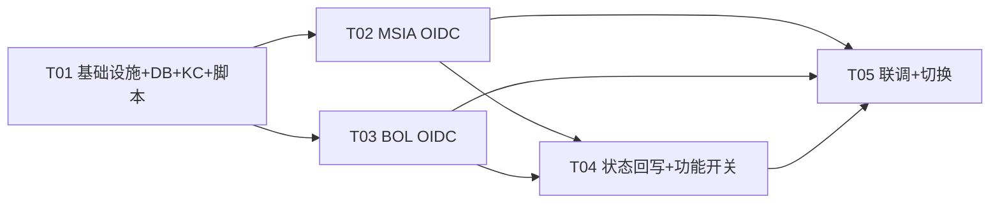

# MSIA Report 系统 & BOL 管理系统统一身份认证实施方案

| 项目 | 内容 |
|---|---|
| 文档版本 | v1.1（策划 + 实施结果） |
| 编制 | 软件开发团队（产品经理：许清楚 · 架构师：高见远 · 主理人：齐活林） |
| 日期 | 2026-11-02 编制，2026-11-03 补充实施结果 |
| 依据 | 《统一身份认证方案A_Keycloak自管密码.md》（下称"方案A"）+ 两系统代码现状调研 |
| 范围 | MSIA Report 系统与 BOL 管理系统的统一身份认证策划：需求、架构、数据库、改造清单、系统外变化、实施计划 |
| 环境 | SQL Server：IRSCNYTFINEREPORT.ap.inalfa.local（账号 ytview，业务库 CN_AME）；SMTP：172.19.253.10:25 无密码；用户规模 < 50 人 |

> 本文档是方案A在"两系统 + 用户给定环境约束"下的落地策划。方案A通用章节（Keycloak 部署细节、LDAP-only 兼容等）本文仅引用不复制。

> **修订记录（2026-11-09，第二轮）**：按《统一身份认证技术交底书_MSIA与BOL实施实录.md》§9.3 / §9.5 对齐——§7.2 会话改为 **Idle 1 天（86400 秒）/ Max 7 天（604800 秒）**（原 8h/12h 作废）；SMTP 发件人改为 `ap_sso@inalfa.com`、显示名 `Inalfa AME系统统一身份认证`（§7.2、§7.4）。暴力破解维持 5 次 / 900 秒。

---

## 目录

1. [需求分析（PRD 摘要）](#1-需求分析prd-摘要)
2. [现状调研结论](#2-现状调研结论)
3. [总体架构](#3-总体架构)
4. [数据库设计（CN_AME 库 + 统一前缀）](#4-数据库设计cn_ame-库--统一前缀)
5. [MSIA Report 系统改造清单](#5-msia-report-系统改造清单)
6. [BOL 管理系统改造清单](#6-bol-管理系统改造清单)
7. [系统外变化清单](#7-系统外变化清单)
8. [实施计划与切换策略](#8-实施计划与切换策略)
9. [任务分解（后续工程师实现清单）](#9-任务分解后续工程师实现清单)
10. [风险清单](#10-风险清单)
11. [待确认问题与待明确事项](#11-待确认问题与待明确事项)
12. [实施期数据底数核实与设计修订（2026-11-02）](#12-实施期数据底数核实与设计修订2026-11-02)
13. [实施结果与上线门项（2026-11-03）](#13-实施结果与上线门项2026-11-03)

---

## 1. 需求分析（PRD 摘要）

### 1.1 产品目标

| # | 目标 | 说明 |
|---|---|---|
| G1 | 统一身份 | 两系统同一账号（AD 登录名）+ 同一密码登录；忘记密码全程自助（邮件重置），无需找管理员 |
| G2 | 人员生命周期自动化 | 入职 T+1 自动建号并邮件邀请设密；离职当日自动停号（含踢会话），无需逐系统人工操作 |
| G3 | 授权可审计 | 权限仍归各系统管理员配置，但"谁-哪个系统-什么角色-谁授的"有台账可查，季度对账有据 |

### 1.2 成功标准（可验收）

| # | 指标 | 验收标准 |
|---|---|---|
| S1 | SSO 生效 | 同一浏览器登录 MSIA 后访问 BOL 免密直达（反之亦然） |
| S2 | 自助密码 | 忘记密码 → 邮件重置 → 重新登录，全程 0 管理员介入 |
| S3 | 入职自动化 | 新员工进入名单，T+1 收到邀请邮件并完成设密，可登录两系统 |
| S4 | 离职自动化 | 名单置停用当日，Keycloak 禁用且会话失效，两系统均无法登录 |
| S5 | 同步可靠 | 同步脚本连续 5 个工作日 OK；名单缺失当日有告警 |
| S6 | 切换率 | 上线后 4 周内 ≥90% 真实登录走 Keycloak |
| S7 | 可回滚 | break-glass 演练通过：停 Keycloak 后各系统本地管理员通道仍可进入 |

### 1.3 现状痛点（两系统用户旅程）

| 旅程 | MSIA 现状 | BOL 现状 |
|---|---|---|
| 入职开号 | HRDB.fine_user 同步建号（半自动），密码靠管理员重置/默认密码 | 用户**自助注册**（用户名不受控，影子账号风险）或管理员建号 |
| 忘记密码 | 找 admin 重置，密码口头传递 | 邮件自助重置（功能完善但密码体系独立） |
| 离职停号 | HRDB 名单移除后下次同步禁用（延迟不确定） | **纯人工停号**；且 7/30 天长效 Token 意味着停号后存量 Token 仍有效 |

跨系统共性：一人多套密码；离职逐系统人工操作易漏；无授权台账；用户资料口径不一（MSIA 来自 HRDB、BOL 手工）。

### 1.4 P0 需求（本期必须）

| # | 需求 | 适用 |
|---|---|---|
| R1 | Keycloak 统一认证中心上线（SMTP 按 25 无认证实际环境修订） | 系统外 |
| R2 | AD 名单 → 中央人员表 → Keycloak 每日同步（全量、MERGE、异常中止、告警） | 系统外 |
| R3/R4 | MSIA / BOL 接入 OIDC 登录，本地登录双轨保留至验收 | 两系统 |
| R5 | 存量账号与 AD 登录名对照表；对不上的不接入（人工裁决） | 两系统 |
| R6 | 密码统一到 Keycloak，强制全员邮件重设（哈希不可导入） | 两系统 |
| R7 | BOL 关闭自助注册（代码保留、配置禁用） | BOL |
| R8 | 离职自动禁用 + 会话失效（BOL 双轨期旧 Token 缺口必须有补偿机制） | 两系统 |
| R9 | 新表统一放 CN_AME 库 + 统一前缀 | 系统外 |
| R10 | 权限台账建立并录入首批数据 | 系统外 |

### 1.5 P1/P2 需求（摘要）

- **P1**：紧急停号脚本（R11）、break-glass 本地管理员通道（R12）、旧登录入口按截止日关闭（R13）、各系统改密/忘记密码功能下线（R14）、台账季度对账制度化（R15）、MSIA 用户资料来源切换为中央表派生（R16）、同步新鲜度监控（R17）
- **P2**：BOL 游客模式处置（R18，建议保留为免登录演示通道，游客不入统一身份体系）、台账线上化（R19）、MFA 预留（R20）、新系统接入模板化（R21）

### 1.6 关键产品决策

| # | 决策 | 结论 |
|---|---|---|
| D1 | BOL 自助注册/游客登录 | 注册**关闭**（影子账号最大来源）；游客**保留为演示通道**（不入统一身份体系，待确认场景真实性） |
| D2 | MSIA 现有 HRDB 用户同步 | 目标态**替代**（中央表一手数据），过渡态**共存**（保回滚）；验收后停用 `user_sync.py` 的 HRDB 来源 |
| D3 | 存量密码迁移 | **强制全员重设**（两系统哈希不可导入 Keycloak；<50 人成本可控） |
| D4 | 各系统改密/忘记密码功能 | 切换完成后**下线**（密码生命周期唯一归 Keycloak；本地通道仅 break-glass 保留） |

---

## 2. 现状调研结论

### 2.1 MSIA Report 系统

- **技术栈**：FastAPI + SQLAlchemy + Vue；JWT（HS256 自签，`settings.JWT_SECRET_KEY`）+ bcrypt
- **认证链路**：`/api/auth/login`（`backend/app/api/auth.py`）→ `backend/app/core/security.py`（签发/校验 JWT）→ `backend/app/core/deps.py`（`get_current_user`/角色依赖注入）
- **用户表**：`CN_AME_MISA_User`（CN_AME 库；字段 Id/Username/DisplayName/RealName/Email/Department/PasswordHash/Role/Status/HrSyncedAt/IsDeleted）
- **已有 HRDB 同步**：`backend/app/services/user_sync.py`（HRDB.fine_user → upsert，缺者禁用），日志表 `CN_AME_MISA_UserSyncLog`
- **角色**：admin / lead_reviewer / reviewer / reviewee
- **管理端点**：`backend/app/api/users.py`（重置密码 / 改角色 / 停启用）
- ⚠️ 调研发现：`jwt_secret_key` 为弱默认值（详见风险 TR7）

### 2.2 BOL 管理系统

- **技术栈**：Django + DRF + Vue3 + Element Plus；生产环境 PyInstaller 打包 exe（waitress 托管 SPA）
- **认证链路**：`Authorization: Token <key>`（`backend/apps/users/authentication.py` 的 `EmployeeTokenAuthentication`）→ 令牌表 `CN_IE_BOL_AuthToken`（CMC 库，默认 7 天有效、复用未过期令牌，remember=true 时 30 天）
- **员工表**：`CN_IE_BOL_Employee`（CMC 库，含 password 哈希 / must_change_password / last_login）
- **认证视图**：`backend/apps/users/auth_views.py`（Register / Login / **GuestLogin** / Logout / Me / ChangePassword / ForgotPassword / ResetPassword）
- **双库**：CMC 读写 + HRDB 只读（`backend/bol_platform/settings.py` + db_router），参数可由 `db_config.ini` 覆盖
- **角色**：ADMIN / IE / MGR / ENGINEER / VIEWER / GUEST

---

## 3. 总体架构

### 3.1 架构图

```
                      ┌────────────────────────────────┐
   AD 域控 (IT 管) ──►│ 每日全量人员名单 CSV            │ ① IT 提供（共享目录/邮件，待书面约定）
   （不给 LDAP）      └───────────────┬────────────────┘
                                     │ 06:00 计划任务
                                     ▼
 ┌───────────────────────────────────────────────────────────────────────┐
 │  Windows Server  IRSCNYTFINEREPORT.ap.inalfa.local                     │
 │  ┌──────────────────────── SQL Server ────────────────────────────┐   │
 │  │ finedb_11 (帆软, 只读参考, 不放自建表)                           │   │
 │  │ CN_AME 库（业务库, 新增 SSO 域表, 统一前缀 CN_AME_SSO_）:        │   │
 │  │   CN_AME_SSO_StgAdUser / CN_AME_SSO_User / CN_AME_SSO_UserMap   │   │
 │  │   CN_AME_SSO_SyncLog / CN_AME_SSO_PermLedger                    │   │
 │  │   （既有: CN_AME_MISA_User 等 MSIA 业务表）                      │   │
 │  │ keycloak 库（Keycloak 26.x 专用, 独立建库独立账号, 不进 CN_AME）  │   │
 │  │ HRDB（只读参考, 既有）                                           │   │
 │  └────────────────────────────────────────────────────────────────┘   │
 │                                                                       │
 │  PowerShell ×3: sync_ad_to_sso.ps1 / sync_sso_to_keycloak.ps1         │
 │                 disable_user_now.ps1(紧急停号, 手工)                    │
 │                 │②名单→暂存→MERGE   │③Admin REST(GET→改→PUT, 禁用踢会话)│
 │                 ▼                    ▼                                │
 │  ┌────────────────────────────────────────────┐                       │
 │  │ Keycloak 26.x（127.0.0.1:8443, NSSM+JDK21） │◄── 统一登录页          │
 │  │ realm: inalfa, 自管密码, SMTP 172.19.253.10:25 无认证                │
 │  │ clients: msia-prod / bol-prod / sync-client                        │
 │  │ 准入组: app-msia / app-bol                                          │
 │  └──────────────▲─────────────────────────────┘                       │
 └─────────────────┼─────────────────────────────────────────────────────┘
                   │ ④ OIDC 授权码流（HTTPS 经反代 sso.ap.inalfa.local）
        ┌──────────┴──────────────────────────┐
        │                                     │
 ┌──────┴───────────────┐          ┌──────────┴───────────────────┐
 │ MSIA Report 系统      │          │ BOL 管理系统                  │
 │ FastAPI+SQLAlchemy+Vue │         │ Django+DRF+Vue3(PyInstaller) │
 │ 本地 JWT(HS256) 双轨   │         │ Token 认证 → OIDC 双轨        │
 └───────────────────────┘          └──────────────────────────────┘
   两系统均经 Keycloak 完成认证; 浏览器已登录后, 第二个系统免密直达(SSO)
```

### 3.2 两条数据流

**数据流 1：人员数据流（每日单向）**
```
AD 全量名单 CSV → 06:00 计划任务 → TRUNCATE 暂存表灌入 → 防错检查（异常中止+告警）
→ MERGE 合并进 CN_AME_SSO_User（禁止改写 login_name；MANUAL 行不覆盖）
→ sync_sso_to_keycloak.ps1 调 Admin REST（幂等：先查后动作；新人建号+邀请设密邮件；
   离职禁用+立即踢会话）→ 写 CN_AME_SSO_SyncLog；异常发告警邮件
```

**数据流 2：认证流（实时）**
```
用户点"统一登录" → 后端生成 state+nonce+PKCE，302 跳 Keycloak 授权端点
→ 用户在 Keycloak 登录页输密码（或已登录免密直达）
→ 回调 /api/auth/oidc/callback?code&state → 换 token → 验 id_token（JWKS 签名/iss/aud/nonce）
→ 取 preferred_username + groups → 校验准入组（app-msia / app-bol）
→ 查对照表映射本地用户名 → 匹配/自动建档
→ 签发本系统本地凭证（MSIA: 本地 JWT；BOL: AuthToken）→ 前端凭一次性码换取，进入系统
```

**核心设计要点**：OIDC 认证成功后**仍签发各系统既有本地凭证**，下游鉴权链路（MSIA 的 `get_current_user`/`require_role`、BOL 的 `EmployeeTokenAuthentication`）完全不动——改造面最小，双轨切换只动登录入口。

### 3.3 与方案A原文的差异对照

| # | 项 | 方案A原文 | 本方案（修订） | 理由 |
|---|---|---|---|---|
| D-1 | 业务表所在库 | 独立新建 `sso` 库 | **复用 CN_AME 库**，统一前缀 `CN_AME_SSO_`（5 张表） | 用户硬约束；CN_AME 已是 MSIA 业务库，少建一个库少一份账号/备份管理 |
| D-2 | Keycloak 自身库 | 独立 `keycloak` 库 | **保持独立，不进 CN_AME** | Keycloak 库由其 schema 迁移自动管理（93 张表起步），混入业务库污染备份边界 |
| D-3 | SMTP | 587 + StartTLS + 密码 | **172.19.253.10:25，无密码无认证，不开 TLS** | 用户给定实际环境；与 MSIA `config.ini [mail]` 现有配置一致 |
| D-4 | 接入范围 | 帆软/ERP 等通用模板 | 收敛为 MSIA + BOL 两自研系统，均走 OIDC 授权码直连 | 本期范围仅两系统，LDAP-only 章节（方案A §11）不涉及 |
| D-5 | 停用传导 | 各系统首次登录自动建档 | 保留自动建档 + **中央表状态回写同步**（BOL 每小时） | BOL 双轨期本地 Token 最长 7/30 天有效，仅靠 Keycloak 禁用挡不住旧 Token |
| D-6 | 表名/主键命名 | `sso_user` 等短名 | `CN_AME_SSO_User` 等；新增 `kc_user_id` 缓存列 | 与库内 `CN_AME_MISA_*` 命名风格协调；缓存 KC ID 减少同步 REST 查询 |
| D-7 | 实施阶段 | P0–P5 含帆软厂商协调 | P0–P4，无厂商依赖环节 | 两系统均自研可控 |

---

## 4. 数据库设计（CN_AME 库 + 统一前缀）

### 4.1 前缀决定：`CN_AME_SSO_`

**理由**：
1. **库内既有惯例**：CN_AME 库现有 MSIA 业务表用 `CN_AME_MISA_` 前缀（库代码_域代码_），SSO 属新域，`CN_AME_SSO_` 与之同构，DBA 一眼可辨识归属；
2. **隔离与清理**：前缀即边界——将来 SSO 下线或重构，`DROP TABLE` 范围明确；权限可按前缀整体授予；
3. **避免跨库混淆**：BOL 的表在 CMC 库用 `CN_IE_BOL_` 前缀，SSO 中央表只在 CN_AME 一处，两系统跨库只读引用；
4. 跨库查询时（BOL 侧 `CN_AME.dbo.CN_AME_SSO_User`）自带库名语义，脚本与日志可读性好。

**库边界声明**：`keycloak` 库独立创建（方案A §8.2 原样执行），由 Keycloak 自动建表与升级迁移，属"产品自带存储"而非业务表，**不纳入前缀体系，不允许人工建表改数**。

### 4.2 完整 T-SQL DDL（在 CN_AME 库执行，幂等可重复）

```sql
/* ============================================================
   统一身份认证 SSO 域建表脚本
   目标: IRSCNYTFINEREPORT.ap.inalfa.local / CN_AME 库
   执行账号: ytview（需对 CN_AME 有 DDL 权限）
   时间列统一 UTC(SYSUTCDATETIME), 展示层转本地时区
   ============================================================ */
USE CN_AME;
GO

/* ---------- 1. AD 名单暂存表（每日 TRUNCATE 重灌） ---------- */
IF OBJECT_ID(N'dbo.CN_AME_SSO_StgAdUser', N'U') IS NULL
BEGIN
CREATE TABLE dbo.CN_AME_SSO_StgAdUser (
    employee_no    NVARCHAR(32)      NOT NULL,               -- 工号（跨系统稳定主键）
    login_name     NVARCHAR(64)      NULL,                   -- 登录名（=AD 域账号, 全小写）
    display_name   NVARCHAR(128)     NULL,                   -- 中文姓名
    email          NVARCHAR(128)     NULL,                   -- 企业邮箱（设密/找回依赖）
    mobile         NVARCHAR(32)      NULL,
    dept_code      NVARCHAR(64)      NULL,
    dept_name      NVARCHAR(128)     NULL,
    title          NVARCHAR(128)     NULL,
    status         TINYINT           NOT NULL DEFAULT 1,     -- 1=在职 0=离职停用（名单标记）
    ad_object_guid UNIQUEIDENTIFIER  NULL,                   -- 防工号复用误合并
    loaded_at      DATETIME2(0)      NOT NULL DEFAULT SYSUTCDATETIME()
);
CREATE INDEX IX_CN_AME_SSO_StgAdUser_EmpNo ON dbo.CN_AME_SSO_StgAdUser (employee_no);
END
GO

/* ---------- 2. 中央人员表（唯一人员事实来源） ---------- */
IF OBJECT_ID(N'dbo.CN_AME_SSO_User', N'U') IS NULL
BEGIN
CREATE TABLE dbo.CN_AME_SSO_User (
    id             BIGINT IDENTITY(1,1) NOT NULL CONSTRAINT PK_CN_AME_SSO_User PRIMARY KEY,
    employee_no    NVARCHAR(32)      NOT NULL,
    login_name     NVARCHAR(64)      NOT NULL,               -- Keycloak username, 一旦确定不改
    display_name   NVARCHAR(128)     NULL,
    email          NVARCHAR(128)     NULL,
    mobile         NVARCHAR(32)      NULL,
    dept_code      NVARCHAR(64)      NULL,
    dept_name      NVARCHAR(128)     NULL,
    title          NVARCHAR(128)     NULL,
    status         TINYINT           NOT NULL DEFAULT 1,     -- 1=在职 0=停用（永不物理删除）
    ad_object_guid UNIQUEIDENTIFIER  NULL,
    source         NVARCHAR(16)      NOT NULL DEFAULT N'AD', -- AD=同步 / MANUAL=例外手工
    pwd_set        BIT               NOT NULL DEFAULT 0,     -- 已在 Keycloak 完成首次设密
    kc_user_id     NVARCHAR(64)      NULL,                   -- Keycloak 用户 ID 缓存(同步脚本回写)
    synced_at      DATETIME2(0)      NULL,                   -- 最近 AD 合并时间（新鲜度监控依据）
    created_at     DATETIME2(0)      NOT NULL DEFAULT SYSUTCDATETIME(),
    updated_at     DATETIME2(0)      NOT NULL DEFAULT SYSUTCDATETIME(),
    CONSTRAINT CK_CN_AME_SSO_User_Status CHECK (status IN (0,1)),
    CONSTRAINT CK_CN_AME_SSO_User_Source CHECK (source IN (N'AD', N'MANUAL'))
);

ALTER TABLE dbo.CN_AME_SSO_User ADD CONSTRAINT UQ_CN_AME_SSO_User_EmpNo  UNIQUE (employee_no);
ALTER TABLE dbo.CN_AME_SSO_User ADD CONSTRAINT UQ_CN_AME_SSO_User_Login  UNIQUE (login_name);
CREATE UNIQUE INDEX UX_CN_AME_SSO_User_Guid ON dbo.CN_AME_SSO_User (ad_object_guid)
    WHERE ad_object_guid IS NOT NULL;
-- 邮箱暂不作为管理对象（用户 2026-11-02 确认）：不设唯一约束，Keycloak 侧关闭重复邮箱校验
CREATE INDEX IX_CN_AME_SSO_User_Email ON dbo.CN_AME_SSO_User (email)
    WHERE email IS NOT NULL;
CREATE UNIQUE INDEX UX_CN_AME_SSO_User_KcId  ON dbo.CN_AME_SSO_User (kc_user_id)
    WHERE kc_user_id IS NOT NULL;
CREATE INDEX IX_CN_AME_SSO_User_Status   ON dbo.CN_AME_SSO_User (status);
CREATE INDEX IX_CN_AME_SSO_User_DeptCode ON dbo.CN_AME_SSO_User (dept_code);
CREATE INDEX IX_CN_AME_SSO_User_SyncedAt ON dbo.CN_AME_SSO_User (synced_at);
END
GO

/* ---------- 3. 跨系统账号对照表（存量用户名 ≠ AD 登录名时用） ---------- */
IF OBJECT_ID(N'dbo.CN_AME_SSO_UserMap', N'U') IS NULL
BEGIN
CREATE TABLE dbo.CN_AME_SSO_UserMap (
    id             BIGINT IDENTITY(1,1) NOT NULL CONSTRAINT PK_CN_AME_SSO_UserMap PRIMARY KEY,
    employee_no    NVARCHAR(32)      NOT NULL,               -- 关联 CN_AME_SSO_User.employee_no
    system_code    NVARCHAR(32)      NOT NULL,               -- 'msia' / 'bol'（与台账同一套编码）
    local_username NVARCHAR(128)     NOT NULL,               -- 该系统已有登录名
    match_key      NVARCHAR(16)      NOT NULL DEFAULT N'USERNAME',  -- USERNAME/EMAIL/EMPNO
    remark         NVARCHAR(200)     NULL,
    created_at     DATETIME2(0)      NOT NULL DEFAULT SYSUTCDATETIME(),
    updated_at     DATETIME2(0)      NOT NULL DEFAULT SYSUTCDATETIME(),
    CONSTRAINT CK_CN_AME_SSO_UserMap_Key CHECK (match_key IN (N'USERNAME', N'EMAIL', N'EMPNO')),
    CONSTRAINT UQ_CN_AME_SSO_UserMap_SysLocal UNIQUE (system_code, local_username)
);
CREATE INDEX IX_CN_AME_SSO_UserMap_Emp ON dbo.CN_AME_SSO_UserMap (employee_no, system_code);
END
GO

/* ---------- 4. 同步日志表（两类同步共用, phase 区分） ---------- */
IF OBJECT_ID(N'dbo.CN_AME_SSO_SyncLog', N'U') IS NULL
BEGIN
CREATE TABLE dbo.CN_AME_SSO_SyncLog (
    id             BIGINT IDENTITY(1,1) NOT NULL CONSTRAINT PK_CN_AME_SSO_SyncLog PRIMARY KEY,
    phase          NVARCHAR(16)      NOT NULL,   -- LOAD/MERGE/KC/KC_EMERGENCY
    run_at         DATETIME2(0)      NOT NULL DEFAULT SYSUTCDATETIME(),
    src_rows       INT               NULL,
    added          INT               NULL,
    updated        INT               NULL,
    disabled       INT               NULL,
    reactivated    INT               NULL,
    status         NVARCHAR(16)      NOT NULL,   -- OK / ABORTED / ERROR
    message        NVARCHAR(2000)    NULL
);
CREATE INDEX IX_CN_AME_SSO_SyncLog_RunAt ON dbo.CN_AME_SSO_SyncLog (run_at DESC, phase);
END
GO

/* ---------- 5. 权限台账表（谁-哪个系统-什么角色-谁授的） ---------- */
IF OBJECT_ID(N'dbo.CN_AME_SSO_PermLedger', N'U') IS NULL
BEGIN
CREATE TABLE dbo.CN_AME_SSO_PermLedger (
    id             BIGINT IDENTITY(1,1) NOT NULL CONSTRAINT PK_CN_AME_SSO_PermLedger PRIMARY KEY,
    employee_no    NVARCHAR(32)      NOT NULL,
    system_code    NVARCHAR(32)      NOT NULL,   -- 'msia' / 'bol' / 'keycloak-admin' / 'local-admin'
    role_name      NVARCHAR(64)      NOT NULL,   -- 系统内角色文本（admin/reviewer/IE/MGR...）
    granted_by     NVARCHAR(64)      NOT NULL,
    granted_at     DATE              NOT NULL DEFAULT CAST(SYSUTCDATETIME() AS DATE),
    revoked_at     DATE              NULL,       -- NULL=仍有效
    remark         NVARCHAR(200)     NULL,
    created_at     DATETIME2(0)      NOT NULL DEFAULT SYSUTCDATETIME()
);
CREATE INDEX IX_CN_AME_SSO_PermLedger_Emp ON dbo.CN_AME_SSO_PermLedger (employee_no);
CREATE INDEX IX_CN_AME_SSO_PermLedger_Sys ON dbo.CN_AME_SSO_PermLedger (system_code, revoked_at);
END
GO
```

### 4.3 MERGE 合并语句（同步脚本调用）

```sql
SET TRANSACTION ISOLATION LEVEL SERIALIZABLE;
BEGIN TRAN;

MERGE dbo.CN_AME_SSO_User AS t
USING dbo.CN_AME_SSO_StgAdUser AS s
   ON t.employee_no = s.employee_no
WHEN MATCHED AND (
        ISNULL(t.display_name,'') <> ISNULL(s.display_name,'')
     OR ISNULL(t.email,'')        <> ISNULL(s.email,'')
     OR ISNULL(t.mobile,'')       <> ISNULL(s.mobile,'')
     OR ISNULL(t.dept_code,'')    <> ISNULL(s.dept_code,'')
     OR ISNULL(t.dept_name,'')    <> ISNULL(s.dept_name,'')
     OR ISNULL(t.title,'')        <> ISNULL(s.title,'')
     OR t.status                  <> s.status
     OR ISNULL(t.ad_object_guid,'00000000-0000-0000-0000-000000000000')
        <> ISNULL(s.ad_object_guid,'00000000-0000-0000-0000-000000000000')
     )
   AND t.source <> N'MANUAL'
THEN UPDATE SET
        t.display_name = s.display_name, t.email = s.email, t.mobile = s.mobile,
        t.dept_code = s.dept_code, t.dept_name = s.dept_name, t.title = s.title,
        t.status = s.status, t.ad_object_guid = s.ad_object_guid,
        t.source = N'AD', t.synced_at = SYSUTCDATETIME(), t.updated_at = SYSUTCDATETIME()
        -- 故意不更新 login_name / kc_user_id：登录名变更走"停旧建新"
WHEN NOT MATCHED BY TARGET THEN
    INSERT (employee_no, login_name, display_name, email, mobile,
            dept_code, dept_name, title, status, ad_object_guid, source, synced_at)
    VALUES (s.employee_no, s.login_name, s.display_name, s.email, s.mobile,
            s.dept_code, s.dept_name, s.title, s.status, s.ad_object_guid, N'AD', SYSUTCDATETIME())
WHEN NOT MATCHED BY SOURCE AND t.status = 1 AND t.source <> N'MANUAL' THEN
    UPDATE SET t.status = 0, t.synced_at = SYSUTCDATETIME(), t.updated_at = SYSUTCDATETIME();

COMMIT;
-- 防错中止规则（行数骤降>30%/停用占比>10%/GUID冲突/登录名变更等）与方案A §6.4 完全一致
```

### 4.4 建表顺序与账号权限矩阵

**建表顺序**：StgAdUser → User → UserMap → SyncLog → PermLedger（无外键，脚本幂等可重复执行）。

| 账号 | 用途 | 权限 | 说明 |
|---|---|---|---|
| `ytview`（现有） | MSIA 运行连接 + 建表执行账号 | CN_AME 现有权限 + 新五表读写 | 需具备 `CREATE TABLE`（DDL）权限；若不足由 DBA 代执行（脚本幂等） |
| `sso_sync_svc`（**新建**） | 三个同步脚本专用 | 仅五表：`GRANT SELECT/INSERT/UPDATE/DELETE ON dbo.CN_AME_SSO_*`（表级，不给整库） | 同步脚本不借 ytview，权限面隔离，出问题可独立停用 |
| `keycloak_svc`（新建） | Keycloak 连库 | 仅独立 `keycloak` 库 read/write/ddladmin | 方案A §8.2 原样 |
| BOL 后端连接账号 | BOL 读对照表/中央表 | `GRANT SELECT ON dbo.CN_AME_SSO_User, CN_AME_SSO_UserMap TO <BOL账号>`（CN_AME 库内授权） | BOL 侧只读两表 |

---

## 5. MSIA Report 系统改造清单

### 5.1 OIDC 接入方式（授权码流 + PKCE，签发本地 JWT 保持下游不变）

**选型**：`authlib`（JOSE/JWKS 验签）+ `httpx`（异步换 token），不引入重框架——本系统已有 PyJWT/bcrypt 体系，OIDC 客户端仅三个端点，轻量可控。

**端点设计**（新增于 `backend/app/api/auth.py`）：

| 端点 | 方法 | 职责 |
|---|---|---|
| `/api/auth/oidc/login` | GET | 生成 state+nonce+PKCE（S256），内存缓存 TTL 10min，302 跳 Keycloak authorize（scope=openid profile email） |
| `/api/auth/oidc/callback` | GET | 校验 state → code+client_secret+PKCE 换 token → 验 id_token（JWKS 签名/iss/aud/exp/nonce）→ 取 preferred_username/email/groups → 准入组与用户匹配 → **复用 `security.create_access_token(user.Id, user.Role)` 签发本地 JWT** → 生成一次性码 otk（60s）→ 302 到前端 `/oidc/callback?otk=...` |
| `/api/auth/oidc/token` | POST | body `{otk}` 校验（一次性、60 秒过期），返回 `{access_token, token_type, user}`——与现有 `/api/auth/login` 响应结构一致，前端 store 复用 |

> 本地 JWT 不进 URL/浏览器历史/访问日志——用一次性码中转，这是 MSIA 现网为 HTTP（TR2）下最重要的补偿控制。

**用户匹配逻辑**（新建 `backend/app/services/sso_identity.py`）：
```
输入: preferred_username(Keycloak username = login_name), groups, email
1. groups 不含 'app-msia' → 403 "未开通本系统访问权限，请联系管理员"
2. SELECT m.local_username FROM CN_AME_SSO_UserMap m
   JOIN CN_AME_SSO_User u ON u.employee_no = m.employee_no
   WHERE m.system_code = 'msia' AND u.login_name = :preferred_username
3. local_username = 对照表命中值, 否则回落 preferred_username
4. SELECT * FROM CN_AME_MISA_User WHERE Username = :local_username AND IsDeleted = 0
   ├─ 命中且 Status=1 → 直接用（Email/DisplayName 为空则补充）
   ├─ 未命中且 auto_create_user=true → 自动建档:
   │    Username=preferred_username, Role='reviewee', Status=1,
   │    PasswordHash=NULL（只建身份不给权限，权限由管理员按台账配置）
   └─ Status=0 → 403 "账号已禁用"
```

### 5.2 逐文件改造清单

| 文件 | 改造内容 | 优先级 |
|---|---|---|
| `backend/config.ini` | 新增 `[oidc]` 段：`enabled`（总开关，false 时 OIDC 端点返回 503）、`issuer=https://sso.ap.inalfa.local/realms/inalfa`、`client_id=msia-prod`、`client_secret`、`redirect_uri`、`required_group=app-msia`、`auto_create_user=true`；`[security]` 增加 `local_login_enabled=true`（双轨开关）；新增 `hr_sync_enabled=true`。**同时强制更换弱 JWT 密钥（现为 `change-me-in-production`）** | P0 |
| `backend/app/core/config.py` | Settings 增加上述字段读取 | P0 |
| `backend/app/core/oidc.py`（新建） | OIDC 客户端：discovery 缓存、JWKS 缓存与轮换、code 换 token、id_token 验签；PKCE/state/otk 内存缓存（单进程部署够用） | P0 |
| `backend/app/api/auth.py` | 新增 3 个 OIDC 端点；`/api/auth/login` 增加 `local_login_enabled` 开关判断（false 时 403 "请使用统一登录"） | P0 |
| `backend/app/services/sso_identity.py`（新建） | 匹配/建档逻辑 | P0 |
| `backend/app/api/users.py` | `reset-password` / `change-password` 等端点增加 `local_login_enabled` 判断——双轨期保留（break-glass 用），本地登录关闭后 403 | P1 |
| `backend/app/services/user_sync.py` | 入口加 `hr_sync_enabled` 开关；**验收后新增数据源切换**：新建 `sso_user_sync.py` 从 `CN_AME_SSO_User` 派生更新 `CN_AME_MISA_User`（DisplayName/Email/Department/Status upsert，来源换表），替代 HRDB.fine_user；双轨期两者共存 | P1 |
| `frontend/src/pages/Login.tsx` | 主按钮改"统一身份登录"；本地账密表单折叠为"本地登录（过渡期）"；`oidc_enabled=false` 时保持原样 | P0 |
| `frontend/src/pages/OidcCallback.tsx`（新建） | 读取 `?otk=` → `POST /api/auth/oidc/token` → 写 auth store → 跳原目标页；失败态展示 403/超时提示 | P0 |
| `frontend/src/api/auth.ts` | 新增 `exchangeOtk()`；`client.ts` 无需改（仍是 Bearer 本地 JWT） | P0 |
| `frontend/src/router/*` | 增加 `/oidc/callback` 路由（免登录守卫） | P0 |
| `frontend/src/pages/SystemUsers.tsx` | 隐藏"重置密码"操作列入口（配置开关控制显隐，代码保留） | P1 |

**双轨与切换**：`[oidc].enabled` 控制 OIDC 入口，`[security].local_login_enabled` 控制本地登录。验收（S6）后 `local_login_enabled=false` → 本地登录/改密/重置密码全部 403，仅保留 break-glass 本地管理员账号（≤2 个，封存入台账）。

---

## 6. BOL 管理系统改造清单

### 6.1 OIDC 接入方式（自研轻量客户端，复用 AuthToken 体系）

**选型对比**：
- `mozilla-django-oidc`：基于 Django session/Cookie 认证体系，与本项目 **DRF + SPA + `Authorization: Token`** 架构错配——需把登录态从 AuthToken 迁到 session，动全部前端请求封装，改造面反而大。**不采用**。
- **推荐：自研 OIDC 模块**（`apps/users/oidc.py`），依赖 `authlib`（JWKS 验签）+ `requests`（项目已有），授权码流三端点与 MSIA 同构，成功后**复用 `AuthToken.create_for_employee()`** 签发 Token，前端封装零改动。

**端点设计**（新增 `backend/apps/users/oidc_views.py`，路由挂入 `auth_urls.py`）：与 MSIA 同构（login / callback / token 三端点），callback 匹配 Employee 后 `AuthToken.create_for_employee()` → 一次性码 → 302 前端。

**用户匹配逻辑**：
```
1. groups 不含 'app-bol' → 403
2. 跨库查对照表（BOL 连接在 CMC，原生 SQL 三段名）:
   SELECT m.local_username FROM CN_AME.dbo.CN_AME_SSO_UserMap m
   JOIN CN_AME.dbo.CN_AME_SSO_User u ON u.employee_no = m.employee_no
   WHERE m.system_code = 'bol' AND u.login_name = :preferred_username
3. local_username 回落 preferred_username
4. Employee.objects.filter(username=local_username).first()
   ├─ 命中且 status='ACTIVE' → 用之
   ├─ 未命中且 auto_create → create(username=preferred_username, name=display_name,
   │     role='VIEWER', status='ACTIVE', password='')  ← 最低权限建档
   └─ status='INACTIVE' → 403
```
跨库读权限：需给 BOL 数据库账号授予 `CN_AME.dbo.CN_AME_SSO_User/UserMap` 的 SELECT（见 4.4）。

### 6.2 逐文件改造清单

| 文件 | 改造内容 | 优先级 |
|---|---|---|
| `backend/bol_platform/settings.py` | 新增：`OIDC_*` 配置组（issuer/client_id/client_secret/redirect_uri/required_group/auto_create）、`SELF_REGISTRATION_ENABLED=False`（R7）、`LOCAL_AUTH_ENABLED=True`（双轨开关）、`PASSWORD_SELF_SERVICE_ENABLED=True`（R14 下线用）、`SSO_STATUS_SYNC_HOURS=1`（状态回写频率）。均可被 `db_config.ini` 覆盖（新增 `[oidc]`、`[auth]` 段） | P0 |
| `backend/db_config.ini`（部署包内） | 新增 `[oidc]` / `[auth]` 段示例与注释 | P0 |
| `backend/apps/users/oidc.py`（新建） | OIDC 客户端：discovery/JWKS 缓存、code 换 token、id_token 验签、state/otk 缓存 | P0 |
| `backend/apps/users/oidc_views.py`（新建） | 3 个 OIDC 端点 + Employee 匹配/建档 | P0 |
| `backend/apps/users/auth_urls.py` | 注册 OIDC 路由 | P0 |
| `backend/apps/users/auth_views.py` | ① `RegisterView`：`SELF_REGISTRATION_ENABLED=False` 时 403"自助注册已关闭"（代码保留配置禁用）；② `LoginView`：`LOCAL_AUTH_ENABLED=False` 时 403；③ `GuestLoginView`：**保留不动**（游客为免登录演示通道，不入统一身份体系）；④ `ChangePassword/ForgotPassword/ResetPasswordView`：`PASSWORD_SELF_SERVICE_ENABLED=False` 时 403 | P0 |
| `backend/apps/users/management/commands/sync_sso_status.py`（新建） | **R8 核心**：每小时从 `CN_AME.dbo.CN_AME_SSO_User` 读 status，按对照表映射回 `CN_IE_BOL_Employee.status`：中央表 status=0 → 本地 'INACTIVE'（**同时清该员工的 AuthToken**）；status=1 且本地 INACTIVE → 恢复 ACTIVE。双轨期即启用——本地 Token 通道离职缺口从"最长 30 天"压到"≤1 小时" | P0 |
| `frontend/src/views/LoginView.vue` | 主按钮"统一身份登录"；本地登录表单折叠为"本地登录（过渡期）"；游客入口保留 | P0 |
| `frontend/src/views/OidcCallback.vue`（新建）+ `router/index.js` | `/oidc/callback` 免守卫路由；`?otk=` → `POST /api/auth/oidc/token` → 写 auth store → 跳原目标页 | P0 |
| `frontend/src/views/RegisterView.vue` / `ForgotPasswordView.vue` | 由后端 `GET /api/auth/config`（新增轻量端点返回 feature flags）控制显隐/提示 | P1 |
| `frontend/src/views/AccountView.vue` | "修改密码"区块按 feature flags 隐藏（R14） | P1 |
| `backend/apps/users/views.py` / `serializers.py` | 员工管理 API 增加"禁用员工时同时清 Token"钩子（配合紧急停号） | P1 |

**双轨与切换**：`LOCAL_AUTH_ENABLED` 控制 LoginView 本地通道；关闭后 `EmployeeTokenAuthentication` **保留**（OIDC 用户仍持 AuthToken 正常工作），仅登录入口收敛。`AuthToken` 增加 `source` 列（'local'/'oidc'），全量切换日统一 `DELETE source='local'` 作废旧本地令牌。

**PyInstaller 注意**：新增 `authlib` 依赖后需更新打包 spec 的 hidden imports（`authlib.jose`, `authlib.oauth2`），重打 exe 并在测试机验证 discovery/JWKS 拉取（内网 DNS 解析 sso.ap.inalfa.local）。

---

## 7. 系统外变化清单

### 7.1 Keycloak 部署与配置要点

**部署**（方案A §8 原样，Windows 原生）：JDK 21（Temurin LTS）→ Keycloak 26.x zip 解压 `C:\keycloak` → 独立 `keycloak` 库 + `keycloak_svc` 账号 → MSSQL JDBC 驱动入 `providers\` + `kc.bat build` → NSSM 注册服务（`start --optimized`，`KC_DB_PASSWORD` 走环境变量）→ `kc.bat bootstrap-admin user` 创建 `kcadmin`（仅 master 域，break-glass 封存）。

**keycloak.conf 关键参数**：
```properties
db=mssql
db-url=jdbc:sqlserver://IRSCNYTFINEREPORT.ap.inalfa.local:1433;databaseName=keycloak;encrypt=true;trustServerCertificate=true
db-username=keycloak_svc
hostname=sso.ap.inalfa.local
proxy-headers=xforwarded        # 必须开，否则反代后 redirect 变 127.0.0.1
http-enabled=false
https-port=8443                 # 只听本机, 不直占 443
health-enabled=true
http-management-port=9000       # 仅本机健康检查
log=file
log-file=C:/keycloak/logs/keycloak.log
```

**Realm `inalfa` 配置**：

| 项 | 值 | 备注 |
|---|---|---|
| SMTP Host / Port | `172.19.253.10` / `25` | **Authentication=OFF，SSL=OFF，StartTLS=OFF**；From `ap_sso@inalfa.com`、From Display Name `Inalfa AME系统统一身份认证`（正式服务参数，以交底书 §9.5 为准；原 `sso-notify@inalfa.local` 作废）；配置后必须 Test connection + **实测收到信** |
| User registration | OFF | 用户只能来自同步 |
| **Duplicate emails** | **OFF（关闭重复邮箱检查）** | 邮箱暂不管理：允许空/重复邮箱，避免同步被邮箱唯一性阻断 |
| Forgot password | ON | 自助重置 |
| 暴力破解防护 | 5 次失败锁 15 分钟 | |
| 会话 | **Idle 1 天（86400 秒）/ Max 7 天（604800 秒）** / Access Token 15min | 交底书 §9.3（2026-11-09 现场决定，覆盖原 8h/12h，原值作废）；加长不踢已登录用户 |
| 事件 | User events 90 天 / Admin events 180 天 | 审计 |
| 密码策略 | 长度≥10，不含用户名，不强制定期过期 | |

**Clients 与准入组**：

| Client | 类型 | Redirect URI | 准入组 | 用途 |
|---|---|---|---|---|
| `msia-prod` | confidential + secret，授权码流，开启 PKCE | `http://172.26.2.203:8078/api/auth/oidc/callback`（精确） | `app-msia`（Group Membership mapper → token `groups` claim） | MSIA OIDC |
| `bol-prod` | 同上 | `http://<BOL部署地址>/api/auth/oidc/callback`（精确，待确认 BOL 对外 URL） | `app-bol` | BOL OIDC |
| `sync-client` | confidential，仅 Service Account，realm-management：manage-users/view-users/query-users | — | — | 同步脚本 |
| `account`（内置） | 保持启用 | — | — | 邀请设密邮件落地 |

### 7.2 AD 名单同步脚本（PowerShell ×3）

| 脚本 | 时间 | 职责 |
|---|---|---|
| `C:\sso\scripts\sync_ad_to_sso.ps1` | 每日 06:00 计划任务 | 找当日 CSV（`ad_users_yyyyMMdd.csv`）→ 校验清洗（employee_no/login_name 唯一、email 格式）→ TRUNCATE + SqlBulkCopy 灌暂存表 → 防错检查（任一命中 ABORTED+告警+退出）→ 执行 MERGE → 写 SyncLog → 串联调 Keycloak 同步。连接账号 `sso_sync_svc`（DPAPI 加密口令文件） |
| `C:\sso\scripts\sync_sso_to_keycloak.ps1` | 由上串联 | 读 `CN_AME_SSO_User` 全量 → 优先按 `kc_user_id`（无则按 username 查，命中回写）→ 新人 POST + `execute-actions-email`(UPDATE_PASSWORD, 3 天有效) → 更新走 **GET→改→PUT 整对象**（硬规则）→ status=0 且 enabled → 禁用 + **立即 POST /logout 踢会话** → 复职 enabled=true（停用>180 天或 pwd_set=0 重发设密）→ requiredActions 无 UPDATE_PASSWORD 且 pwd_set=0 → 回写 pwd_set=1 → 写 SyncLog；HTTP 失败 10s/30s/60s 退避重试 3 次 |
| `C:\sso\scripts\disable_user_now.ps1` | 手工（紧急停号） | 工号 → 中央表 status=0 → KC 禁用+踢会话 → SyncLog(phase='KC_EMERGENCY') + 告警邮件（**必须写明"当天通知 IT 从名单移除，否则次日 MERGE 复活"**） |

### 7.3 Windows 计划任务

| 任务名 | 时间 | 内容 |
|---|---|---|
| SSO_AD_Import | 每日 06:00 | sync_ad_to_sso.ps1（内部串联 KC 同步） |
| SSO_HealthCheck | 每日 07:30 | `MAX(synced_at)` >26h 告警（新鲜度监控）、当日 SyncLog 非 OK 告警、`Get-Service Keycloak`、每周一发 SMTP 测试邮件 |
| SSO_KC_Export | 每周日 02:00 | `kc.bat export --dir C:\sso\kc-export`（realm 备份） |

### 7.4 反代 / DNS / 证书 / 防火墙（需 IT 配合项汇总）

| 项 | 内容 | 责任 |
|---|---|---|
| DNS | A 记录 `sso.ap.inalfa.local` → IRSCNYTFINEREPORT 服务器 IP | 需 IT 配合 |
| 证书 | `*.ap.inalfa.local` 通配符或单域名企业证书，装 IIS/反代 | 需 IT 配合 |
| 反代 | IIS ARR（推荐）：站点绑 `sso.ap.inalfa.local:443` + 企业证书 → server farm 指向 `https://127.0.0.1:8443`；保留 Host 头、补 `X-Forwarded-For/Proto/Host`。ARR 调不通退 nginx | 客户自做 |
| 防火墙 | 443 对内网开放；8443/9000 仅本机；1433 仅应用/管理机 | 需 IT 配合 |
| 名单投递 | 共享目录 `\\<文件服务器>\sso_import\`（推荐）或邮件附件，**全量名单 + 固定列名 + 文件名带日期**（书面约定） | 需 IT 配合 |
| SMTP 中继 | 确认 172.19.253.10:25 允许 `ap_sso@inalfa.com` 发件且不被判垃圾（原 `sso-notify@inalfa.local` 作废） | 需 IT 配合 |

### 7.5 备份策略

`keycloak` 库 + `CN_AME` 库每日完整备份（SQL Server 既有作业纳管）；realm JSON 每周导出；`C:\sso\conf+scripts`、`C:\keycloak\conf` 文件备份；证书 PFX 存 IT 保密区；**恢复演练至少 1 次**（新目录解压→恢复→起服务→验证登录）。

---

## 8. 实施计划与切换策略

### 8.1 阶段划分（6 周）

| 阶段 | 内容 | 验收标准 | 回滚方案 |
|---|---|---|---|
| **P0 准备**（第 1 周） | 与 IT 签名单约定；DNS/证书/防火墙申请；建 5 表 + 账号授权；两系统存量账号盘点、填对照表与台账首批数据；确认 BOL 对外 URL；**更换 MSIA JWT 密钥** | M1：建表脚本执行成功、权限验证通过、对照表覆盖全部存量用户（对不上的标记待人工裁决） | DROP 前缀表即清场，无侵入 |
| **P1 部署**（第 2 周） | JDK21+Keycloak+NSSM+MSSQL；IIS ARR 反代；realm/SMTP（25 无认证实测）/密码策略/事件；建 clients 与组 | M2：`https://sso.ap.inalfa.local` 管理台可开（企业证书）；Test connection 发信成功；反代验收 4 项全过 | 停 NSSM 服务 + 删 IIS 站点即回到现状 |
| **P2 数据链路**（第 3 周） | 导入首批名单（先手工上传跑通，再固化共享目录）；MERGE + KC 同步脚本上线；3 个计划任务；告警邮件 | M3：全员账号在 Keycloak 就绪并收到设密邮件；同步连续 5 个工作日 OK；人为制造"名单未到"次日收到告警 | 中止机制保证中央表不被污染；停计划任务即停链路 |
| **P3 试点接入**（第 4 周） | **MSIA 先行**：OIDC 后端+前端上线（双轨照常）；10 人试点（含 1 名"新人模拟"验证 T+1 建号、1 名"离职模拟"验证当日停号+踢会话）；BOL 同步开发 | M4：试点用户 SSO 免密直达；忘记密码 0 管理员介入；离职模拟者两系统均不可登录 | MSIA `oidc.enabled=false` 一键退回本地登录 |
| **P4 全量切换**（第 5–6 周） | BOL OIDC 上线（含 RegisterView 禁用、每小时状态回写、AuthToken.source 区分）；全员强制邮件重设密码；观察 4 周；达标后：两系统 `local_login_enabled=false`、`PASSWORD_SELF_SERVICE_ENABLED=false`、MSIA 停 HRDB 同步改走中央表派生；break-glass 演练 | M5：≥90% 登录走 Keycloak；break-glass 演练通过；台账季度对账制度生效 | 逐系统打开 `local_login_enabled` 回本地通道；整体放弃=关 Keycloak，各系统账号体系原样保留（"只做加法"原则） |

### 8.2 接入顺序：MSIA 先、BOL 后

1. **用户数据一致性高**：MSIA 已有 HRDB.fine_user 每日同步，Username 与 AD 账号高度一致（对照表工作量小——存量账号对不上号是方案A第一迁移坑）；
2. **单库无跨库权限依赖**：MSIA 与 SSO 表同在 CN_AME（ytview 直读），BOL 需 CMC 账号跨库授权（依赖 DBA 审批，可能延迟）；
3. **技术面更简单**：无 PyInstaller 重打包、无双库路由、无注册/游客/改密一堆功能开关；FastAPI 加三个端点即成，试点周期短；
4. **爆炸半径小**：先在低风险系统验证全链路（同步、踢会话、准入组），BOL 接入时模板已成熟。

---

## 9. 任务分解（后续工程师实现清单）

| ID | 任务 | 关键文件 | 依赖 | 优先级 |
|---|---|---|---|---|
| T01 | **基础设施与数据库**：五表 DDL 执行、账号授权脚本、Keycloak 部署（conf/NSSM/反代）、realm-client-组配置、3 个同步脚本 + 计划任务 | `scripts/sql/01_create_sso_tables.sql`、`02_grants.sql`、`keycloak.conf`、`C:\sso\scripts\*.ps1` | — | P0 |
| T02 | **MSIA OIDC 接入**（后端 3 端点 + 匹配建档 + 前端登录改造 + 配置） | `app/core/oidc.py`(新)、`app/core/config.py`、`app/api/auth.py`、`app/services/sso_identity.py`(新)、`config.ini`、`frontend/src/pages/Login.tsx`、`OidcCallback.tsx`(新) | T01 | P0 |
| T03 | **BOL OIDC 接入**（后端 3 端点 + 匹配建档 + 注册禁用/游客保留 + 前端登录改造 + 打包验证） | `apps/users/oidc.py`(新)、`oidc_views.py`(新)、`auth_views.py`、`auth_urls.py`、`settings.py`、`db_config.ini`、`frontend/src/views/LoginView.vue`、`OidcCallback.vue`(新)、打包 spec | T01 | P0 |
| T04 | **状态回写与功能开关**：BOL sync_sso_status 命令 + AuthToken.source 列 + MSIA 端点开关 + user_sync 开关与中央表派生 + 前端入口显隐 + break-glass 文档 | `sync_sso_status.py`(新)、`apps/users/models.py`、`app/api/users.py`、`user_sync.py`、`sso_user_sync.py`(新) | T02、T03 | P1 |
| T05 | **集成联调与切换**：对照表灌数对账脚本、端到端测试清单（S1–S7 逐项）、试点 10 人执行、双轨→单轨切换操作手册、回滚演练、台账季度对账 SQL 模板 | `90_usermap_backfill.sql`、`docs/acceptance-checklist.md`、`cutover-runbook.md`、`rollback-runbook.md` | T01–T04 | P0 |

**共享约定（给工程师）**：
- 匹配顺序统一：`groups 准入校验 → CN_AME_SSO_UserMap(system_code) → 回落 preferred_username → 本地用户表 → 自动建档（最低权限）`；
- `system_code` 取值：`msia` / `bol` / `keycloak-admin` / `local-admin`（台账与对照表同一套编码）；
- OIDC 成功后签发**各系统既有本地凭证**，下游鉴权代码零改动；
- 一次性码 otk：60 秒有效、单次使用，令牌不进 URL/日志；
- 所有开关默认"只加不改"——上线即双轨，关闭须走切换手册；
- 时间列 UTC 存储，展示层转本地时区；
- Keycloak Admin REST 更新一律 GET→改→PUT 整对象，禁止部分 PUT。



---

## 10. 风险清单

### 10.1 技术风险（TR）

| # | 风险 | 可能/影响 | 应对 |
|---|---|---|---|
| TR1 | Keycloak 26.x + MSSQL 兼容性 | 中/中 | P1 先在测试库验证 build+启动+schema 迁移；备选 PostgreSQL 单机 |
| TR2 | **MSIA 生产为纯 HTTP（172.26.2.203:8078）**：OIDC 回调明文 | 高/中 | 短期：PKCE + 一次性码中转 + confidential client；中期：请 IT 配 HTTPS 域名 |
| TR3 | BOL PyInstaller 重打包：authlib hidden imports / 内网 DNS 在打包环境失效 | 中/中 | T03 内置打包冒烟清单（discovery→login→callback 全链路在 exe 上验证） |
| TR4 | 跨库权限：BOL 的 CMC 账号无 CN_AME 读权限 | 中/中 | P0 即提交授权申请，不拖到接入周 |
| TR5 | SMTP 25 无认证中继：发件人可伪造、邮件被判垃圾 | 中/高 | P1 实测 Test connection + 全员域邮箱收件验证；与 IT 书面确认中继白名单 |
| TR6 | 双轨期 BOL 旧本地 Token 残留：离职者 7/30 天 token 仍有效 | 高/中 | sync_sso_status 每小时回写 + 清 AuthToken；双轨期临时把 Token 有效期降为 24h；切换日 DELETE source='local' |
| TR7 | **MSIA `jwt_secret_key` 为弱默认值**，双轨期本地 JWT 可被伪造 | 高/高 | P0 强制更换（随机 64 字符），列入 M1 验收 |
| TR8 | ytview 权限过宽（DDL + 业务读写 + SSO 表） | 中/中 | 本次用 `sso_sync_svc` 隔离同步；远期运行/建表账号分离（登记远期项） |
| TR9 | Admin REST 部分 PUT 清空用户资料 | 中/高 | 同步脚本代码评审对照方案A §17.4.2 骨架；联调真实环境验证 |
| TR10 | 对照表脏数据 → OIDC 匹配到错误本地账号（权限串号） | 中/高 | UQ(system_code, local_username) 防重复；P0 对账人工裁决；匹配失败宁可 403 不猜测 |
| TR11 | 服务器间时钟偏差导致 id_token 校验失败 | 低/中 | NTP 统一；id_token 校验留 ±60s leeway |
| TR12 | 反代配置错误：redirect 变 127.0.0.1 / 帆软 443 冲突 | 中/高 | KC 只听 8443（不占 443）；M2 强制按方案A §8.7.3 验收 |
| TR13 | 同机单点：SQL+帆软+KC 同服务器 | 中/高 | 接受（<50 人）；NSSM 拉起 + 每日备份 + break-glass 演练 |
| TR14 | 紧急停号次日被 MERGE 复活 | 中/高 | 告警邮件强制提示通知 IT；可加"停号保护期 24h 内不复职"逻辑 |
| TR15 | MSIA 内存态 state/otk 缓存重启丢失 | 低/低 | 单进程部署（现状）；缓存 TTL 10min；未来多进程改 Redis |

### 10.2 产品/流程风险（摘要，源自 PRD 与方案A）

同步静默失效（26h 新鲜度监控）、双轨制长期并存（设切换截止日）、离职残留权限（台账 revoked_at + 季度对账）、台账无人维护（写进岗位职责）、首次设密邮件被当钓鱼（宣讲"域名必为 sso.ap.inalfa.local"）、存量用户名对不上号（对照表 + 不对不接）。

---

## 11. 待确认问题与待明确事项

### 11.1 需用户/IT 决策（Q 系列，源自 PRD）

| # | 问题 | 建议默认值 |
|---|---|---|
| Q1 | BOL 游客登录场景是否真实高频使用？（决定游客通道去留） | 保留为演示通道 |
| Q2 | BOL 存量自注册账号中用户名与 AD 登录名不一致的数量？ | P0 盘点后定 |
| Q3 | MSIA 存量空密码用户规模（影响设密邮件节奏） | 全员一次发，3 天滞留电话提醒 |
| Q4 | IT 每日 AD 名单导出的时间点/格式/投递方式书面约定 | 共享目录 + 全量 + 固定列名 |
| Q5 | CN_AME 库替代独立 sso 库的变更说明（CN_AME 非帆软管辖库，风险可接受） | 已在本文档 3.3/4.1 说明 |
| Q6 | SMTP 25 无认证通道的发件账号是否专用？垃圾邮件拦截风险？ | 需 IT 配合验证 |
| Q7 | 两系统切换的先后顺序与截止日 | MSIA 先试点（见 8.2） |
| Q8 | 台账载体 | 直接建表（CN_AME_SSO_PermLedger） |
| Q9 | break-glass 本地管理员账号范围 | 每系统 ≤2 人 |
| Q10 | 本地 admin 角色是否纳入台账 | 纳入 |

### 11.2 技术侧待明确（U 系列，P0/P1 前关闭）

| # | 事项 | 影响 | 建议截止 |
|---|---|---|---|
| U1 | **MSIA 是否有 HTTPS 域名**（现为 http://172.26.2.203:8078）；请 IT 评估给两系统配内网 HTTPS 域名 | redirect 配置、TR2 | P0 |
| U2 | BOL 固定内网访问 URL 与端口（waitress 托管地址，无需公网） | `bol-prod` client redirect_uri | P0 |
| U3 | IT 名单导出细节：时间/方式/列名/编码/ad_object_guid/status 口径 | T01 脚本参数 | P0 |
| U4 | SMTP 中继确认（Q6） | M2 验收 | P1 |
| U5 | 存量账号对账结果（Q2/Q3） | R5/R6 执行计划 | P0 |
| U6 | break-glass 账号清单确认（Q9）与封存流程 | T05 runbook | P3 |
| U7 | ytview 是否已具备 CN_AME 建表权限；DBA 授权审批时长 | T01 排期 | P0 |
| U8 | 服务器 NTP 时钟源确认 | 联调 | P1 |
| U9 | Keycloak 26.x 小版本号锁定（"※请核对"项以锁定版本为准） | T01 | P1 |

---

## 12. 实施期数据底数核实与设计修订（2026-11-02）

> 本章为实施启动前的实测结论（已实际连接 IRSCNYTFINEREPORT.ap.inalfa.local 验证），对第 4–8 章形成修订，实施以本章为准。

### 12.1 实测环境事实

| 项 | 实测结果 | 影响 |
|---|---|---|
| SQL 实例 | `IRSCNYTFINERPO\SQLEXPRESS`，数据库：CMC / CN_AME / finedb_11 / HRDB / Inalfa_kanban / MEDashboard / pts | SSO 五表建 CN_AME（已确认） |
| ytview 权限 | CN_AME 的 **db_owner + db_ddladmin** | ✅ 可直接执行建表 DDL；无 CMC/finedb_11 访问权 |
| BOL 账号 | `sparePartRead` / `Inalfa@2026`（CMC 库，部署包 db_config.ini 确认生产同参） | BOL 表实际在 **`db_datawriter` schema** 下（非 dbo）：`db_datawriter.CN_IE_BOL_Employee` 等 |
| MSIA 邮箱配置 | `config.ini [mail]`：172.19.253.10:25 无密码，与用户给定一致 | — |

### 12.2 真实用户底数（<50 人假设成立）

| 系统 | 表行数 | 真实可登录用户 | 说明 |
|---|---|---|---|
| MSIA | CN_AME_MISA_User 共 **4289** 行 | **14 人**（PasswordHash 非空） | 其余 4275 行是 HRDB/fine_user 同步产物、无密码、**无法登录**；角色分布 admin×4、lead_reviewer×2、reviewer×2、reviewee×6（4 个测试账号 status=0） |
| BOL | CN_IE_BOL_Employee 共 **8** 行 | **7 人 + 1 游客** | admin/ligu/Yaolei/chenca/Zhangy4/libi2（VIEWER~ADMIN）+ zhaop3（ENGINEER，无邮箱，must_change_password=1）+ guest（GUEST，游客通道保留，**不进 SSO**） |

**首版中央人员表种子（去重后 13 人）**：两系统并集——admin、ligu、yangli1、yaole、zhangya4、fansh1、luyu、zhangp2、zhangpe、zhaop3、abelmi2、Yaolei、chenca、libi2（其中 3 人测试账号 lead_reviewer01/reviewer01/reviewee01 按用户确认决定是否纳入）。

**跨系统用户名不一致实测案例**（对照表必要性证据）：

| 姓名 | MSIA 用户名 | BOL 用户名 | 差异类型 |
|---|---|---|---|
| 姚雷 | yaole（status=0） | Yaolei | 大小写/拼写不一致 |
| 张琰玉 | zhangya4 | Zhangy4 | 大小写不一致 |
| 李国柱 | ligu | ligu | 一致 |
| 赵鹏程 | zhaop3 | zhaop3 | 一致（BOL 无邮箱，需补） |

### 12.3 名单来源设计修订（重要）

**`finedb_11.dbo.fine_user` 不能直接作为名单来源**，实测三个硬伤：
1. **4277 行全公司目录**（含机器账号 `xxx$`、共享/会议室账号），远超 <50 人范围；
2. **email 列 4277 行全部是同一个管理员邮箱 `guozhu.li@inalfa.com`**（实测 0 个其他邮箱）——无法用于 Keycloak 唯一邮箱约束，更无法投递设密邮件；
3. **无工号/部门字段**，realName 1275 行为空。

**修订后的三级名单来源设计**：
| 级别 | 来源 | 用途 |
|---|---|---|
| L1 种子（P0，本次实施生成） | 两系统真实用户并集（12.2），邮箱取两系统实测真实邮箱，人工核对后灌入 | 试点与首批邀请设密 |
| L2 每日同步（P2，主通道） | IT 提供的 AD 名单 CSV，**列名参照 fine_user**（userName/realName/email/mobile/enable），但要求：① 仅在职人员；② 增加 employeeNo 工号列；落到固定共享目录，脚本 06:00 拉取 | 日常同步 |
| L3 兜底（可选） | 若 IT 最终将名单落入某数据库表，脚本加 `-Source table` 模式直接 SQL 读取 | 应急 |

**employee_no 策略修订**：AD 名单无工号时，`employee_no = login_name`（登录名本身在两系统内已验证唯一且稳定）；对照表以 `login_name` 为主匹配键。`ad_object_guid` 留空（不阻断）。

**邮箱策略（用户 2026-11-02 确认"邮箱暂不用管理"）**：
- fine_user.email 列全量为测试邮箱（`guozhu.li@inalfa.com`），**不作为任何依据**；
- 种子数据邮箱取两系统实测真实邮箱（如 `Guozhu.Li@inalfa.com`、`Pengcheng.Zhao@inalfa.com`）；确实没有的（如 BOL 的 guest/zhaop3）留 NULL 并在台账 remark 记录；
- `CN_AME_SSO_User.email` **不设唯一约束**（普通索引），Keycloak realm 关闭 "Duplicate emails" 检查，允许空/重复邮箱；
- 首次设密邀请邮件只发给有邮箱的用户；**无邮箱用户的兜底流程**：由 Keycloak 管理员在控制台代设初始密码（required action 强制首登改密），不走邮件邀请；
- 同步脚本防错规则中"同一邮箱多人→整体中止"一条取消，仅保留"email 格式非法→告警不同步"。

### 12.4 已确认的开放问题（用户 2026-11-02 决策）

| # | 问题 | 结论 |
|---|---|---|
| Q1 | BOL 游客登录 | **保留**——GUEST 角色免登录演示通道，不入统一身份体系 |
| U1 | MSIA 访问方式 | MSIA 部署在 IRSCNYTFINEREPORT.ap.inalfa.local 服务器下，**可通过该机 IIS ARR 反代获得 HTTPS 域名**（建议 `msia.ap.inalfa.local`，与 sso.ap.inalfa.local 同机同证书，复用通配符证书）。现网 `http://172.26.2.203:8078` 作为过渡回调地址 |
| U2 | BOL 对外访问 | **不需要公网访问**。OIDC 回调只需一个固定的内网地址（当前 IP:端口即可），但建议随 IIS ARR 一并分配内网域名（如 `bol.ap.inalfa.local`）以便证书与回调管理 |
| Q4/U3 | 名单格式与投递 | 格式参照 fine_user 列名（见 12.3 L2）；**投递方式不影响系统设计**——脚本按 12.3 的 L1/L2/L3 分级取数 |

### 12.5 数据库结构影响评估（用户关切）

| 系统 | 是否需要改现有表 | 影响评估 |
|---|---|---|
| MSIA | **不改任何现有表**。CN_AME_MISA_User 复用现有字段（Username 匹配、Role 授权、PasswordHash 留空即禁止本地登录）；SSO 五表为纯新增 | 零侵入，正常使用无影响 |
| BOL | **仅 1 处加法改动**：CN_IE_BOL_AuthToken 增加 `source` 列（NVARCHAR(8)，可空，默认 'local'，Django migration 生成）。CN_IE_BOL_Employee 不改结构（username 匹配、role/status 复用） | 加法迁移向后兼容；切换日 `DELETE WHERE source='local'` 作废旧令牌 |
| 数据库整体 | 新增 5 表于 CN_AME（已在该库既有备份作业范围内）；fine_user/finedb_11 **零改动零写入**；CMC 库仅 AuthToken 一列加法迁移 | 备份、权限、现有查询均不受影响 |

---

## 13. 实施结果与上线门项（2026-11-03）

> 本章记录实施阶段完成情况、独立 QA 结论与上线前必须关闭的事项；第 12 章实测结论继续有效。

### 13.1 已完成交付

1. **数据库与系统外工件**：CN_AME 五张 `CN_AME_SSO_` 表、种子数据、授权、PowerShell 同步/停号/健康检查脚本、Keycloak 配置与切换/回滚手册均已落地（详见 `统一身份认证实施/README.md`）。
2. **MSIA Report**：OIDC 授权码流 + PKCE + OTK 接入完成；OIDC 成功后签发本地 JWT；新增本地登录、HR 同步、中央表派生同步开关；前端双轨登录与回调页完成。
3. **BOL 管理系统**：OIDC 授权码流 + PKCE + OTK 接入完成；OIDC 成功后签发既有 AuthToken；保留游客通道；新增自助注册/本地登录/密码自助开关；`AuthToken.source` 加法迁移完成；中央表状态每小时回写完成。
4. **安全加固**：MSIA 弱默认 JWT 密钥已更换；BOL 中央表停用回写同步清理本地 Token，且清理动作不依赖状态转换，避免残留 Token 复职后复活。

### 13.2 验证结论

| 验证层 | 结论 |
|---|---|
| BOL 后端 | `manage.py check` 默认与 `settings_prod` 均通过；`apps.users` 35 项测试通过；`users` 迁移检查无差异；`compileall` 通过 |
| MSIA 后端 | 应用导入成功；SSO/OIDC 16 项测试通过；`compileall` 通过 |
| 前端 | BOL、MSIA 生产构建均通过 |
| 邮件路径 | Django 邮件 API 参数静态校验通过；QA 另用 mock 完成 4 项功能级测试通过 |
| 独立 QA | Round 2 **IS_PASS: YES**；初轮与 Token minor 修复复核均通过，功能级证据 7/7 |

**BOL 打包产物**：最新候选包为 `BOL管理系统/backend/dist-sso-20261103-r2/BOLServer/`；`BOLServer.exe --help` 冒烟通过，包内已核对 users 迁移 0005/0006、`sync_sso_status` 修复、静态文件与配置示例。旧 `dist/BOLServer` 保留未删，避免批量删除风险。

**既有问题（非本次改造引入）**：全项目迁移检查显示 `budget_bol`、`dynamic_bol`、`reports` 存在模型/迁移 drift；`users` 无 drift。该问题需业务/DBA 单独处理，不阻塞统一身份认证交付。

**运维口径（QA Round 2 确认）**：中央人员表是人员状态唯一事实来源。BOL 后台或数据库手工把员工置为 `INACTIVE` 后，下一次 `sync_sso_status` 会按中央表状态覆盖；`ACTIVE` Token 复活只在中央表仍为 `status=1` 时发生，属于预期复职，不是绕过禁用。

### 13.3 上线前门项

| # | 门项 | 责任 |
|---|---|---|
| G1 | 部署 Keycloak 26.x、realm `inalfa`、`msia-prod`/`bol-prod`/`sync-client`，生成并封存 secret | T01/IT |
| G2 | 打通 `sso.ap.inalfa.local` 反代、证书、DNS；确认 MSIA/BOL 固定内网回调地址 | IT |
| G3 | SMTP 25 无认证真实发送验证 | IT | 已完成：用户确认前期已验证 OK |
| G4 | BOL `bol-prod` redirect_uri 定稿（U2：固定内网地址，无需公网） | 用户 + T03 | 待用户提供 BOL 固定内网 URL/端口 |
| G5 | MSIA 姚雷本地禁用状态业务裁决（中央表在职、MSIA 本地 status=0） | 业务 | 业务项：默认不自动恢复，后续按需设置 |
| G6 | 双轨期运行观察达标后，按 cutover-runbook 切换单轨；切换前演练 rollback-runbook | 主理人 + 工程师 |

---

## 附录：方案一句话总结

**CN_AME 库内 `CN_AME_SSO_` 前缀五表为人员唯一事实来源（keycloak 库独立、不进业务库）；Keycloak 自管密码 + 每日单向同步 + 准入组 + 对照表；两系统以"OIDC 授权码流 → 签发本地凭证"最小侵入接入，登录入口双轨开关化；BOL 双轨期靠每小时状态回写堵住旧 Token 离职缺口；MSIA 先试点、BOL 后全量，全程只做加法、随时可回滚。**
